<!-- GENERATED by worklog roadmap-render. DO NOT EDIT. -->

> This file is generated from `.work/todo.jsonl`. Edits will be overwritten.
> To change the roadmap, change the work items: `worklog add|update|close`.

# Roadmap

_4 epic(s) in flight, 28 open item(s), 1 blocked, 1 unclassified._

## Now

### Themed tables in PDF export  ·  P1  ·  6 of 7 done  ·  → v0.6.7
PDF export prints tables as spaced text. This work draws real tables in the PDF and adds table colors (header, row, alternate row, border) to export themes, so PDF, Word, and the preview all match.

| # | Item | Type | Priority | Status | Blocked by |
|---|---|---|---|---|---|
| 01M5JJZF | Clean up the v0.6.6 branches and file the DMG build failure | task | P2 | in progress | — |

## Next

### Save discoverability, new-note persistence E2E, and post-v0.1 follow-ups  ·  P1  ·  13 of 18 done  ·  feature 16 / bug 1 / ops 1  ·  → mixed
Make Save findable after New Note, lock create to edit to save to reload in Playwright, land dataset and SQL install E2E, and file post-v0.1 product gaps.

| # | Item | Type | Priority | Status | Blocked by |
|---|---|---|---|---|---|
| 01KYQYYN | Agent-browser final pass in Definition of Done | task | P2 | todo | — |
| 01KYQYYN | Sidebar: sort by name or date | task | P2 | todo | — |
| 01KYQYYN | Search inside file contents (grep/glob UX) | task | P2 | todo | — |

### AI editor: selection, /ai, preview  ·  P1  ·  10 of 13 done  ·  feature 9 / bug 4  ·  → mixed
Three entry points, one pipeline, preview before commit. Phase 1 on the existing CLI transport.

| # | Item | Type | Priority | Status | Blocked by |
|---|---|---|---|---|---|
| 01M19Z6Z | Bun sidecar so packaged Tauri streams Ask AI | task | P2 | todo | — |

### Editor surface, zoom scope, resizable layout, icon toolbar, and window drag  ·  P1  ·  6 of 7 done  ·  feature 5 / bug 2  ·  → v0.6.4
Mac dogfood of 0.6.3: keep TOC.md, replace SKILL.md with a folder README, zoom content not chrome, drop the editor max-width cap, resize sidebar and split, show zoom percent, icon toolbar, and actually drag the window from the header.

| # | Item | Type | Priority | Status | Blocked by |
|---|---|---|---|---|---|
| 01M1MVB3 | Mac dogfood the header drag | subtask | P1 | blocked | — |

### (no epic)

| # | Item | Type | Priority | Status | Blocked by |
|---|---|---|---|---|---|
| 01M18Q56 | Mac dogfood: unsigned .app, Finder Open With, overlay padding | task | P1 | todo | — |
| 01M5FSD7 | Word export: keep line breaks in code blocks | task | P1 | todo | — |
| 01M5FSD7 | E2E: markdown pane edits do not reach the editor on main | story | P1 | todo | — |
| 01M5GQ20 | Round-trip custom themes and exportThemeId through the Rust settings commands | task | P1 | todo | — |
| 01M5FSD7 | PDF export: keep bold, italic, and inline code | task | P2 | todo | — |
| 01M5FSD7 | Rust settings test: themes array round-trips through apply_settings_partial | task | P2 | todo | — |
| 01M5FSD7 | Dev: Tauri MCP bridge for agent-driven desktop testing | task | P2 | todo | — |
| 01M5FT7D | ArcKit baseline: stakeholders, requirements, journeys, and scenarios | story | P2 | todo | — |
| 01M5GQ20 | Add tests for the 9 MUST scenarios with no coverage | story | P2 | todo | — |
| 01M5GQ20 | Export images to PDF and Word instead of the alt text only | task | P2 | todo | — |
| 01M5GQ20 | Fix the 9 docs-versus-code differences in REQ Appendix F | task | P2 | todo | — |
| 01M5GQ20 | Decide where publish tokens are stored | task | P2 | todo | — |
| 01M5GQYS | Add tests for ImageGen generation and inline storage | task | P2 | todo | — |
| 01M5JJZR | bun tauri build fails at the DMG step (bundle_dmg.sh) | task | P2 | todo | — |
| 01M5JKR1 | E2E: new-note and dataset journeys fail at random under load | task | P2 | todo | — |
| 01M5JKV9 | Wiki publish: no script applies publish-manifest.json to the wiki | task | P2 | todo | — |
| 01M61ZMB | chore(release): v0.6.7 changelog, version bump, roadmap snapshot | task | P2 | todo | — |

## Later

### Save discoverability, new-note persistence E2E, and post-v0.1 follow-ups  ·  P1  ·  13 of 18 done  ·  feature 16 / bug 1 / ops 1
Make Save findable after New Note, lock create to edit to save to reload in Playwright, land dataset and SQL install E2E, and file post-v0.1 product gaps.

| # | Item | Type | Priority | Status | Blocked by |
|---|---|---|---|---|---|
| 01KYQYYN | Require branch protection on main for verify + rust checks | task | P3 | todo | — |
| 01M1ABZH | Dev-server publish handlers have no test of their own | task | P3 | todo | — |

### AI editor: selection, /ai, preview  ·  P1  ·  10 of 13 done  ·  feature 9 / bug 4
Three entry points, one pipeline, preview before commit. Phase 1 on the existing CLI transport.

| # | Item | Type | Priority | Status | Blocked by |
|---|---|---|---|---|---|
| 01M18R79 | Dictation last | task | P3 | todo | — |
| 01M1ABZH | Ask AI does not say when a reply was cut off at max_tokens | task | P3 | todo | — |

### (no epic)

| # | Item | Type | Priority | Status | Blocked by |
|---|---|---|---|---|---|
| 01M5FSD7 | PDF export: add space between the title rule and the first paragraph | task | P3 | todo | — |

## Needs classification

- 01M5GQ20 Decide where publish tokens are stored (task)

## Milestones

### v0.6.0

| # | Item | Type | Priority | Status | Blocked by |
|---|---|---|---|---|---|
| 01M18Q56 | Mac dogfood: unsigned .app, Finder Open With, overlay padding | task | P1 | todo | — |
| 01M19Z6Z | Bun sidecar so packaged Tauri streams Ask AI | task | P2 | todo | — |
| 01M18R79 | Dictation last | task | P3 | todo | — |

### v0.6.1

| # | Item | Type | Priority | Status | Blocked by |
|---|---|---|---|---|---|
| 01M1ABZH | Ask AI does not say when a reply was cut off at max_tokens | task | P3 | todo | — |

### v0.6.4

| # | Item | Type | Priority | Status | Blocked by |
|---|---|---|---|---|---|
| 01M1MVB3 | Mac dogfood the header drag | subtask | P1 | blocked | — |

### v0.6.6

| # | Item | Type | Priority | Status | Blocked by |
|---|---|---|---|---|---|
| 01M5FSD7 | Word export: keep line breaks in code blocks | task | P1 | todo | — |
| 01M5FSD7 | E2E: markdown pane edits do not reach the editor on main | story | P1 | todo | — |
| 01M5GQ20 | Round-trip custom themes and exportThemeId through the Rust settings commands | task | P1 | todo | — |
| 01M5FSD7 | PDF export: keep bold, italic, and inline code | task | P2 | todo | — |
| 01M5FSD7 | Rust settings test: themes array round-trips through apply_settings_partial | task | P2 | todo | — |
| 01M5FSD7 | Dev: Tauri MCP bridge for agent-driven desktop testing | task | P2 | todo | — |
| 01M5FSD7 | PDF export: add space between the title rule and the first paragraph | task | P3 | todo | — |

### v0.6.7

| # | Item | Type | Priority | Status | Blocked by |
|---|---|---|---|---|---|
| 01M5JJZF | Clean up the v0.6.6 branches and file the DMG build failure | task | P2 | in progress | — |
| 01M61ZMB | chore(release): v0.6.7 changelog, version bump, roadmap snapshot | task | P2 | todo | — |

## Visual roadmap

### Dependency graph

```mermaid
graph TD
    01KYQYYN3SBWDT25TC6H3G4EAA["📦 Save discoverability new-note"]
    01KYQYYN3T2SSGG33ESEWPXKH8["📦 Agent-browser final pass in De"]
    01KYQYYN3T731B57N8NXQ8C0FQ["📦 Require branch protection on m"]
    01KYQYYN3TA69K8848E483HC82["📦 Sidebar sort by name or date"]
    01KYQYYN3TKW93D9SVW07VKFZY["📦 Search inside file contents (g"]
    01M18Q560MPAYQJTA0W6F4DAW3["🔧 Mac dogfood unsigned .app Find"]
    01M18R79ZM90HJ0MBG3CX6VW7E["📦 Dictation last"]
    01M18R79ZMN53CMV76JFHKVEFN["📦 AI editor selection /ai previe"]
    01M19Z6Z3XQZ03EYNXKKBG5WK7["📦 Bun sidecar so packaged Tauri"]
    01M1ABZH14RJDDJ7M7HT3TZKYW["🐛 Ask AI does not say when a rep"]
    01M1ABZH2F573CM32N93NDMAGB["🔧 Dev-server publish handlers ha"]
    01M1MVB300KXXJPZ2XACH7A64K["🐛 Mac dogfood the header drag"]
    01M5FSD7DGETDXNZ9DBQCSTM0T["🐛 Word export keep line breaks i"]
    01M5FSD7FX4ZP6BR5YQT8KHDAD["🐛 PDF export keep bold italic an"]
    01M5FSD7J51R65WWC8VF85M0W2["🐛 PDF export add space between t"]
    01M5FSD7PJCJXQ9VE693ACM4B2["🐛 Rust settings test themes arra"]
    01M5FSD7RV6MJ0JZVAT5F3VW3H["🐛 E2E markdown pane edits do not"]
    01M5FSD7V43Q89K2GM50EMJ6EC["🔧 Dev Tauri MCP bridge for agent"]
    01M5FT7DV6ZMNBXWA883G6CDC8["🔧 ArcKit baseline stakeholders r"]
    01M5GQ207P956J179YGENY9ERT["🐛 Round-trip custom themes and e"]
    01M5GQ20A1NSA2XAG232KJVGHK["📦 Add tests for the 9 MUST scena"]
    01M5GQ20CANKH5P50X4QC523WM["🐛 Export images to PDF and Word"]
    01M5GQ20H070MJFSM16QNX12TY["🔧 Fix the 9 docs-versus-code dif"]
    01M5GQ20K7RQ0WTFF1973915BP["❓ Decide where publish tokens ar"]
    01M5GQYSTS6MXM432NYSV6JY5G["📦 Add tests for ImageGen generat"]
    01M5JJZFC11HAXZHJJ6N10S79G["📦 Themed tables in PDF export"]
    01M5JJZFC1B9P22KTJF6JS378H["📦 Clean up the v0.6.6 branches a"]
    01M5JJZRM87A0Y5YFFHE8WF2GR["🐛 bun tauri build fails at the D"]
    01M5JKR1P3V9VD5TGSFYFXCV6D["🐛 E2E new-note and dataset journ"]
    01M5JKV9HQZ7X83CD6X1SMP6VV["🔧 Wiki publish no script applies"]
    01M61ZMBTJ98N776ZAKWG0GGXF["🔧 chore(release) v0.6.7 changelo"]
    01KYQYYN3SBWDT25TC6H3G4EAA --> 01KYQYYN3T2SSGG33ESEWPXKH8
    01KYQYYN3SBWDT25TC6H3G4EAA --> 01KYQYYN3T731B57N8NXQ8C0FQ
    01KYQYYN3SBWDT25TC6H3G4EAA --> 01KYQYYN3TA69K8848E483HC82
    01KYQYYN3SBWDT25TC6H3G4EAA --> 01KYQYYN3TKW93D9SVW07VKFZY
    01M18R79ZMN53CMV76JFHKVEFN --> 01M18R79ZM90HJ0MBG3CX6VW7E
    01M18R79ZMN53CMV76JFHKVEFN --> 01M19Z6Z3XQZ03EYNXKKBG5WK7
    01M18R79ZMN53CMV76JFHKVEFN --> 01M1ABZH14RJDDJ7M7HT3TZKYW
    01KYQYYN3SBWDT25TC6H3G4EAA --> 01M1ABZH2F573CM32N93NDMAGB
    01M5JJZFC11HAXZHJJ6N10S79G --> 01M5JJZFC1B9P22KTJF6JS378H
    classDef todo fill:#f4f4f4,stroke:#999999
    class 01KYQYYN3SBWDT25TC6H3G4EAA,01KYQYYN3T2SSGG33ESEWPXKH8,01KYQYYN3T731B57N8NXQ8C0FQ,01KYQYYN3TA69K8848E483HC82,01KYQYYN3TKW93D9SVW07VKFZY,01M18Q560MPAYQJTA0W6F4DAW3,01M18R79ZM90HJ0MBG3CX6VW7E,01M18R79ZMN53CMV76JFHKVEFN,01M19Z6Z3XQZ03EYNXKKBG5WK7,01M1ABZH14RJDDJ7M7HT3TZKYW,01M1ABZH2F573CM32N93NDMAGB,01M5FSD7DGETDXNZ9DBQCSTM0T,01M5FSD7FX4ZP6BR5YQT8KHDAD,01M5FSD7J51R65WWC8VF85M0W2,01M5FSD7PJCJXQ9VE693ACM4B2,01M5FSD7RV6MJ0JZVAT5F3VW3H,01M5FSD7V43Q89K2GM50EMJ6EC,01M5FT7DV6ZMNBXWA883G6CDC8,01M5GQ207P956J179YGENY9ERT,01M5GQ20A1NSA2XAG232KJVGHK,01M5GQ20CANKH5P50X4QC523WM,01M5GQ20H070MJFSM16QNX12TY,01M5GQ20K7RQ0WTFF1973915BP,01M5GQYSTS6MXM432NYSV6JY5G,01M5JJZFC11HAXZHJJ6N10S79G,01M5JJZRM87A0Y5YFFHE8WF2GR,01M5JKR1P3V9VD5TGSFYFXCV6D,01M5JKV9HQZ7X83CD6X1SMP6VV,01M61ZMBTJ98N776ZAKWG0GGXF todo
    classDef in_progress fill:#d9f2d9,stroke:#2e7d32
    class 01M5JJZFC1B9P22KTJF6JS378H in_progress
    classDef blocked fill:#fde0e0,stroke:#c62828
    class 01M1MVB300KXXJPZ2XACH7A64K blocked
```

### Hierarchy

```mermaid
graph TD
    01KYQYYN3SBWDT25TC6H3G4EAA["📦 Save discoverability new-note"]
    01KYQYYN3T2SSGG33ESEWPXKH8["📦 Agent-browser final pass in De"]
    01KYQYYN3T731B57N8NXQ8C0FQ["📦 Require branch protection on m"]
    01KYQYYN3TA69K8848E483HC82["📦 Sidebar sort by name or date"]
    01KYQYYN3TKW93D9SVW07VKFZY["📦 Search inside file contents (g"]
    01M18Q560MPAYQJTA0W6F4DAW3["🔧 Mac dogfood unsigned .app Find"]
    01M18R79ZM90HJ0MBG3CX6VW7E["📦 Dictation last"]
    01M18R79ZMN53CMV76JFHKVEFN["📦 AI editor selection /ai previe"]
    01M19Z6Z3XQZ03EYNXKKBG5WK7["📦 Bun sidecar so packaged Tauri"]
    01M1ABZH14RJDDJ7M7HT3TZKYW["🐛 Ask AI does not say when a rep"]
    01M1ABZH2F573CM32N93NDMAGB["🔧 Dev-server publish handlers ha"]
    01M1MVB300KXXJPZ2XACH7A64K["🐛 Mac dogfood the header drag"]
    01M5FSD7DGETDXNZ9DBQCSTM0T["🐛 Word export keep line breaks i"]
    01M5FSD7FX4ZP6BR5YQT8KHDAD["🐛 PDF export keep bold italic an"]
    01M5FSD7J51R65WWC8VF85M0W2["🐛 PDF export add space between t"]
    01M5FSD7PJCJXQ9VE693ACM4B2["🐛 Rust settings test themes arra"]
    01M5FSD7RV6MJ0JZVAT5F3VW3H["🐛 E2E markdown pane edits do not"]
    01M5FSD7V43Q89K2GM50EMJ6EC["🔧 Dev Tauri MCP bridge for agent"]
    01M5FT7DV6ZMNBXWA883G6CDC8["🔧 ArcKit baseline stakeholders r"]
    01M5GQ207P956J179YGENY9ERT["🐛 Round-trip custom themes and e"]
    01M5GQ20A1NSA2XAG232KJVGHK["📦 Add tests for the 9 MUST scena"]
    01M5GQ20CANKH5P50X4QC523WM["🐛 Export images to PDF and Word"]
    01M5GQ20H070MJFSM16QNX12TY["🔧 Fix the 9 docs-versus-code dif"]
    01M5GQ20K7RQ0WTFF1973915BP["❓ Decide where publish tokens ar"]
    01M5GQYSTS6MXM432NYSV6JY5G["📦 Add tests for ImageGen generat"]
    01M5JJZFC11HAXZHJJ6N10S79G["📦 Themed tables in PDF export"]
    01M5JJZFC1B9P22KTJF6JS378H["📦 Clean up the v0.6.6 branches a"]
    01M5JJZRM87A0Y5YFFHE8WF2GR["🐛 bun tauri build fails at the D"]
    01M5JKR1P3V9VD5TGSFYFXCV6D["🐛 E2E new-note and dataset journ"]
    01M5JKV9HQZ7X83CD6X1SMP6VV["🔧 Wiki publish no script applies"]
    01M61ZMBTJ98N776ZAKWG0GGXF["🔧 chore(release) v0.6.7 changelo"]
    01KYQYYN3SBWDT25TC6H3G4EAA --> 01KYQYYN3T2SSGG33ESEWPXKH8
    01KYQYYN3SBWDT25TC6H3G4EAA --> 01KYQYYN3T731B57N8NXQ8C0FQ
    01KYQYYN3SBWDT25TC6H3G4EAA --> 01KYQYYN3TA69K8848E483HC82
    01KYQYYN3SBWDT25TC6H3G4EAA --> 01KYQYYN3TKW93D9SVW07VKFZY
    01M18R79ZMN53CMV76JFHKVEFN --> 01M18R79ZM90HJ0MBG3CX6VW7E
    01M18R79ZMN53CMV76JFHKVEFN --> 01M19Z6Z3XQZ03EYNXKKBG5WK7
    01M18R79ZMN53CMV76JFHKVEFN --> 01M1ABZH14RJDDJ7M7HT3TZKYW
    01KYQYYN3SBWDT25TC6H3G4EAA --> 01M1ABZH2F573CM32N93NDMAGB
    01M5JJZFC11HAXZHJJ6N10S79G --> 01M5JJZFC1B9P22KTJF6JS378H
```

