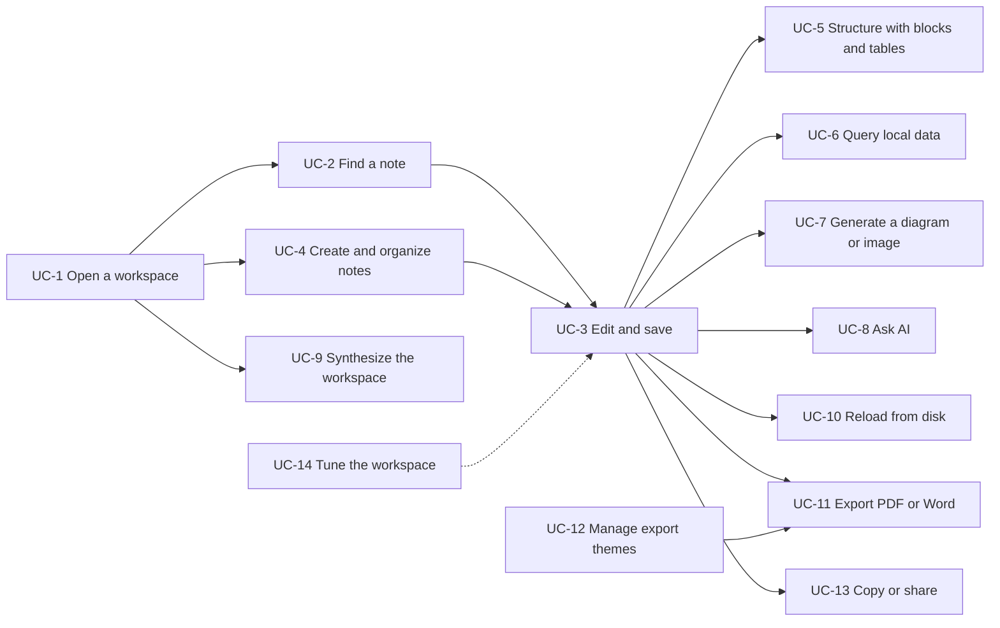
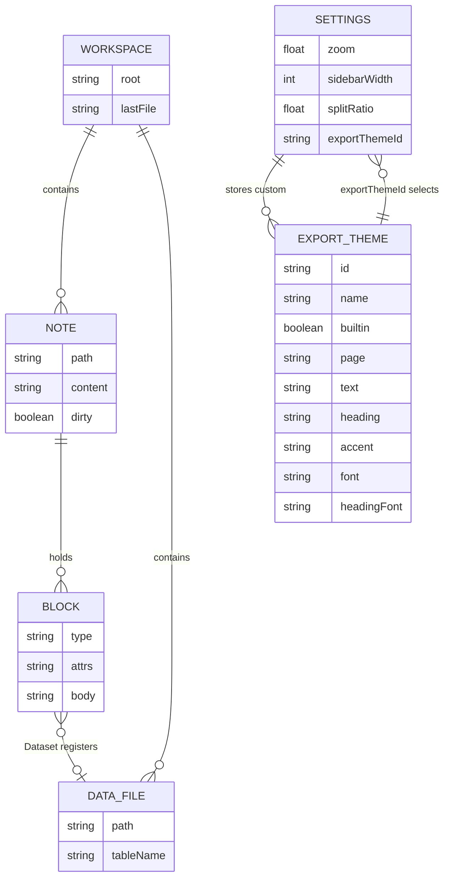

# Project requirements: Motion

> **Template Origin**: Official | **ArcKit Version**: 6.18.2 | **Command**: `/arckit:requirements`

## Document control

| Field | Value |
|-------|-------|
| **Document ID** | ARC-001-REQ-v1.0 |
| **Document Type** | Business and Technical Requirements |
| **Project** | Motion (Project 001) |
| **Classification** | PUBLIC |
| **Status** | DRAFT |
| **Version** | 1.0 |
| **Created Date** | 2026-10-21 |
| **Last Modified** | 2026-10-21 |
| **Review Cycle** | Monthly |
| **Next Review Date** | 2026-11-20 |
| **Owner** | Rick Hightower, Spillwave Solutions (maintainer and product owner) |
| **Reviewed By** | [PENDING] |
| **Approved By** | [PENDING] |
| **Distribution** | Project Team, Architecture Team, AI agent contributors (through the repo) |

## Revision history

| Version | Date | Author | Changes | Approved By | Approval Date |
|---------|------|--------|---------|-------------|---------------|
| 1.0 | 2026-10-21 | ArcKit AI | Initial creation from `/arckit:requirements` command. Reverse-engineered from `feat/export-themes` at `56485be`. | [PENDING] | [PENDING] |

## Document purpose

This document states what Motion does today, as requirements, so that you can trace each behavior to a stakeholder goal and to a test. Motion has no prior requirements document. Every requirement here is reverse-engineered from the code, the tests, and the docs at commit `56485be`, which is v0.6.5 plus PR 63 (reload, themed PDF and Word export, and themes).

Use this document to:

- Decide what a change must keep working.
- Find user journeys that have no end-to-end (E2E) test.
- Find places where the docs and the code disagree.

Each requirement carries an evidence tag:

- **Confirmed**: the code implements it and a test proves it.
- **Implemented, untested**: the code implements it, but no test proves it.
- **Gap**: the behavior is missing, or it differs from what a doc claims.

User journeys are written as use cases (UC-1 to UC-14). Each use case ends with Given/When/Then scenarios. Each scenario names the E2E spec that proves it, or says **Not covered**.

---

## Executive summary

### Business context

Technical writers and developers keep documentation as Markdown in a folder or a git repository. To write well, they switch between a text editor, a diagram tool, a SQL console, an image generator, and a word processor. Motion puts that work in one editor. The Markdown stays plain Markdown on disk, while diagrams, datasets, query results, and generated images render inline.

"Local-first" is the core promise. Motion has no account, no sync service, and no server-side store. Content leaves the machine only when you choose an action that sends it: **Ask AI**, a generative block, **Synthesize**, or **Share**. Motion runs as a native macOS desktop app built with Tauri 2. The same UI also runs in a browser against a local Bun dev server, which is the harness for the E2E tests.

Spillwave Solutions builds Motion with a small human team and AI agent contributors. The repo enforces a strict Definition of Done (DoD): unit tests, a Playwright journey, and truthful docs for every user-visible feature. This baseline makes that DoD traceable from stakeholder goals ([ARC-001-STKE-v1.0](ARC-001-STKE-v1.0.md)) to requirements and to tests.

### Objectives

- Keep every file operation inside the folder that you opened, in both runtimes (G-1).
- Let you write, structure, query, generate, and deliver a document without another tool (G-5).
- Keep every AI change behind a preview that you accept (G-4).
- Prove every shipped feature with a user journey test, and make the quality gate mandatory (G-2, G-3).
- Keep preferences, including export themes, across restarts and runtimes (G-6).

### Expected outcomes

- Zero data-loss or workspace-escape reports per release (O-1).
- Five of five output paths (PDF, Word, Copy All, Gist, and Notion) proven by E2E, plus a manual open check of PDF and Word per release (O-2).
- Under 10% of merged pull requests need a defect-fix round after review (O-3).
- A license that GitHub detects, and a README build that works on a clean machine (O-4).

### Project scope

**In Scope**:

- The React and Tiptap editor, its view modes, blocks, tables, and Ask AI.
- Workspace file operations: list, read, write, create, rename, and search.
- Data blocks backed by DuckDB-WASM.
- Generative blocks and **Synthesize** through local CLIs and the Anthropic API.
- Output: **Copy All**, **Share** (GitHub Gist and Notion), and **Export PDF** and **Export Word** with themes.
- Settings: zoom, layout, export theme, and custom themes.
- The two runtimes: the Tauri desktop app and the Bun dev server.
- The validation loop: typecheck, client-bundle guard, unit tests, E2E, Rust tests, and clippy.

**Out of Scope**:

- The `bin/` worklog tooling and the generated `docs/.index/` wiki artifacts.
- The vendored DuckDB-WASM binaries under `public/duckdb/`.
- Multi-user editing, sync, accounts, and any hosted service.
- Windows and Linux desktop packaging. CI builds Rust on Linux for tests only.
- Open pull request 62 (open on-disk Markdown links). It is not in the `56485be` baseline.

---

## Stakeholders

| Stakeholder | Role | Organization | Involvement Level |
|-------------|------|--------------|-------------------|
| Rick Hightower | Maintainer, product owner, and release manager | Spillwave Solutions | Decision maker |
| Spillwave Solutions | Owning company | Spillwave Solutions | Sponsor, license and brand decisions |
| AI agent contributors | Implementers under `CLAUDE.md` and `AGENTS.md` | Claude Code, Codex, and Grok sessions | Requirements consumers, test authors |
| Human reviewers | Pull request review | GitHub | Design review |
| Writers | Primary users | Technical writers and developers | User acceptance (dogfood) |
| Readers | Recipients of exported and shared documents | External | Indirect beneficiaries |
| Anthropic, Google, GitHub, Notion, Apple | Suppliers and platform owners | External | Integration constraints |

The full analysis, with drivers SD-1 to SD-10, goals G-1 to G-8, and outcomes O-1 to O-4, is in [ARC-001-STKE-v1.0](ARC-001-STKE-v1.0.md).

---

## Business requirements

### BR-001: Local-first editing

**Description**: Motion edits plain Markdown files on the local disk. It never reads or writes a file outside the folder that you opened, and it never sends content off the machine without an explicit action from you.

**Rationale**: Writers trust Motion with their real notes only if the files stay theirs (SD-1). This is the core promise in `README.md`.

**Acceptance Criteria**:

- [ ] 100% of the 22 storage contract cases pass in `bun test src` and in `cargo test --lib` on every merge to `main`.
- [ ] Zero reported workspace escapes per release.
- [ ] No network request occurs during open, edit, save, block render, query, or export.

**Priority**: MUST_HAVE

**Stakeholder**: Writers (SD-1), Maintainer (SD-4). Goal G-1, outcome O-1.

**Evidence**: Confirmed. `tests/contract/storage-cases.json`, `src/lib/fsCore.ts`, and `src-tauri/src/fs_core.rs`.

---

### BR-002: One tool from draft to delivery

**Description**: You can write, structure, query data, generate diagrams and images, and deliver the result to a reader in Motion, with no other tool.

**Rationale**: The switch between tools is the problem that Motion solves (SD-2). Readers need formats they can open (SD-7).

**Acceptance Criteria**:

- [ ] Five output paths work: **Export PDF**, **Export Word**, **Copy All**, **Share** to Gist, and **Share** to Notion.
- [ ] Each output path has a passing E2E journey.
- [ ] Before each release, the maintainer opens one exported PDF in Preview and one Word file in Word or Pages.

**Priority**: MUST_HAVE

**Stakeholder**: Writers (SD-2), Readers (SD-7). Goal G-5, outcome O-2.

**Evidence**: Confirmed for the five E2E paths. The manual open check is not recorded yet.

---

### BR-003: AI assistance under your control

**Description**: AI can rewrite, extend, and edit a note, but no AI output reaches the note until you accept a preview.

**Rationale**: Writers accept AI help only if they keep control of the text (SD-3).

**Acceptance Criteria**:

- [ ] Every AI entry point (selection, `/ai`, and **Refine**) shows a preview before it changes the note.
- [ ] Each entry point has an E2E test for the preview and for the failure path.

**Priority**: MUST_HAVE

**Stakeholder**: Writers (SD-3). Goal G-4, outcome O-1.

**Evidence**: Confirmed. `e2e/ai.spec.ts` and `e2e/doc-commands.spec.ts`.

---

### BR-004: A native macOS desktop product

**Description**: Motion ships as a macOS desktop app with native behavior: a folder picker, **Open With** from Finder, a remembered last folder, an overlay title bar, and a draggable header.

**Rationale**: "Desktop is the product" (`CLAUDE.md`). The browser mode exists to drive tests (SD-10).

**Acceptance Criteria**:

- [ ] `bun tauri dev` and the packaged app open a folder, edit, save, export, and keep settings across a relaunch.
- [ ] The production build emits `dist/index.html`, and CI asserts it.

**Priority**: MUST_HAVE

**Stakeholder**: Maintainer (SD-10). Goal G-6.

**Evidence**: Implemented. The build assertion is in CI. Desktop journeys are manual today.

---

### BR-005: Every feature proven before it ships

**Description**: Every user-visible feature ships with unit tests, a Playwright journey, and green `bun run verify`. CI blocks a merge to `main` when a required check fails.

**Rationale**: The maintainer reviews design, not defects (SD-4). Agents need one honest gate (SD-6).

**Acceptance Criteria**:

- [ ] Each feature in the `README.md` feature list maps to at least one E2E journey (traceability in Appendix E).
- [ ] Zero MUST scenarios marked **Not covered** by v0.7.0 (target 2026-12-31).
- [ ] Branch protection on `main` requires the CI jobs `typecheck, guards, unit, e2e` and `cargo test + clippy` by 2026-11-30.

**Priority**: MUST_HAVE

**Stakeholder**: Maintainer (SD-4), AI agents (SD-6). Goals G-2 and G-3, outcome O-3.

**Evidence**: Gap. 76 E2E tests and 258 unit tests exist. Section "Use Cases" lists the scenarios that have no test. Branch protection does not exist.

---

### BR-006: Truthful documentation

**Description**: `README.md`, the user guide, the design doc, and the GitHub wiki describe what the code does, and they change in the same pull request as the feature.

**Rationale**: Agents and Writers act on the docs. Docs that disagree with the code cause wrong changes (STKE risk R-3).

**Acceptance Criteria**:

- [ ] Every difference in Appendix F is fixed or recorded as intended.
- [ ] A doc check runs before each release.

**Priority**: SHOULD_HAVE

**Stakeholder**: AI agents (SD-6), Writers (SD-2). Goal G-2.

**Evidence**: Gap. Appendix F lists nine differences at `56485be`.

---

### BR-007: Open-source readiness

**Description**: The public repo has a license that matches the intent of Spillwave, and an outside developer can build and verify Motion from the README.

**Rationale**: A public repo with no license gives no right of reuse (SD-8). Spillwave uses Motion as a public reference product (SD-5).

**Acceptance Criteria**:

- [ ] `gh repo view SpillwaveSolutions/motion --json licenseInfo` returns a license by 2026-11-30.
- [ ] The `README.md` license section points to a file that exists.

**Priority**: SHOULD_HAVE

**Stakeholder**: Spillwave Solutions (SD-5), open-source contributors (SD-8). Goal G-8, outcome O-4.

**Evidence**: Gap. `licenseInfo` is `null` on 2026-10-21, and `LICENSE` does not exist.

---

### BR-008: Steady releases

**Description**: Motion releases at least once every 45 days, starting with v0.7.0 by 2026-12-31.

**Rationale**: Finished features wait on open pull requests (PR 62 since 2026-09-28, PR 63 since 2026-10-21). The last release was v0.6.5 on 2026-09-10 (SD-5).

**Acceptance Criteria**:

- [ ] v0.7.0 is in `CHANGELOG.md` with a date on or before 2026-12-31.
- [ ] After v0.7.0, the gap between releases is 45 days or less.

**Priority**: SHOULD_HAVE

**Stakeholder**: Maintainer and Spillwave (SD-5). Goal G-7.

**Evidence**: Gap. 41 days without a release at 2026-10-21.

---

## Functional requirements

### User personas

#### Persona 1: Technical writer

- **Role**: Writes product docs, guides, and design notes in Markdown, kept in git.
- **Goals**: Write fast, add diagrams and tables, and deliver a good-looking PDF or Word file to readers who do not use Markdown.
- **Pain Points**: Copies Markdown into Word to format it. Keeps diagrams in a separate tool. Fears tools that rewrite or move files.
- **Technical Proficiency**: Medium

#### Persona 2: Developer-author

- **Role**: Software engineer who documents systems in the repo next to the code.
- **Goals**: Edit Markdown with live Mermaid, query sample data with SQL, and use AI to tighten text. Keep plain-text diffs.
- **Pain Points**: Web editors that need an account. AI tools that change text without review.
- **Technical Proficiency**: High

#### Persona 3: Analyst-writer

- **Role**: Writes reports that quote CSV or JSONL data.
- **Goals**: Register a local dataset, run a `SELECT`, and show the result inline.
- **Pain Points**: Copies query results from a SQL console into a doc by hand.
- **Technical Proficiency**: Medium

#### Persona 4: Reader (secondary)

- **Role**: Gets a PDF, a Word file, a Gist, or a Notion page from a Writer.
- **Goals**: Open the file in the tool they already use, and read a document that looks finished.
- **Pain Points**: Raw Markdown. Broken tables. Inconsistent styles.
- **Technical Proficiency**: Low

---

### Use cases

The use cases are the user journeys of Motion. The diagram shows how they connect. A Writer usually opens a workspace, finds a note, edits it, and then delivers it.

Scenario status values:

- **Covered (E2E)**: a Playwright spec asserts the scenario.
- **Covered (unit)**: only a unit test asserts it.
- **Manual**: it needs the desktop app. No automated test exists.
- **Not covered**: no test asserts it.

#### UC-1: Open a workspace

**Actor**: Technical writer, developer-author

**Preconditions**:

- Motion is running, as the desktop app or in browser mode.
- In browser mode, `MOTION_WORKSPACE` names the folder. The default is `public/demo/`.

**Main Flow**:

1. You click **Open Folder**.
2. On desktop, Motion shows the native folder picker, and you choose a folder. In browser mode, Motion opens the configured workspace.
3. Motion lists every `.md` file under the folder as a collapsible tree named **Notes**.
4. You click a note, and Motion opens it in the editor.

**Postconditions**:

- The workspace root is set. Every later file operation is jailed to it.
- On desktop, Motion stores the root and the selected file for the next launch.

**Alternative Flows**:

- **Alt 1a**: On desktop, you right-click a `.md` file in Finder and choose **Open With > Motion**. Motion uses the parent folder as the workspace and selects the file.
- **Alt 1b**: On desktop, Motion starts and restores the last workspace and the last file.
- **Alt 1c**: In browser mode, the URL has `?open=<path>`. Motion selects that note with no click on **Open Folder**.

**Exception Flows**:

- **Ex 1**: A path resolves outside the workspace. The backend refuses it with "Access denied: path is outside the opened workspace", and no file is read.

**Business Rules**:

- Browser mode never restores a workspace from storage, so that E2E specs do not race a restored tree.
- The dev server takes the workspace root only from the environment, never from a request.

**Priority**: CRITICAL

**Scenarios**:

| ID | Given / When / Then | Evidence | Status |
|----|---------------------|----------|--------|
| SC-1.1 | Given a seeded workspace with nested folders, when you click **Open Folder**, then the tree lists every note, including nested files. | `e2e/persistence.spec.ts` "lists the seeded workspace, including nested files" | Covered (E2E) |
| SC-1.2 | Given the URL `/?open=welcome.md`, when the app loads, then `welcome.md` is selected with no click. | `e2e/open.spec.ts` "?open= selects the note without clicking Open Folder" | Covered (E2E) |
| SC-1.3 | Given `/?open=` with a nested path, when the app loads, then the nested note is selected. | `e2e/open.spec.ts` "?open= nested path selects the nested note" | Covered (E2E) |
| SC-1.4 | Given a real file outside the workspace, when a client asks the filesystem API for it, then the API refuses it. | `e2e/persistence.spec.ts` "the filesystem API refuses a real file outside the workspace" | Covered (E2E) |
| SC-1.5 | Given a `..`, an absolute path, a sibling folder with the same name prefix, or an outward symlink, when either core resolves it, then the core refuses it. | `tests/contract/storage-cases.json`, run by both suites | Covered (unit) |
| SC-1.6 | Given a `.md` file in Finder, when you choose **Open With > Motion**, then the parent folder opens and the file is selected. | None | Manual |
| SC-1.7 | Given a previous desktop session, when you relaunch Motion, then the last workspace and file open. | None | Manual |

---

#### UC-2: Find a note

**Actor**: Technical writer, developer-author

**Preconditions**:

- A workspace is open.

**Main Flow**:

1. You press ⌘K (Ctrl+K), or you click **Search notes**.
2. You type text.
3. Motion filters the tree to notes whose filename or contents match. A content match shows a short snippet.
4. You open a note and press ⌘F to find text in it. Motion shows the match count.

**Postconditions**:

- No file changes.

**Alternative Flows**:

- **Alt 2a**: You press Escape in the find bar, and Motion closes it.

**Exception Flows**:

- **Ex 1**: No note matches. The tree is empty for the query.

**Business Rules**:

- Search covers filenames and file contents.

**Priority**: HIGH

**Scenarios**:

| ID | Given / When / Then | Evidence | Status |
|----|---------------------|----------|--------|
| SC-2.1 | Given text that is only inside `welcome.md`, when you type it in **Search notes**, then only `welcome.md` shows, with a snippet. | `e2e/journeys.spec.ts` "search matches note contents, not just the filename" | Covered (E2E) |
| SC-2.2 | Given an open note, when you open **Find in note** and type a word, then the bar shows "N of M". | `e2e/journeys.spec.ts` "find in note opens with the shortcut and counts matches" (clicks the button) | Covered (E2E) |
| SC-2.3 | Given an open note, when you press ⌘F, then **Find in note** opens. | None. The spec clicks the button and does not press the shortcut. | Not covered |
| SC-2.4 | Given a workspace, when you press ⌘K, then focus moves to **Search notes**. | None | Not covered |

---

#### UC-3: Edit and save a note

**Actor**: All Writer personas

**Preconditions**:

- A note from the workspace is open.

**Main Flow**:

1. You edit the note in **WYSIWYG**, **Markdown**, or **Split** view.
2. Motion keeps the editor document and the Markdown source in sync across the view modes.
3. You click **Save note**, or you press ⌘S (Ctrl+S).
4. Motion converts the document to Markdown and writes it to the same file. The status shows **Saving…** and then **Saved**.

**Postconditions**:

- The file on disk holds the edited Markdown.

**Alternative Flows**:

- **Alt 3a**: You stop typing. Motion autosaves after 1.5 seconds.
- **Alt 3b**: You click another note before the first one loads. Motion opens the note that you clicked last.

**Exception Flows**:

- **Ex 1**: The write fails. The status shows **Save failed**.
- **Ex 2**: The open content has no file path (the welcome content). **Save** is not available.

**Business Rules**:

- A view-mode switch is not an edit, and it does not trigger autosave.
- Markdown source shows syntax highlighting.

**Priority**: CRITICAL

**Scenarios**:

| ID | Given / When / Then | Evidence | Status |
|----|---------------------|----------|--------|
| SC-3.1 | Given an edited note, when you save and reload, then the edit is still there. | `e2e/persistence.spec.ts` "an edit survives save and reload" | Covered (E2E) |
| SC-3.2 | Given an edit in WYSIWYG, when you go to Markdown, Split, and back, then nothing is lost. | `e2e/journeys.spec.ts` "a view-mode round trip loses nothing" | Covered (E2E) |
| SC-3.3 | Given an edit in the Markdown pane, when you switch to WYSIWYG, then the editor shows it. | `e2e/journeys.spec.ts` "edits made in the markdown pane reach the editor" | Covered (E2E) |
| SC-3.4 | Given an unedited note, when you switch view modes, then no save occurs. | `e2e/copy.spec.ts` "switching view modes does not autosave an unedited note" | Covered (E2E) |
| SC-3.5 | Given a real edit, when you wait, then autosave writes the file. | `e2e/copy.spec.ts` "an actual edit still autosaves" | Covered (E2E) |
| SC-3.6 | Given the Markdown view, when it renders, then the source is syntax-highlighted. | `e2e/copy.spec.ts` "markdown source is syntax-highlighted" | Covered (E2E) |
| SC-3.7 | Given several quick clicks on different notes, when loading ends, then the last-clicked note is open. | `e2e/journeys.spec.ts` "rapid file switching lands on the file that was clicked last" | Covered (E2E) |
| SC-3.8 | Given a write that fails, when you save, then the status shows **Save failed**. | None | Not covered |

---

#### UC-4: Create and organize notes

**Actor**: Technical writer, developer-author

**Preconditions**:

- A workspace is open.

**Main Flow**:

1. You click **New Note**.
2. Motion writes `untitled-<timestamp>.md` with the stub `# New Note` in the parent folder of the selected file, or in the workspace root.
3. Motion opens an inline name field in the tree.
4. You type a name and press Enter. Motion renames the file.

**Postconditions**:

- A new file exists on disk and shows in the tree.

**Alternative Flows**:

- **Alt 4a**: You press Escape. The file keeps its `untitled-<timestamp>.md` name.
- **Alt 4b**: To rename an existing note, you right-click it and choose **Rename**, press F2, or click it again while it is selected.
- **Alt 4c**: You click **New Folder** and enter a name. Motion creates the folder with a `README.md` in it, so that the tree can show the folder.

**Exception Flows**:

- **Ex 1**: The rename target is outside the workspace. The backend refuses it.

**Business Rules**:

- New items land in the parent of the selected file, or in the workspace root.

**Priority**: HIGH

**Scenarios**:

| ID | Given / When / Then | Evidence | Status |
|----|---------------------|----------|--------|
| SC-4.1 | Given an open workspace, when you click **New Note**, then a note is created, listed, and opened with no error. | `e2e/persistence.spec.ts` "a new note is created, listed, and opens without error" | Covered (E2E) |
| SC-4.2 | Given a new note, when you edit, save, and reload, then the content is intact. | `e2e/persistence.spec.ts` "a new note can be edited, saved, and reloaded with content intact" | Covered (E2E) |
| SC-4.3 | Given the inline name field, when you type a name and press Enter, then the file has the real name. | `e2e/rename.spec.ts` "New Note opens inline rename; Enter commits a real filename" | Covered (E2E) |
| SC-4.4 | Given the inline name field, when you press Escape, then the untitled name stays. | `e2e/rename.spec.ts` "Escape on a new note keeps the untitled filename" | Covered (E2E) |
| SC-4.5 | Given a note, when you right-click and choose **Rename**, then the inline field opens. | `e2e/rename.spec.ts` "right-click Rename starts the same inline field" | Covered (E2E) |
| SC-4.6 | Given a selected note, when you press F2 or click it again, then rename starts. | `e2e/rename.spec.ts` "F2 starts rename on the selected note" and "a second click on the already-selected file starts rename" | Covered (E2E) |
| SC-4.7 | Given an open workspace, when you click **New Folder** and enter a name, then the folder shows in the tree with a `README.md`. | None | Not covered |

---

#### UC-5: Structure a note with blocks and tables

**Actor**: All Writer personas

**Preconditions**:

- A note is open in WYSIWYG or Split view.

**Main Flow**:

1. You type `/` at the start of a line, or you use the toolbar.
2. Motion shows the slash menu: **Ask AI**, **Table**, and the five block types (Mermaid, Dataset, Query, Image gen, and Diagram gen).
3. You choose an item. Motion inserts it at the cursor.
4. You save. Motion writes each block as a fenced block that reloads as the same block.

**Postconditions**:

- The note holds the block or table, and the Markdown on disk holds its source.

**Alternative Flows**:

- **Alt 5a**: With the caret in a table, the toolbar shows **Add row**, **Delete row**, **Add column**, **Delete column**, and **Delete table**.
- **Alt 5b**: You insert a table while the caret is in a table. Motion adds the new table after the current one, with an empty paragraph between them.

**Exception Flows**:

- **Ex 1**: Mermaid source is not valid. The block shows the error inside itself and keeps your source.

**Business Rules**:

- Tables do not nest, because Markdown tables cannot nest.
- Untrusted HTML in a note is sanitized. Scripts and inline event handlers never run.

**Priority**: HIGH

**Scenarios**:

| ID | Given / When / Then | Evidence | Status |
|----|---------------------|----------|--------|
| SC-5.1 | Given the welcome document, when it renders, then its blocks render as blocks and not as code. | `e2e/blocks.spec.ts` "the welcome document renders its blocks as blocks, not code" | Covered (E2E) |
| SC-5.2 | Given a document with blocks, when you save and reload, then the content is intact. | `e2e/blocks.spec.ts` "a document with blocks survives save and reload with content intact" | Covered (E2E) |
| SC-5.3 | Given an open note, when you insert a block twice from the toolbar, then both blocks exist. | `e2e/journeys.spec.ts` "a block can be inserted twice in a row from the toolbar" | Covered (E2E) |
| SC-5.4 | Given an empty line, when you choose a block from the slash menu, then the block is inserted. | `e2e/journeys.spec.ts` "a block can be inserted from the slash menu" | Covered (E2E) |
| SC-5.5 | Given a pipe table in Markdown, when it loads, then it is a real table, and it survives save and reload. | `e2e/tables.spec.ts` "a pipe table becomes a real table and survives save/reload" | Covered (E2E) |
| SC-5.6 | Given an open note, when you click **Insert Table** and **Add row**, then a 3×3 table grows to 4 rows. | `e2e/tables.spec.ts` "Insert Table creates a 3×3 and Add row grows it" | Covered (E2E) |
| SC-5.7 | Given the caret in a table, when you insert a table or type `/tab`, then a sibling table is added, never a nested one. | `e2e/tables.spec.ts` "Insert Table from inside a table appends a sibling, never a nested one" and "/tab from inside a table also escapes, with the typed text removed" | Covered (E2E) |
| SC-5.8 | Given a `<script>` tag or an inline event handler in a note, when it renders, then nothing runs and the handler is stripped. | `e2e/sanitize.spec.ts` "script tags in a document never execute or survive" and "inline event handlers are stripped" | Covered (E2E) |
| SC-5.9 | Given invalid Mermaid, when it renders, then the error shows inside the block and not in the page body. | `e2e/sanitize.spec.ts` "an invalid Mermaid diagram reports inside its block, not into document.body" | Covered (E2E) |

---

#### UC-6: Query local data

**Actor**: Analyst-writer

**Preconditions**:

- A CSV, JSON, or JSONL file is inside the open workspace.

**Main Flow**:

1. You insert a **Dataset** block and choose a source file. Motion stores the path relative to the workspace.
2. Motion registers the file as a named table in DuckDB-WASM and shows sample rows.
3. You insert a **Query** block and write a `SELECT` or `WITH` statement.
4. Motion validates the SQL, runs it in the page, and shows the rows.

**Postconditions**:

- The note holds the Dataset and Query sources. The data file is not changed.

**Alternative Flows**:

- **Alt 6a**: You register two datasets and `JOIN` them by table name.

**Exception Flows**:

- **Ex 1**: The source file is missing. The block shows an error and not an empty table.
- **Ex 2**: The welcome demo files are not in the workspace. The block says that the demo data is not in this workspace.
- **Ex 3**: The SQL has more than one statement or a forbidden keyword. Motion refuses it.

**Business Rules**:

- SQL must be a single `SELECT` or `WITH` statement. The keywords `ATTACH`, `COPY`, `CREATE`, `DROP`, `ALTER`, `INSERT`, `UPDATE`, `DELETE`, `TRUNCATE`, `PRAGMA`, `INSTALL`, `LOAD`, `EXPORT`, `IMPORT`, `CALL`, `EXECUTE`, `GRANT`, and `REVOKE` are refused.
- Identifiers must match `^[A-Za-z_][A-Za-z0-9_]*$`.
- The row limit is clamped to 1 to 10,000. The default is 5.

**Priority**: HIGH

**Scenarios**:

| ID | Given / When / Then | Evidence | Status |
|----|---------------------|----------|--------|
| SC-6.1 | Given the welcome datasets, when they load, then they register and show rows with no error banner. | `e2e/data.spec.ts` "welcome datasets register and show rows without an error banner" | Covered (E2E) |
| SC-6.2 | Given the registered team and events tables, when the welcome query runs a `JOIN`, then it returns rows. | `e2e/data.spec.ts` "welcome SQL JOIN runs against the registered team and events tables" | Covered (E2E) |
| SC-6.3 | Given two Dataset blocks, when a Query joins them by table name, then it returns rows. | `e2e/data.spec.ts` "a document can register two datasets and JOIN them by table name" | Covered (E2E) |
| SC-6.4 | Given a Dataset with a missing source, when it loads, then it shows an error and not an empty table. | `e2e/data.spec.ts` "a missing dataset source surfaces an error instead of a silent empty table" | Covered (E2E) |
| SC-6.5 | Given a workspace without the demo files, when the welcome note loads, then the Dataset blocks say the demo data is not in this workspace. | `e2e/data.spec.ts` "welcome datasets degrade when demo files are not in the workspace" | Covered (E2E) |
| SC-6.6 | Given `DROP TABLE x` or two statements, when the Query runs, then Motion refuses it. | `src/lib/data/sqlSafety` unit tests | Covered (unit) |

---

#### UC-7: Generate a diagram or an image

**Actor**: Developer-author, technical writer

**Preconditions**:

- The `claude` CLI (for diagrams) or the `imagen` CLI (for images) is on `PATH`.

**Main Flow**:

1. You insert a **Diagram gen** or **Image gen** block and type a prompt.
2. Motion calls the CLI through the backend.
3. For a diagram, Motion validates the reply as Mermaid and then stores it. For an image, Motion embeds the image as a base64 PNG data URI.

**Postconditions**:

- The note holds the Mermaid source or the image data URI.

**Alternative Flows**:

- None.

**Exception Flows**:

- **Ex 1**: The CLI is missing. The block shows the failure and changes nothing.
- **Ex 2**: The call takes more than 120 seconds. The backend stops it and reports a timeout.
- **Ex 3**: The diagram reply is not valid Mermaid. Motion refuses it, and the document does not change.

**Business Rules**:

- The backend spawns only allowlisted providers: `claude`, `opencode`, and `qwen` for text, and `imagen` for images.

**Priority**: MEDIUM

**Scenarios**:

| ID | Given / When / Then | Evidence | Status |
|----|---------------------|----------|--------|
| SC-7.1 | Given a valid Mermaid reply, when it renders, then node labels show, which proves that `sanitizeSvg` kept `foreignObject`. | `e2e/sanitize.spec.ts` "Mermaid node labels render, so foreignObject survived sanitizeSvg" | Covered (E2E) |
| SC-7.2 | Given a missing CLI, when you generate, then the block shows the failure. | Unit tests for `cliWrappers` and the block components | Covered (unit) |
| SC-7.3 | Given a CLI that hangs, when 120 seconds pass, then the call fails with a timeout message. | `src/lib/cliWrappers.ts` timeout logic | Covered (unit) |
| SC-7.4 | Given `imagen` on `PATH`, when you generate an image, then the note embeds a PNG data URI that survives save and reload. | None | Not covered |

---

#### UC-8: Ask AI to edit a note

**Actor**: All Writer personas

**Preconditions**:

- `ANTHROPIC_API_KEY` is set, or the `claude` CLI is on `PATH`.
- A note is open.

**Main Flow**:

1. You start Ask AI in one of three ways: select text and click the floating **Ask AI** button, type `/ai` at the start of a line, or click **Refine** in the toolbar.
2. You type an instruction or choose a chip: **Rewrite**, **Tighten**, **Expand**, **Fix grammar**, or **Continue**.
3. Motion streams the reply into a preview.
4. You choose **Replace**, **Insert below**, **Try again**, or **Discard**.

**Postconditions**:

- The note changes only if you chose **Replace**, **Insert below**, or **Apply N edits**.

**Alternative Flows**:

- **Alt 8a**: The model proposes targeted edits (`replace_range`, `insert_after_block`, `table_add_row`, or `table_update_cell`). The preview is a **Proposed edits** list. **Apply N edits** commits the whole list as one undo step.
- **Alt 8b**: **Refine** works on the whole document and has no **Insert below**.
- **Alt 8c**: In Markdown view, there is no bubble and no slash menu. **Refine** still works.

**Exception Flows**:

- **Ex 1**: The call fails. The error shows in the panel, not in an alert.
- **Ex 2**: An edit cannot apply, or two edits overlap. Motion refuses the batch and shows an error in the panel.
- **Ex 3**: You press Escape or **Discard** during a stream. Motion cancels the stream and changes nothing.

**Business Rules**:

- Motion locates every edit in one batch against the note as it was when you asked.
- `MOTION_AI_MODEL` sets the model (default `claude-opus-5`). `MOTION_AI_EFFORT` sets the effort (`low`, `medium`, `high`, `xhigh`, or `max`). An unknown effort value falls back to `low`.

**Priority**: HIGH

**Scenarios**:

| ID | Given / When / Then | Evidence | Status |
|----|---------------------|----------|--------|
| SC-8.1 | Given selected text, when you click **Ask AI** and **Replace**, then the preview shows first, and then the selection changes. | `e2e/ai.spec.ts` "selecting text shows Ask AI, previews, then Replace commits" | Covered (E2E) |
| SC-8.2 | Given `/ai` at a line start, when you ask and click **Insert below**, then the reply is inserted. | `e2e/ai.spec.ts` "/ai opens a prompt at the cursor and Insert below commits" | Covered (E2E) |
| SC-8.3 | Given **Refine**, when the preview shows, then it has no **Insert below**. | `e2e/ai.spec.ts` "Refine previews a document-scoped edit with no Insert below" | Covered (E2E) |
| SC-8.4 | Given a failing **Refine** call, when it fails, then the error is in the panel and not in an alert. | `e2e/ai.spec.ts` "Refine failure lands in the panel, not an alert" | Covered (E2E) |
| SC-8.5 | Given Markdown view, when you look for the bubble, then it is absent, and **Refine** still previews. | `e2e/ai.spec.ts` "markdown mode has no bubble; Refine still previews" | Covered (E2E) |
| SC-8.6 | Given a streaming reply, when tokens arrive, then they show while you wait, and then they settle into the preview. | `e2e/ai.spec.ts` "streaming tokens appear while Asking AI, then settle into preview" | Covered (E2E) |
| SC-8.7 | Given a proposed table-row edit, when you click **Apply**, then the row is added. | `e2e/doc-commands.spec.ts` "DocCommands preview lists the edit; Apply commits a table row" | Covered (E2E) |
| SC-8.8 | Given a proposed edit, when you click **Discard**, then the table does not change. | `e2e/doc-commands.spec.ts` "Discard leaves the table unchanged" | Covered (E2E) |
| SC-8.9 | Given an `insert_after_block` command from `/ai`, when you apply it, then the block is inserted. | `e2e/doc-commands.spec.ts` "/ai can return insert_after_block and Apply inserts it" | Covered (E2E) |
| SC-8.10 | Given a command that cannot apply, when the preview shows, then the panel shows an error. | `e2e/doc-commands.spec.ts` "an un-applicable command lands in the panel as an error" | Covered (E2E) |

---

#### UC-9: Synthesize the workspace

**Actor**: Technical writer

**Preconditions**:

- A workspace is open, and the `claude` CLI is on `PATH`.

**Main Flow**:

1. You click **Synthesize**.
2. Motion reads up to 40 notes, summarizes each one, and clusters them by topic. A progress bar shows the step.
3. Motion writes `TOC.md` and a folder `README.md` to the workspace root.
4. Both files show in the tree.

**Postconditions**:

- `TOC.md` and `README.md` (or `README.motion.md`) exist in the workspace root.

**Alternative Flows**:

- **Alt 9a**: A hand-written `README.md` exists. Motion writes `README.motion.md` and says so in the status bar. Motion overwrites only a README that has its own marker `<!-- generated-by: motion-synthesize -->`.
- **Alt 9b**: The workspace has more than 40 notes. Motion uses the first 40 and reports how many it skipped.

**Exception Flows**:

- **Ex 1**: The CLI fails. The status bar shows a readable failure.

**Business Rules**:

- Synthesize never reads its own output (`TOC.md`, `README.md`, `README.motion.md`, and the legacy `SKILL.md`) as input.
- Each note costs one CLI call.

**Priority**: MEDIUM

**Scenarios**:

| ID | Given / When / Then | Evidence | Status |
|----|---------------------|----------|--------|
| SC-9.1 | Given a workspace, when you synthesize, then `TOC.md` and a generated `README.md` are written. | `e2e/synthesis.spec.ts` "synthesizing a workspace writes TOC.md and a generated README" | Covered (E2E) |
| SC-9.2 | Given a hand-written `README.md`, when you synthesize, then it survives, and Motion writes `README.motion.md`. | `e2e/synthesis.spec.ts` "a hand-written README.md survives; the run writes README.motion.md instead" | Covered (E2E) |
| SC-9.3 | Given a failing CLI, when you synthesize, then a readable failure shows. | `e2e/synthesis.spec.ts` "synthesis reports a readable failure instead of dying silently" | Covered (E2E) |
| SC-9.4 | Given 41 notes, when you synthesize, then 40 are used and the skip is reported. | `src/lib/workspaceSynthesis` unit tests | Covered (unit) |

---

#### UC-10: Reload a note from disk

**Actor**: All Writer personas

**Preconditions**:

- A note is open. **Reload note** is disabled until a note is open.

**Main Flow**:

1. You click **Reload note**.
2. If the note has unsaved edits, Motion asks: "Reload this note from disk? Unsaved edits will be lost."
3. You accept. Motion reads the file again and replaces the editor content.

**Postconditions**:

- The editor shows the file as it is on disk. Unsaved edits are gone.

**Alternative Flows**:

- **Alt 10a**: The note has no unsaved edits. Motion reloads with no prompt.
- **Alt 10b**: You cancel the prompt. The edits stay, and Motion reads nothing.

**Exception Flows**:

- **Ex 1**: The file no longer exists, or the read fails. Motion shows the read error and keeps the editor content.

**Business Rules**:

- Motion never discards unsaved edits without your confirmation.

**Priority**: HIGH

**Scenarios**:

| ID | Given / When / Then | Evidence | Status |
|----|---------------------|----------|--------|
| SC-10.1 | Given unsaved text in a note, when you click **Reload note** and accept, then the text is gone and the file content is back. | `e2e/export.spec.ts` "reload drops unsaved edits and restores the file" | Covered (E2E) |
| SC-10.2 | Given unsaved text, when you click **Reload note** and cancel, then the text stays. | None | Not covered |
| SC-10.3 | Given a clean note, when you click **Reload note**, then it reloads with no prompt. | None | Not covered |
| SC-10.4 | Given no open note, when the header renders, then **Reload note** is disabled. | None | Not covered |
| SC-10.5 | Given a file that another program changed, when you click **Reload note**, then the editor shows the new content. | None | Not covered |

---

#### UC-11: Export a note to PDF or Word

**Actor**: Technical writer, with the Reader as beneficiary

**Preconditions**:

- A note is open. **Export PDF** and **Export Word** are disabled until a note is open.

**Main Flow**:

1. You click **Export PDF** or **Export Word**.
2. Motion opens a dialog with an **Export theme** menu and an iframe titled **Export preview**. The default theme is the one that you set with **Use for export**.
3. You choose a theme. The preview changes its colors and fonts.
4. You click **Download PDF** or **Download Word**.
5. Motion builds the file from the same block list as the preview and downloads it.

**Postconditions**:

- A `.pdf` file (starts with `%PDF`) or a `.docx` file (a ZIP that starts with `PK`) is downloaded.

**Alternative Flows**:

- **Alt 11a**: The note has unsaved edits. The export uses the live editor buffer, including the unsaved edits.

**Exception Flows**:

- **Ex 1**: The theme in settings no longer exists. Motion falls back to Ice Snowstorm.

**Business Rules**:

- The export renders headings, paragraphs (bold, italic, inline code, and links), ordered and unordered lists, quotes, code blocks, horizontal rules, and tables.
- Fenced blocks (Mermaid, Dataset, and Query sources) export as code text.
- PDF fonts are Helvetica, Times, and Courier only. Word fonts are Calibri, Georgia, and Consolas. The HTML preview uses system fonts, so it looks closer to the theme than the PDF does. This difference is expected.

**Priority**: HIGH

**Scenarios**:

| ID | Given / When / Then | Evidence | Status |
|----|---------------------|----------|--------|
| SC-11.1 | Given the export dialog, when you choose Clay, then the preview page is `rgb(250, 249, 245)` and the H1 is `rgb(20, 20, 19)`. | `e2e/export.spec.ts` "export preview uses the theme and downloads PDF and Word" | Covered (E2E) |
| SC-11.2 | Given the export dialog, when you choose Ice Snowstorm, then the preview page is `rgb(243, 246, 251)` and the H1 is `rgb(11, 31, 75)`. | Same spec | Covered (E2E) |
| SC-11.3 | Given the PDF dialog, when you click **Download PDF**, then a `.pdf` file that starts with `%PDF` downloads. | Same spec | Covered (E2E) |
| SC-11.4 | Given the Word dialog with Clay, when you click **Download Word**, then a `.docx` file that starts with `PK` downloads. | Same spec | Covered (E2E) |
| SC-11.5 | Given headings, marks, lists, quotes, code, and tables, when Motion builds the blocks, then all of them are kept. | `src/lib/export.test.ts` "keeps headings, marks, lists, quotes, code, and tables" | Covered (unit) |
| SC-11.6 | Given unsaved edits, when you export, then the file and the preview include the edits. | None. The spec exports the welcome note with no edits. | Not covered |
| SC-11.7 | Given no open note, when the header renders, then **Export PDF** and **Export Word** are disabled. | None | Not covered |
| SC-11.8 | Given a downloaded PDF and `.docx`, when you open them in Preview and in Word or Pages, then they open and show the heading, paragraph, list, quote, code, and table. | Release checklist | Manual |
| SC-11.9 | Given a note with a generated image, when you export, then the image is in the file. | None. The code exports the image alt text only. | Not covered (Gap) |

---

#### UC-12: Manage export themes

**Actor**: Technical writer

**Preconditions**:

- Motion is running. **Themes** is always available in the header.

**Main Flow**:

1. You click **Themes**. Motion opens the **Theme settings** dialog with the theme list.
2. You select a theme and click **New theme**. Motion copies the selected theme as a custom theme.
3. You edit **Theme name**, **Page**, **Text**, **Headings**, **Accent**, **Body font**, and **Heading font**.
4. You check **Use for export** to make it the default.
5. You click **Save themes**. Motion writes `themes` and `exportThemeId` to the settings file.

**Postconditions**:

- The custom theme and the default survive a quit and relaunch.

**Alternative Flows**:

- **Alt 12a**: You select a custom theme and click **Delete**. Motion removes it.
- **Alt 12b**: You select a builtin theme. Its fields and **Delete** are disabled.

**Exception Flows**:

- **Ex 1**: A hex value is not valid. Motion falls back to the color of the source theme.

**Business Rules**:

- Two builtin themes are locked:

  | Theme | Page | Text | Headings | Accent | Body font | Heading font |
  |-------|------|------|----------|--------|-----------|--------------|
  | Ice Snowstorm (`ice-snowstorm`, default) | `#F3F6FB` | `#111111` | `#0B1F4B` | `#1D4E89` | sans | sans |
  | Clay (`clay`) | `#FAF9F5` | `#3D3D3A` | `#141413` | `#D97757` | sans | serif (Georgia in Word and in the preview) |

- A custom theme id matches `^[a-z0-9][a-z0-9-]{0,40}$` and cannot reuse a builtin id. A name has at most 40 characters.
- Motion keeps at most 24 custom themes. Fonts are `serif`, `sans`, or `mono`.

**Priority**: MEDIUM

**Scenarios**:

| ID | Given / When / Then | Evidence | Status |
|----|---------------------|----------|--------|
| SC-12.1 | Given the **Theme settings** dialog, when it opens, then Ice Snowstorm and Clay are listed. | `e2e/export.spec.ts` "theme settings can add a theme and both builtins preview" | Covered (E2E) |
| SC-12.2 | Given Clay selected, when you read the fields, then **Headings hex** is `#141413` and **Accent hex** is `#D97757`. | Same spec | Covered (E2E) |
| SC-12.3 | Given **New theme** named Harbor, when you click **Save themes**, then `POST /api/settings` succeeds, and Harbor is listed when the dialog opens again. | Same spec | Covered (E2E) |
| SC-12.4 | Given a builtin theme, when it is selected, then its fields and **Delete** are disabled. | None | Not covered |
| SC-12.5 | Given a custom theme, when you click **Delete** and **Save themes**, then it is gone after reload. | None | Not covered |
| SC-12.6 | Given **Use for export** on a custom theme, when you save and open **Export PDF**, then that theme is preselected. | None | Not covered |
| SC-12.7 | Given a custom theme and a default saved in the desktop app, when you quit and relaunch, then both are still there. | None | Manual |
| SC-12.8 | Given a custom theme with a builtin id or a bad color, when settings load, then Motion rejects the id and replaces the color. | `src/lib/export.test.ts` "custom themes cannot steal a builtin id and bad colors fall back" | Covered (unit) |

---

#### UC-13: Copy or share a note

**Actor**: Technical writer, developer-author

**Preconditions**:

- A note is open. For **Share**, a GitHub token with `gist` scope, or a Notion integration token and a parent page.

**Main Flow**:

1. You click **Copy all**. Motion copies the live buffer as Markdown and as rich text. The title reads **Copied** for a moment.
2. To share, you click **Share** and choose **Publish to Gist** or **Publish to Notion**.
3. Motion publishes the current buffer, including unsaved edits, and shows the result.

**Postconditions**:

- The clipboard holds the note, or a Gist or Notion page exists.

**Alternative Flows**:

- **Alt 13a**: No token is stored. Motion opens **Publish settings** and does not call the API.

**Exception Flows**:

- **Ex 1**: GitHub or Notion refuses the request. The backend returns an HTTP 200 envelope with `ok: false`, and the UI shows the error.

**Business Rules**:

- Tokens stay in local storage on this machine. Motion never writes them to the workspace or to the settings file.

**Priority**: MEDIUM

**Scenarios**:

| ID | Given / When / Then | Evidence | Status |
|----|---------------------|----------|--------|
| SC-13.1 | Given no selected note, when the header renders, then **Copy all** is disabled. | `e2e/copy.spec.ts` "Copy All is disabled until a note is selected" | Covered (E2E) |
| SC-13.2 | Given the welcome note, when you click **Copy all**, then it becomes **Copied**. | `e2e/copy.spec.ts` "Copy All is enabled on the welcome note and becomes Copied" | Covered (E2E) |
| SC-13.3 | Given unsaved edits, when you copy, then the clipboard includes them. | `e2e/copy.spec.ts` "Copy All includes unsaved edits from the live buffer" | Covered (E2E) |
| SC-13.4 | Given a GitHub token, when you publish to Gist, then the Gist call succeeds. | `e2e/publish.spec.ts` "Share publishes the current note to a Gist" | Covered (E2E) |
| SC-13.5 | Given a Notion token and parent page, when you publish to Notion, then the call succeeds. | `e2e/publish.spec.ts` "Share publishes the current note to Notion" | Covered (E2E) |
| SC-13.6 | Given no GitHub token, when you publish to Gist, then **Publish settings** opens and the API is not called. | `e2e/publish.spec.ts` "a missing GitHub token opens Settings instead of calling the API" | Covered (E2E) |
| SC-13.7 | Given a bad token, when GitHub refuses, then the response is a 200 envelope that the network gate accepts. | `e2e/publish.spec.ts` "a refused Gist is a 200 envelope the network gate does not fail on" | Covered (E2E) |

---

#### UC-14: Tune the workspace

**Actor**: All Writer personas

**Preconditions**:

- Motion is running.

**Main Flow**:

1. You press ⌘+ or ⌘- (Ctrl on other keyboards). Motion scales the editor and the tree by 10% per step, not the header. A percentage overlay shows for about one second.
2. You drag the trailing edge of the tree, or the Split divider.
3. Motion saves `zoom`, `sidebarWidth`, and `splitRatio` to the settings file.

**Postconditions**:

- The next launch uses the same zoom and widths.

**Alternative Flows**:

- **Alt 14a**: You press ⌘0. Zoom returns to 100%.
- **Alt 14b**: You focus a resize handle and use the arrow keys, Home, or End.

**Exception Flows**:

- **Ex 1**: The settings file has a value out of range. Motion clamps it on read.

**Business Rules**:

- Zoom is 0.75 to 2.0, in steps of 0.1. The sidebar is 180 to 480 pixels (default 280, step 16). The split ratio is 0.25 to 0.75 (default 0.5, step 0.02).
- The header and the format toolbar stay in place while a long note scrolls.

**Priority**: MEDIUM

**Scenarios**:

| ID | Given / When / Then | Evidence | Status |
|----|---------------------|----------|--------|
| SC-14.1 | Given ⌘+, when you press it, then the editor grows and the header does not, and ⌘0 restores it. | `e2e/zoom.spec.ts` "Cmd+plus grows the editor, not the header, and Cmd+0 restores it" | Covered (E2E) |
| SC-14.2 | Given repeated ⌘+, when you hold it, then zoom stops at the limit. | `e2e/zoom.spec.ts` "zoom is clamped, so holding the key cannot make the app unusable" | Covered (E2E) |
| SC-14.3 | Given a zoom change, when you reload, then the level is the same. | `e2e/zoom.spec.ts` "the level survives a reload" (test name continues past an em dash) | Covered (E2E) |
| SC-14.4 | Given a zoom keystroke, when you press it, then the percentage shows and then goes away. | `e2e/zoom.spec.ts` "a zoom keystroke shows the percentage, then it disappears" | Covered (E2E) |
| SC-14.5 | Given a sidebar drag, when you reload, then the width persists. | `e2e/layout.spec.ts` "dragging the sidebar handle changes its width and the value persists" | Covered (E2E) |
| SC-14.6 | Given the Split divider, when you press the arrow keys, then it moves. | `e2e/layout.spec.ts` "split divider is a separator and arrow keys move it" | Covered (E2E) |
| SC-14.7 | Given a long note, when you scroll, then the header and format toolbar stay in place. | `e2e/layout.spec.ts` "scrolling a long note leaves the header and format toolbar in place" | Covered (E2E) |
| SC-14.8 | Given a wider window, when you resize, then the editor gets wider. | `e2e/layout.spec.ts` "widening the viewport widens the editor surface" | Covered (E2E) |

---

### Functional requirements detail

Each functional requirement links to a business requirement (BR), a use case (UC), and a stakeholder goal (G) from [ARC-001-STKE-v1.0](ARC-001-STKE-v1.0.md). The acceptance criteria repeat the key scenarios. The use case tables above give the full scenario list and evidence.

#### FR-001: Open a folder as the workspace

**Description**: The system opens one folder as the workspace and lists every `.md` file under it, recursively, as a collapsible tree.

**Relates To**: BR-001, UC-1, G-1

**Rationale**: Every other journey starts from a jailed workspace.

**Acceptance Criteria**:

- [ ] Given a folder with nested notes, when you open it, then the tree shows every `.md` file at its real depth (SC-1.1).
- [ ] Given browser mode, when the server starts, then the root comes only from `MOTION_WORKSPACE`.

**Data Requirements**:

- **Inputs**: Folder path (desktop picker) or `MOTION_WORKSPACE`.
- **Outputs**: List of workspace-relative note paths.
- **Validations**: Path canonicalized and checked for containment by component, never by string prefix.

**Priority**: MUST_HAVE

**Complexity**: MEDIUM

**Dependencies**: NFR-SEC-002

**Assumptions**: One workspace at a time.

---

#### FR-002: Open a file from Finder

**Description**: On desktop, the system accepts **Open With > Motion** on a `.md` file, opens its parent folder as the workspace, and selects the file.

**Relates To**: BR-004, UC-1, G-6

**Rationale**: Native file handling is part of the Mac product (SD-10).

**Acceptance Criteria**:

- [ ] Given a `.md` in Finder, when you choose **Open With > Motion**, then the parent folder opens and the note is selected (SC-1.6).

**Data Requirements**:

- **Inputs**: File path from the macOS open event (`take_pending_open`).
- **Outputs**: Workspace root and selected file.
- **Validations**: The file must be inside the folder that becomes the workspace.

**Priority**: SHOULD_HAVE

**Complexity**: MEDIUM

**Dependencies**: INT-006

**Assumptions**: Desktop only. Evidence: Implemented, untested (manual).

---

#### FR-003: Restore the last workspace on desktop

**Description**: On desktop launch, the system reopens the last workspace and the last file. Browser mode never restores.

**Relates To**: BR-004, UC-1, G-6

**Rationale**: Writers continue where they stopped. Browser mode must not race E2E specs.

**Acceptance Criteria**:

- [ ] Given a previous desktop session, when Motion relaunches, then the last workspace and file open (SC-1.7).
- [ ] Given browser mode, when the app loads, then no workspace opens until you click **Open Folder**.

**Data Requirements**:

- **Inputs**: `motion.workspace.root` and `motion.workspace.file` in the webview local storage.
- **Outputs**: Restored workspace and selection.
- **Validations**: The restored root goes through the same jail.

**Priority**: SHOULD_HAVE

**Complexity**: LOW

**Dependencies**: FR-001

**Assumptions**: Implemented, untested in E2E (manual).

---

#### FR-004: Open a note from the URL

**Description**: In browser mode, the query parameter `?open=<path>` selects that note on load.

**Relates To**: BR-005, UC-1, G-2

**Rationale**: Deep links make E2E journeys short and exact.

**Acceptance Criteria**:

- [ ] Given `/?open=welcome.md` or a nested path, when the page loads, then that note is selected (SC-1.2, SC-1.3).

**Data Requirements**:

- **Inputs**: Workspace-relative path.
- **Outputs**: Selected note.
- **Validations**: Jail check on the path.

**Priority**: SHOULD_HAVE

**Complexity**: LOW

**Dependencies**: FR-001

**Assumptions**: Confirmed.

---

#### FR-005: Search notes by name and content

**Description**: The system filters the tree by filename and by file content as you type in **Search notes**, and shows a snippet for a content match. ⌘K or Ctrl+K moves focus to the field.

**Relates To**: BR-002, UC-2, G-2

**Rationale**: Large workspaces need search by content, not only by name.

**Acceptance Criteria**:

- [ ] Given text inside one note only, when you search for it, then only that note shows, with a snippet (SC-2.1).
- [ ] Given a workspace, when you press ⌘K, then **Search notes** has focus (SC-2.4, not covered).

**Data Requirements**:

- **Inputs**: Query text.
- **Outputs**: Filtered tree and snippets.
- **Validations**: None.

**Priority**: SHOULD_HAVE

**Complexity**: MEDIUM

**Dependencies**: FR-001

**Assumptions**: Sort by date is not implemented (roadmap).

---

#### FR-006: Find text in the open note

**Description**: ⌘F or Ctrl+F opens **Find in note**, which highlights matches and shows the count. Escape closes it.

**Relates To**: BR-002, UC-2

**Rationale**: Long notes need find.

**Acceptance Criteria**:

- [ ] Given an open note, when you search in **Find in note**, then the bar shows "N of M" (SC-2.2).
- [ ] Given an open note, when you press ⌘F, then the bar opens (SC-2.3, not covered).

**Data Requirements**:

- **Inputs**: Search text.
- **Outputs**: Match count and highlights.
- **Validations**: None.

**Priority**: SHOULD_HAVE

**Complexity**: LOW

**Dependencies**: None

**Assumptions**: Gap: `README.md` and the user guide do not list this feature (Appendix F).

---

#### FR-007: Edit in three view modes without loss

**Description**: The system offers **WYSIWYG**, **Markdown**, and **Split** views. An edit in any view reaches the other views. A view switch is not an edit.

**Relates To**: BR-002, UC-3, G-2

**Rationale**: View-mode loss was a real regression (commit `fb3a3cb`).

**Acceptance Criteria**:

- [ ] Given an edit, when you cycle through the three views, then nothing is lost (SC-3.2, SC-3.3).
- [ ] Given an unedited note, when you switch views, then no save occurs (SC-3.4).

**Data Requirements**:

- **Inputs**: Editor document or Markdown text.
- **Outputs**: Synced document and source.
- **Validations**: None.

**Priority**: MUST_HAVE

**Complexity**: HIGH

**Dependencies**: None

**Assumptions**: Split view shows Markdown source, not a second rendered pane.

---

#### FR-008: highlight markdown source

**Description**: The Markdown view and the Split source pane show syntax highlighting in a labeled text area named **Markdown source**.

**Relates To**: BR-002, UC-3

**Rationale**: Readable source reduces mistakes in raw edits.

**Acceptance Criteria**:

- [ ] Given Markdown view, when it renders, then the source is highlighted (SC-3.6).

**Data Requirements**:

- **Inputs**: Markdown text.
- **Outputs**: Highlighted view.
- **Validations**: None.

**Priority**: COULD_HAVE

**Complexity**: LOW

**Dependencies**: FR-007

**Assumptions**: Confirmed.

---

#### FR-009: Save a note, by hand and by autosave

**Description**: The system writes the note to its file when you click **Save note** or press ⌘S, and 1.5 seconds after the last edit. The status shows **Saving…**, **Saved**, or **Save failed**.

**Relates To**: BR-001, UC-3, G-1

**Rationale**: Saving is the core contract with the Writer.

**Acceptance Criteria**:

- [ ] Given an edit, when you save and reload, then the edit is on disk (SC-3.1).
- [ ] Given an edit, when 1.5 seconds pass, then autosave writes it (SC-3.5).
- [ ] Given a write error, when you save, then **Save failed** shows (SC-3.8, not covered).

**Data Requirements**:

- **Inputs**: Editor document.
- **Outputs**: UTF-8 Markdown written in place.
- **Validations**: Jail check. Content with no file path cannot save.

**Priority**: MUST_HAVE

**Complexity**: MEDIUM

**Dependencies**: FR-001, NFR-SEC-002

**Assumptions**: Gap: the user guide does not describe autosave (Appendix F).

---

#### FR-010: Open the last-clicked note

**Description**: When you click several notes quickly, the system cancels the earlier loads and opens the note that you clicked last.

**Relates To**: BR-001, UC-3

**Rationale**: A late load must not overwrite the note that you chose.

**Acceptance Criteria**:

- [ ] Given rapid clicks, when loading ends, then the last-clicked note is open (SC-3.7).

**Data Requirements**:

- **Inputs**: Sequence of note selections.
- **Outputs**: One open note.
- **Validations**: None.

**Priority**: MUST_HAVE

**Complexity**: MEDIUM

**Dependencies**: FR-009

**Assumptions**: Confirmed.

---

#### FR-011: Create a note

**Description**: **New Note** writes `untitled-<timestamp>.md` with `# New Note` in the parent folder of the selected file, or in the root, and starts inline rename.

**Relates To**: BR-002, UC-4

**Rationale**: New notes must exist on disk at once, so that a later save cannot fail on a missing file.

**Acceptance Criteria**:

- [ ] Given a workspace, when you click **New Note**, then the note is created, listed, and opened (SC-4.1).
- [ ] Given the new note, when you edit, save, and reload, then the content is intact (SC-4.2).

**Data Requirements**:

- **Inputs**: Selected file or root.
- **Outputs**: New file.
- **Validations**: Jail check.

**Priority**: MUST_HAVE

**Complexity**: LOW

**Dependencies**: FR-001, FR-013

**Assumptions**: Confirmed.

---

#### FR-012: Create a folder

**Description**: **New Folder** asks for a name and creates the folder with a `README.md`, so that the tree can show it.

**Relates To**: BR-002, UC-4

**Rationale**: The tree lists Markdown files only, so an empty folder would not show.

**Acceptance Criteria**:

- [ ] Given a name, when you create a folder, then it shows in the tree with a `README.md` (SC-4.7, not covered).

**Data Requirements**:

- **Inputs**: Folder name from a prompt (default `new-folder`).
- **Outputs**: Folder and `README.md`.
- **Validations**: Jail check.

**Priority**: SHOULD_HAVE

**Complexity**: LOW

**Dependencies**: FR-001

**Assumptions**: Implemented, untested.

---

#### FR-013: Rename a note

**Description**: You rename a note inline with right-click **Rename**, F2, or a second click on the selected note. Enter commits, and Escape keeps the old name.

**Relates To**: BR-002, UC-4

**Rationale**: Untitled notes need a fast rename.

**Acceptance Criteria**:

- [ ] Given each of the three entry points, when you rename, then the inline field opens (SC-4.5, SC-4.6).
- [ ] Given Enter or Escape, when you finish, then the name changes or stays (SC-4.3, SC-4.4).

**Data Requirements**:

- **Inputs**: Old path, new name.
- **Outputs**: Renamed file (`rename_file` or the HTTP rename route).
- **Validations**: Jail check on both paths.

**Priority**: SHOULD_HAVE

**Complexity**: MEDIUM

**Dependencies**: FR-001

**Assumptions**: Gap: rename is not in the storage contract fixture, so parity between the two cores is not proven.

---

#### FR-014: Insert blocks from the toolbar or the slash menu

**Description**: You insert Mermaid, Dataset, Query, Image gen, Diagram gen, **Ask AI**, and **Table** from the toolbar, or with `/` at the start of a line.

**Relates To**: BR-002, UC-5

**Rationale**: One editor for every kind of content (SD-2).

**Acceptance Criteria**:

- [ ] Given the toolbar, when you insert a block twice, then two blocks exist (SC-5.3).
- [ ] Given the slash menu, when you choose a block, then it is inserted (SC-5.4).

**Data Requirements**:

- **Inputs**: Block type.
- **Outputs**: Atom node in the document.
- **Validations**: None.

**Priority**: MUST_HAVE

**Complexity**: MEDIUM

**Dependencies**: FR-007

**Assumptions**: Confirmed.

---

#### FR-015: Keep blocks through save and reload

**Description**: Each block saves as a fenced block with attributes and reloads as the same block, through one shared attribute parser (`blockAttrs`).

**Relates To**: BR-001, UC-5

**Rationale**: Block loss was a real regression (four of five blocks failed at the Phase 1 freeze).

**Acceptance Criteria**:

- [ ] Given a document with blocks, when you save and reload, then every block is intact (SC-5.2).

**Data Requirements**:

- **Inputs**: Block attributes.
- **Outputs**: Fenced Markdown.
- **Validations**: Shared parse and serialize.

**Priority**: MUST_HAVE

**Complexity**: MEDIUM

**Dependencies**: FR-014

**Assumptions**: Confirmed.

---

#### FR-016: Render Mermaid in place

**Description**: A Mermaid block renders its diagram and re-renders as you edit. Invalid syntax shows an error in the block and keeps your source.

**Relates To**: BR-002, UC-5

**Rationale**: Diagrams are the most common rich content in technical docs.

**Acceptance Criteria**:

- [ ] Given valid Mermaid, when it renders, then node labels show (SC-7.1).
- [ ] Given invalid Mermaid, when it renders, then the error is in the block (SC-5.9).

**Data Requirements**:

- **Inputs**: Mermaid source.
- **Outputs**: Sanitized SVG.
- **Validations**: `sanitizeSvg` before insertion.

**Priority**: MUST_HAVE

**Complexity**: MEDIUM

**Dependencies**: NFR-SEC-005

**Assumptions**: Confirmed.

---

#### FR-017: Edit GFM tables

**Description**: Pipe tables become real tables. You insert a 3×3 table with **Insert Table** or `/tab`, edit cells, and add or delete rows and columns. A table never nests.

**Relates To**: BR-002, UC-5

**Rationale**: Tables are common in technical docs, and they must round-trip as Markdown.

**Acceptance Criteria**:

- [ ] Given a pipe table, when you save and reload, then it is still a table (SC-5.5).
- [ ] Given a table, when you insert from inside it, then a sibling table is added (SC-5.7).

**Data Requirements**:

- **Inputs**: Table edits.
- **Outputs**: GFM pipe table.
- **Validations**: No nested tables. An empty paragraph between adjacent tables.

**Priority**: MUST_HAVE

**Complexity**: MEDIUM

**Dependencies**: FR-014

**Assumptions**: Confirmed.

---

#### FR-018: Register a local dataset

**Description**: A Dataset block registers a workspace CSV, JSON, or JSONL file as a named table, stores the path relative to the workspace, and shows sample rows.

**Relates To**: BR-002, UC-6

**Rationale**: Analyst-writers quote data in their docs.

**Acceptance Criteria**:

- [ ] Given a valid file, when the block loads, then the table registers and rows show (SC-6.1).
- [ ] Given a missing file, when the block loads, then it shows an error (SC-6.4).

**Data Requirements**:

- **Inputs**: `source`, `name`, `limit`.
- **Outputs**: DuckDB table in the page.
- **Validations**: Identifier rules. Jail check on the source.

**Priority**: SHOULD_HAVE

**Complexity**: MEDIUM

**Dependencies**: NFR-SEC-005

**Assumptions**: Confirmed.

---

#### FR-019: Run read-only SQL

**Description**: A Query block runs one `SELECT` or `WITH` statement against registered datasets in DuckDB-WASM and shows the rows.

**Relates To**: BR-001, UC-6

**Rationale**: SQL from a document is untrusted input. It must not change data.

**Acceptance Criteria**:

- [ ] Given two datasets, when a Query joins them, then rows return (SC-6.3).
- [ ] Given a forbidden keyword or two statements, when the Query runs, then Motion refuses it (SC-6.6).

**Data Requirements**:

- **Inputs**: SQL text.
- **Outputs**: Result rows (limit clamped to 1 to 10,000).
- **Validations**: `validateSelectSql`, `validateIdentifier`, and `clampLimit`.

**Priority**: SHOULD_HAVE

**Complexity**: MEDIUM

**Dependencies**: FR-018

**Assumptions**: Confirmed.

---

#### FR-020: Generate an image from a prompt

**Description**: An Image gen block calls the `imagen` CLI and embeds the result as a base64 PNG data URI.

**Relates To**: BR-002, UC-7

**Rationale**: Writers need illustrations without a separate tool.

**Acceptance Criteria**:

- [ ] Given `imagen` on `PATH`, when you generate, then the image is embedded and survives save and reload (SC-7.4, not covered).
- [ ] Given no `imagen`, when you generate, then the block shows the failure (SC-7.2).

**Data Requirements**:

- **Inputs**: Prompt.
- **Outputs**: Data URI in the Markdown.
- **Validations**: 120-second timeout.

**Priority**: COULD_HAVE

**Complexity**: MEDIUM

**Dependencies**: INT-003

**Assumptions**: Images are inline, so notes with images can be large.

---

#### FR-021: Generate a diagram from a prompt

**Description**: A Diagram gen block calls the `claude` CLI, validates the reply as Mermaid, and stores it only if it is valid.

**Relates To**: BR-002, UC-7

**Rationale**: A bad generation must not corrupt the document.

**Acceptance Criteria**:

- [ ] Given an invalid reply, when it returns, then the document does not change.

**Data Requirements**:

- **Inputs**: Prompt.
- **Outputs**: Mermaid source.
- **Validations**: Mermaid parse before acceptance.

**Priority**: COULD_HAVE

**Complexity**: MEDIUM

**Dependencies**: INT-002, FR-016

**Assumptions**: Implemented, untested in E2E.

---

#### FR-022: Start Ask AI from selection, `/ai`, or Refine

**Description**: The system offers three entry points to one AI pipeline (`src/lib/ai`), with an instruction field and the chips **Rewrite**, **Tighten**, **Expand**, **Fix grammar**, and **Continue**. Replies stream into the preview.

**Relates To**: BR-003, UC-8, G-4

**Rationale**: One pipeline keeps the preview rule in one place.

**Acceptance Criteria**:

- [ ] Given each entry point, when you ask, then the preview opens (SC-8.1, SC-8.2, SC-8.3).
- [ ] Given a stream, when tokens arrive, then they show as they arrive (SC-8.6).

**Data Requirements**:

- **Inputs**: Instruction, target text, packed note context.
- **Outputs**: Streamed reply.
- **Validations**: Provider and effort resolution.

**Priority**: MUST_HAVE

**Complexity**: HIGH

**Dependencies**: INT-001, INT-002

**Assumptions**: Confirmed.

---

#### FR-023: Preview every AI change before commit

**Description**: No AI reply changes the note until you choose **Replace**, **Insert below**, or **Apply N edits**. **Discard** or Escape changes nothing and cancels a stream.

**Relates To**: BR-003, UC-8, G-4

**Rationale**: Writer control is the condition for AI use (SD-3).

**Acceptance Criteria**:

- [ ] Given a preview, when you discard, then the note does not change (SC-8.8).
- [ ] Given a failure, when it occurs, then the error is in the panel, not in an alert (SC-8.4).

**Data Requirements**:

- **Inputs**: Reply.
- **Outputs**: Committed change or none.
- **Validations**: None.

**Priority**: MUST_HAVE

**Complexity**: MEDIUM

**Dependencies**: FR-022

**Assumptions**: Confirmed.

---

#### FR-024: Apply targeted AI edits as one batch

**Description**: The model can return `replace_range`, `insert_after_block`, `table_add_row`, and `table_update_cell` commands. The system shows them as **Proposed edits** and applies them as one undo step. It refuses a batch with overlapping edits or an edit that cannot apply.

**Relates To**: BR-003, UC-8, G-4

**Rationale**: A partial batch would leave the note in a state that nobody asked for.

**Acceptance Criteria**:

- [ ] Given a table-row command, when you apply, then the row is added (SC-8.7).
- [ ] Given a command that cannot apply, when the preview shows, then the panel shows an error (SC-8.10).

**Data Requirements**:

- **Inputs**: DocCommands (SDK tools or a `doccommands` fence).
- **Outputs**: One transaction.
- **Validations**: Locate against the note as it was when you asked. Refuse overlaps.

**Priority**: SHOULD_HAVE

**Complexity**: HIGH

**Dependencies**: FR-023

**Assumptions**: Confirmed.

---

#### FR-025: Choose the AI provider, model, and effort

**Description**: The system uses the Anthropic API when `ANTHROPIC_API_KEY` is set, and the `claude` CLI otherwise. `MOTION_AI_MODEL` sets the model (default `claude-opus-5`). `MOTION_AI_EFFORT` sets the effort (default `low`). An unknown effort falls back to `low`.

**Relates To**: BR-003, UC-8

**Rationale**: Writers use the credentials that they already have, and suppliers change model names (STKE risk R-5).

**Acceptance Criteria**:

- [ ] Given no key, when you ask, then the CLI path runs.
- [ ] Given `MOTION_AI_EFFORT=bogus`, when you ask, then the request uses `low`.

**Data Requirements**:

- **Inputs**: Environment variables.
- **Outputs**: Provider selection.
- **Validations**: Effort allowlist.

**Priority**: SHOULD_HAVE

**Complexity**: LOW

**Dependencies**: INT-001, INT-002

**Assumptions**: The packaged desktop app calls `run_llm_cli` as a one-shot (no streaming) until a sidecar exists.

---

#### FR-026: Synthesize a workspace index

**Description**: **Synthesize** summarizes up to 40 notes, clusters them by topic, and writes `TOC.md` and `README.md`, or `README.motion.md` when a hand-written README exists.

**Relates To**: BR-002, UC-9

**Rationale**: Large workspaces need an index. The cap bounds cost and time.

**Acceptance Criteria**:

- [ ] Given a workspace, when you synthesize, then both files are written (SC-9.1).
- [ ] Given a hand-written README, when you synthesize, then it survives (SC-9.2).
- [ ] Given a CLI failure, when you synthesize, then a readable error shows (SC-9.3).

**Data Requirements**:

- **Inputs**: Up to 40 notes, excluding generated files.
- **Outputs**: `TOC.md` and a README with the marker `<!-- generated-by: motion-synthesize -->`.
- **Validations**: Overwrite only a README that has the marker.

**Priority**: COULD_HAVE

**Complexity**: HIGH

**Dependencies**: INT-002

**Assumptions**: Gap: the design doc says the output is `SKILL.md` (Appendix F).

---

#### FR-027: Reload the open note from disk

**Description**: **Reload note** reads the open file again. It is disabled until a note is open. If the note has unsaved edits, the system asks "Reload this note from disk? Unsaved edits will be lost." A clean note reloads with no prompt. Cancel keeps the edits.

**Relates To**: BR-001, UC-10, G-1

**Rationale**: Writers edit the same files in git, other editors, and agents. They need to pull the disk state into Motion without data loss by accident.

**Acceptance Criteria**:

- [ ] Given unsaved edits, when you accept the prompt, then the file content returns (SC-10.1).
- [ ] Given unsaved edits, when you cancel, then the edits stay (SC-10.2, not covered).
- [ ] Given a clean note, when you reload, then no prompt shows (SC-10.3, not covered).
- [ ] Given no open note, when the header renders, then **Reload note** is disabled (SC-10.4, not covered).

**Data Requirements**:

- **Inputs**: Open file path, dirty flag.
- **Outputs**: Editor content from disk.
- **Validations**: Jail check on read.

**Priority**: MUST_HAVE

**Complexity**: LOW

**Dependencies**: FR-009

**Assumptions**: New in PR 63.

---

#### FR-028: Open the export dialog with a live themed preview

**Description**: **Export PDF** and **Export Word** open a dialog named for the format, with an **Export theme** menu and an iframe titled **Export preview**. Both buttons are disabled until a note is open. The preview changes when you change the theme.

**Relates To**: BR-002, UC-11, G-5

**Rationale**: You must see the result before you download it (SD-7).

**Acceptance Criteria**:

- [ ] Given Clay, when the preview renders, then the page is `#FAF9F5` and the H1 is `#141413` (SC-11.1).
- [ ] Given Ice Snowstorm, when the preview renders, then the page is `#F3F6FB` and the H1 is `#0B1F4B` (SC-11.2).
- [ ] Given no open note, when the header renders, then both export buttons are disabled (SC-11.7, not covered).

**Data Requirements**:

- **Inputs**: Live buffer, theme.
- **Outputs**: Preview HTML.
- **Validations**: Unknown theme id falls back to Ice Snowstorm.

**Priority**: MUST_HAVE

**Complexity**: MEDIUM

**Dependencies**: FR-030

**Assumptions**: New in PR 63.

---

#### FR-029: Download a themed PDF or Word file from the live buffer

**Description**: **Download PDF** and **Download Word** build the file from the same block list as the preview, from the live editor buffer, including unsaved edits. The PDF uses Helvetica, Times, and Courier. Word uses Calibri, Georgia, and Consolas.

**Relates To**: BR-002, UC-11, G-5

**Rationale**: Readers need formats that they can open (SD-7). The live buffer avoids a save before every export.

**Acceptance Criteria**:

- [ ] Given **Download PDF**, when it finishes, then the file starts with `%PDF` and ends in `.pdf` (SC-11.3).
- [ ] Given **Download Word**, when it finishes, then the file starts with `PK` and ends in `.docx` (SC-11.4).
- [ ] Given unsaved edits, when you export, then the file includes them (SC-11.6, not covered).
- [ ] Given a note with a heading, paragraph, list, quote, code fence, and table, when you open the files in Preview and in Word or Pages, then all six elements show (SC-11.8, manual).

**Data Requirements**:

- **Inputs**: Live Markdown, theme.
- **Outputs**: PDF bytes (jsPDF) or `.docx` bytes (docx).
- **Validations**: Hex colors parsed. Fonts mapped from `serif`, `sans`, and `mono`.

**Priority**: MUST_HAVE

**Complexity**: HIGH

**Dependencies**: FR-028

**Assumptions**: Gap: images export as alt text only (SC-11.9).

---

#### FR-030: Provide two locked builtin themes

**Description**: The system ships Ice Snowstorm (default) and Clay, with the exact colors and fonts in UC-12. You cannot edit or delete them.

**Relates To**: BR-002, UC-12, G-5

**Rationale**: A Writer can export a good-looking file with no setup.

**Acceptance Criteria**:

- [ ] Given **Theme settings**, when it opens, then both builtins are listed with their colors (SC-12.1, SC-12.2).
- [ ] Given a builtin, when it is selected, then its fields and **Delete** are disabled (SC-12.4, not covered).

**Data Requirements**:

- **Inputs**: None.
- **Outputs**: `BUILTIN_THEMES`.
- **Validations**: A custom theme cannot use a builtin id.

**Priority**: MUST_HAVE

**Complexity**: LOW

**Dependencies**: None

**Assumptions**: New in PR 63.

---

#### FR-031: Create, edit, delete, and save custom themes

**Description**: **New theme** copies the selected theme. You edit the name, page, text, headings, accent, body font, and heading font. **Delete** works only on custom themes. **Save themes** writes the list to the settings file.

**Relates To**: BR-002, UC-12, G-6

**Rationale**: Writers need house styles beyond the builtins.

**Acceptance Criteria**:

- [ ] Given a new theme, when you save, then it is listed when the dialog opens again (SC-12.3).
- [ ] Given a custom theme, when you delete and save, then it is gone after reload (SC-12.5, not covered).
- [ ] Given a desktop app with a saved custom theme, when you quit and relaunch, then the theme is there (SC-12.7, manual).

**Data Requirements**:

- **Inputs**: Theme fields.
- **Outputs**: `themes` array in settings.
- **Validations**: `sanitizeTheme` (id pattern, name length 40, hex colors, font enum, 24 themes maximum).

**Priority**: SHOULD_HAVE

**Complexity**: MEDIUM

**Dependencies**: FR-038

**Assumptions**: New in PR 63.

---

#### FR-032: Set the default export theme

**Description**: **Use for export** sets `exportThemeId`. The export dialog opens with that theme.

**Relates To**: BR-002, UC-12, G-6

**Rationale**: A Writer with a house style does not pick it every time.

**Acceptance Criteria**:

- [ ] Given **Use for export** on a theme, when you save and open **Export PDF**, then that theme is preselected (SC-12.6, not covered).

**Data Requirements**:

- **Inputs**: Theme id.
- **Outputs**: `exportThemeId` in settings.
- **Validations**: Unknown id resolves to Ice Snowstorm.

**Priority**: SHOULD_HAVE

**Complexity**: LOW

**Dependencies**: FR-031

**Assumptions**: New in PR 63.

---

#### FR-033: Copy the whole note

**Description**: **Copy all** copies the live buffer as Markdown and as rich text. It is disabled until a note is selected. Its title reads **Copied** for a moment after it works.

**Relates To**: BR-002, UC-13, G-5

**Rationale**: Pasting into Docs, Word, Mail, or Slack must keep the format.

**Acceptance Criteria**:

- [ ] Given no note, when the header renders, then **Copy all** is disabled (SC-13.1).
- [ ] Given unsaved edits, when you copy, then they are included (SC-13.3).

**Data Requirements**:

- **Inputs**: Live buffer.
- **Outputs**: Clipboard text and HTML.
- **Validations**: HTML sanitized.

**Priority**: SHOULD_HAVE

**Complexity**: LOW

**Dependencies**: None

**Assumptions**: Confirmed.

---

#### FR-034: Share to a GitHub Gist or a Notion page

**Description**: **Share** publishes the live buffer to a Gist or to a Notion page under a parent page. **Publish settings** stores the tokens on this machine. A missing token opens **Publish settings** with no API call.

**Relates To**: BR-002, UC-13, G-5

**Rationale**: Some readers live in GitHub or Notion.

**Acceptance Criteria**:

- [ ] Given tokens, when you publish, then the Gist or page is created (SC-13.4, SC-13.5).
- [ ] Given no token, when you publish, then **Publish settings** opens and no API call occurs (SC-13.6).

**Data Requirements**:

- **Inputs**: Live buffer, tokens, Notion parent page id.
- **Outputs**: Gist URL or Notion page URL.
- **Validations**: Token presence.

**Priority**: COULD_HAVE

**Complexity**: MEDIUM

**Dependencies**: INT-004, INT-005, NFR-SEC-004

**Assumptions**: Confirmed.

---

#### FR-035: Zoom the content

**Description**: ⌘+, ⌘-, and ⌘0 (Ctrl on other keyboards) scale the editor and the tree from 0.75 to 2.0 in steps of 0.1. The header stays the same. An overlay shows the percentage for about one second. The level persists.

**Relates To**: BR-004, UC-14, G-6

**Rationale**: Writers need comfortable text size without a larger UI chrome.

**Acceptance Criteria**:

- [ ] Given ⌘+, when you press it, then content grows and the header does not (SC-14.1).
- [ ] Given a zoom change, when you reload, then it persists (SC-14.3).

**Data Requirements**:

- **Inputs**: Key events.
- **Outputs**: `--zoom` CSS variable, `zoom` setting.
- **Validations**: Clamp and round to two decimals.

**Priority**: SHOULD_HAVE

**Complexity**: LOW

**Dependencies**: FR-038

**Assumptions**: Confirmed.

---

#### FR-036: Resize the sidebar and the Split view

**Description**: You drag or use the keyboard on the sidebar edge (180 to 480 pixels) and the Split divider (0.25 to 0.75). Both values persist.

**Relates To**: BR-004, UC-14, G-6

**Rationale**: Writers set the layout once.

**Acceptance Criteria**:

- [ ] Given a drag, when you reload, then the width persists (SC-14.5).
- [ ] Given the divider, when you press the arrow keys, then it moves (SC-14.6).

**Data Requirements**:

- **Inputs**: Pointer or key events.
- **Outputs**: `sidebarWidth`, `splitRatio`.
- **Validations**: Clamp.

**Priority**: SHOULD_HAVE

**Complexity**: LOW

**Dependencies**: FR-038

**Assumptions**: Confirmed.

---

#### FR-037: Keep native window chrome stable

**Description**: The header and the format toolbar stay fixed while a note scrolls. Every header action has a non-empty accessible name. The header is a drag region, and a mousedown on the logo does not select text.

**Relates To**: BR-004, UC-14

**Rationale**: Native feel on macOS (SD-10). Accessible names make the UI testable and usable with assistive technology.

**Acceptance Criteria**:

- [ ] Given a long note, when you scroll, then the header and toolbar stay in place (SC-14.7).
- [ ] Given the header, when it renders, then every action has a non-empty accessible name (`e2e/layout.spec.ts`).

**Data Requirements**:

- **Inputs**: None.
- **Outputs**: None.
- **Validations**: None.

**Priority**: SHOULD_HAVE

**Complexity**: LOW

**Dependencies**: None

**Assumptions**: The window drag needs a Tauri capability (PR 59).

---

#### FR-038: Persist settings in one shared file

**Description**: Both runtimes read and write `~/.config/motion/settings.json` (or the path in `MOTION_SETTINGS_FILE`). A write updates only the keys that it names and keeps unknown keys. Values are clamped or sanitized on read. The keys are `zoom`, `sidebarWidth`, `splitRatio`, `exportThemeId`, and `themes`.

**Relates To**: BR-004, UC-12, UC-14, G-6

**Rationale**: The desktop app drops settings keys that the Rust side does not copy. One shape in both runtimes keeps the browser E2E meaningful for desktop.

**Acceptance Criteria**:

- [ ] Given an older file with unknown keys, when you save, then the unknown keys stay (`src/lib/settingsIo.test.ts`, Rust `settings_partial_clamps_and_preserves_unknown_keys`).
- [ ] Given a zoom write, when a `sidebarWidth` is on disk, then it stays (`src/lib/settingsIo.test.ts`).
- [ ] Given a custom `themes` array and a non-default `exportThemeId`, when Rust `set_settings` writes them and `get_settings` reads them, then both are the same (not covered).
- [ ] Given the same keys, when TypeScript `saveSettings` and `loadSettings` run, then both keys round-trip (not covered).

**Data Requirements**:

- **Inputs**: Partial settings.
- **Outputs**: Merged settings JSON.
- **Validations**: Clamp numbers. Sanitize themes on read in TypeScript.

**Priority**: MUST_HAVE

**Complexity**: MEDIUM

**Dependencies**: INT-008

**Assumptions**: Gap: Rust stores the `themes` array as received, without validation. TypeScript sanitizes it on read, so the risk is contained in the UI.

---

## Non-Functional Requirements (NFRs)

### Performance requirements

#### NFR-P-001: response time

**Requirement**: Interactive actions give visible feedback at once, and long actions report progress.

**Targets**:

| Action | Target | Current state |
|--------|--------|---------------|
| Autosave after the last keystroke | 1.5 seconds | Implemented (debounce constant) |
| Zoom overlay | Shows for about 1 second | Implemented, E2E asserts that it appears and goes away |
| AI reply | First tokens stream into the preview while the call runs | Implemented (SSE stream `POST /api/ai/stream`) |
| Synthesize | Progress message per step | Implemented |
| Open a note, save, export | Not measured | Proposed: under 1 second for a 100 KB note on an Apple silicon Mac |

**Rationale**: Writers stay in flow only if the editor responds at once.

**Acceptance Criteria**:

- [ ] A performance check measures open, save, and export for a 100 KB note before v1.0.

**Priority**: SHOULD_HAVE

**Evidence**: Gap. The repo has no performance measurement.

---

#### NFR-P-002: throughput

**Requirement**: Every unbounded operation has a bound.

| Operation | Bound | Source |
|-----------|-------|--------|
| LLM or image CLI call | 120 seconds | `src/lib/cliWrappers.ts`, `src-tauri/src/lib.rs` |
| Synthesize | 40 notes per run | `MAX_NOTES` in `src/lib/workspaceSynthesis.ts` |
| Query rows | 10,000 maximum, default 5 | `MAX_QUERY_LIMIT` in `src/lib/data/sqlSafety.ts` |
| Custom themes | 24 maximum | `sanitizeCustomThemes` in `src/lib/themes.ts` |

**Rationale**: A hung CLI or a huge workspace must not freeze the app or create an unbounded bill.

**Acceptance Criteria**:

- [ ] Each bound has a unit test.

**Priority**: MUST_HAVE

**Evidence**: Confirmed.

---

### Availability and resilience requirements

#### NFR-A-001: availability target

**Requirement**: The core journeys (UC-1 to UC-6, UC-10, UC-11, UC-12, and UC-14) work with no network connection. Only Ask AI, the generative blocks, Synthesize, and Share need a network or a CLI.

**Rationale**: Local-first (BR-001). There is no hosted service, so there is no uptime target.

**Acceptance Criteria**:

- [ ] With the network off, you can open, edit, save, query, reload, and export a note.

**Priority**: MUST_HAVE

**Evidence**: Implemented. No test turns the network off.

---

#### NFR-A-002: disaster recovery

**Requirement**: Motion keeps no data of its own beyond settings and local storage keys. Your files are the source of truth, and you protect them with your own backup or version control. Motion never deletes a note.

**Rationale**: Motion is a local editor, not a store.

**Acceptance Criteria**:

- [ ] No Motion code path deletes a user file. Rename and write are the only changes to existing files.

**Priority**: MUST_HAVE

**Evidence**: Implemented. Synthesize overwrites only its own marked README.

---

#### NFR-A-003: fault tolerance

**Requirement**: A failure in one feature shows in that feature (a block, a panel, or the status bar) and does not break the rest of the app. E2E runs fail on any console error, uncaught exception, failed request, or HTTP response with status 400 or above.

**Rationale**: A broken UI must not pass quietly (design doc AD-6).

**Acceptance Criteria**:

- [ ] `e2e/fixtures.ts` enforces the four failure checks on every spec, automatically.
- [ ] `e2e/guard.proof.capture.spec.ts` with `BASELINE=1` gives 3 failed and 1 passed.

**Priority**: MUST_HAVE

**Evidence**: Confirmed.

---

### Scalability requirements

#### NFR-S-001: horizontal scaling

**Requirement**: Not applicable. Motion is a single-user, single-process desktop app with no server tier.

**Rationale**: No scaling unit exists.

**Acceptance Criteria**:

- [ ] None. This requirement is recorded so that a future sync feature must revisit it.

**Priority**: WONT_HAVE

---

#### NFR-S-002: data volume scaling

**Requirement**: Motion stays usable with a workspace of 1,000 notes and with single notes up to 1 MB.

**Rationale**: Writers keep years of notes in one repo.

**Acceptance Criteria**:

- [ ] A seeded workspace of 1,000 notes lists and searches in under 2 seconds.

**Priority**: COULD_HAVE

**Evidence**: Gap. Not measured. Inline base64 images (FR-020) make notes large.

---

### Security requirements

#### NFR-SEC-001: authentication

**Requirement**: Motion has no user accounts. The dev server binds to `127.0.0.1` only, so that no other machine can reach the unauthenticated API.

**Rationale**: Single local user by design. A server on `0.0.0.0` would expose the workspace to the network.

**Acceptance Criteria**:

- [ ] `src/server.ts` binds to loopback only.

**Priority**: MUST_HAVE

**Evidence**: Confirmed (design doc section 0.1).

---

#### NFR-SEC-002: authorization

**Requirement**: Every file path from the UI is canonicalized and checked for containment in the workspace before any I/O, in both cores. The check is by path component, never by string prefix. Symlinks resolve before the check.

**Rationale**: The jail is the only access control (BR-001).

**Acceptance Criteria**:

- [ ] All 22 contract cases pass in both suites (SC-1.5).
- [ ] Every new file operation adds contract cases before it ships.

**Priority**: MUST_HAVE

**Evidence**: Confirmed. Gap: rename has no contract case (FR-013).

---

#### NFR-SEC-003: data encryption

**Requirement**: Notes stay plain text at rest, by design. Calls to Anthropic, GitHub, and Notion use HTTPS. Publish tokens SHOULD move from plaintext local storage to the macOS Keychain.

**Rationale**: Plain files are the product promise. Tokens are secrets.

**Acceptance Criteria**:

- [ ] All outbound API calls use HTTPS.
- [ ] Publish tokens are stored in the Keychain on desktop.

**Priority**: SHOULD_HAVE

**Evidence**: Gap. Tokens are plaintext in the webview `localStorage` (`src/lib/publish/settings.ts`).

---

#### NFR-SEC-004: secrets management

**Requirement**: `ANTHROPIC_API_KEY` comes from the environment only. Publish tokens stay on this machine. Motion never writes a secret to the workspace, to the settings file, to a log, or to an exported file.

**Rationale**: A secret in a note would be committed to git.

**Acceptance Criteria**:

- [ ] A test asserts that `settings.json` and exported files contain no token.

**Priority**: MUST_HAVE

**Evidence**: Implemented. No test asserts it.

---

#### NFR-SEC-005: vulnerability management

**Requirement**: Treat note content as untrusted input:

- Sanitize rendered HTML (`sanitizeHtml`) and generated SVG (`sanitizeSvg`).
- Validate SQL as read-only (FR-019).
- Spawn only allowlisted CLI providers.
- Sanitize settings on read (themes, numbers).
- Keep `Bun` APIs out of the client bundle (`bun run guard:client`).

**Rationale**: A shared note must not run code or change data.

**Acceptance Criteria**:

- [ ] `e2e/sanitize.spec.ts` passes.
- [ ] `guard:client` runs in CI.
- [ ] Rust validates the `themes` array in `set_settings`, as TypeScript does on read.

**Priority**: MUST_HAVE

**Evidence**: Confirmed, except the Rust themes validation (gap).

---

### Compliance and regulatory requirements

#### NFR-C-001: data privacy compliance

**Requirement**: Motion collects no telemetry and sends no data in the background. Note content leaves the machine only on an explicit action, to the supplier that you choose, under your own account. Motion is not a data controller for content that it never receives.

**Rationale**: Local-first (BR-001). Writers can still put personal data in notes, so they must know when content leaves.

**Acceptance Criteria**:

- [ ] The user guide lists every action that sends content off the machine, and the destination.
- [ ] No network call occurs at startup.

**Priority**: MUST_HAVE

**Evidence**: Implemented. The user guide does not yet list the destinations in one place.

---

#### NFR-C-002: audit logging

**Requirement**: Motion keeps no audit log. Git history in the workspace is the audit trail for content.

**Rationale**: A local editor with one user does not need its own audit log.

**Acceptance Criteria**:

- [ ] None.

**Priority**: WONT_HAVE

---

#### NFR-C-003: regulatory reporting

**Requirement**: The repo has a license file, and dependency licenses are compatible with it. Fonts named in exports (Calibri, Georgia, and Consolas) are referenced by name and not embedded.

**Rationale**: Open-source readiness (BR-007).

**Acceptance Criteria**:

- [ ] `LICENSE` exists, and GitHub detects it.
- [ ] A dependency license report shows no conflict.

**Priority**: SHOULD_HAVE

**Evidence**: Gap. No `LICENSE` file.

---

### Usability requirements

#### NFR-U-001: user experience

**Requirement**: Every action that can lose data asks first (Reload with unsaved edits). Every action that can fail shows the failure where you are working (a block, a panel, or the status bar), never as an alert. Every AI change has a preview.

**Rationale**: Writers trust what they can predict.

**Acceptance Criteria**:

- [ ] Scenarios SC-8.4, SC-9.3, SC-10.1, and SC-10.2 pass.

**Priority**: MUST_HAVE

**Evidence**: Confirmed, except SC-10.2 (not covered).

---

#### NFR-U-002: accessibility

**Requirement**: Every control has an accessible name. Resize handles are separators that work with the keyboard. E2E specs find controls by role and accessible name, not by CSS. The target is WCAG 2.2 AA.

**Rationale**: Accessible names make the app usable with assistive technology and keep the tests stable.

**Acceptance Criteria**:

- [ ] `e2e/layout.spec.ts` "every header action button has a non-empty accessible name" passes.
- [ ] An automated axe check runs on the main views before v1.0.

**Priority**: SHOULD_HAVE

**Evidence**: Partly confirmed. No WCAG audit exists.

---

#### NFR-U-003: localization and internationalization

**Requirement**: The UI is English only. Notes can hold any UTF-8 text.

**Rationale**: No market need is recorded for other languages.

**Acceptance Criteria**:

- [ ] Non-ASCII text survives save, reload, and export.

**Priority**: WONT_HAVE (UI translation). MUST_HAVE (UTF-8 content).

---

### Maintainability and supportability requirements

#### NFR-M-001: observability

**Requirement**: Motion has no telemetry and no log store. Errors show in the UI. During tests, the E2E guard turns every console error into a failure.

**Rationale**: Local-first and no telemetry (NFR-C-001).

**Acceptance Criteria**:

- [ ] The E2E guard stays on for all specs.

**Priority**: SHOULD_HAVE

**Evidence**: Confirmed.

---

#### NFR-M-002: documentation

**Requirement**: A feature pull request updates `README.md`, the user guide, the design doc or code walkthrough when architecture changes, and the GitHub wiki.

**Rationale**: BR-006.

**Acceptance Criteria**:

- [ ] Appendix F has zero open differences at each release.

**Priority**: MUST_HAVE

**Evidence**: Gap. Nine differences at `56485be`.

---

#### NFR-M-003: operational runbooks

**Requirement**: The repo keeps a release checklist (`docs/release-checklist.md`) and a macOS packaging guide (`docs/macos.md`). The release checklist includes the manual desktop checks in this document (SC-1.6, SC-1.7, SC-11.8, and SC-12.7).

**Rationale**: Desktop behavior has no automated test.

**Acceptance Criteria**:

- [ ] The release checklist names each manual scenario.

**Priority**: SHOULD_HAVE

**Evidence**: Partly. The checklist exists. It does not yet name these scenarios.

---

#### NFR-M-004: verification gate

**Requirement**: `bun run verify` runs typecheck (strict `tsc --noEmit`), `guard:client`, `bun test src`, and Playwright, in that order. Rust changes also pass `cargo test --lib` and `cargo clippy --all-targets -- -D warnings`. CI runs the same steps.

**Rationale**: One command answers "is the app OK?" (BR-005).

**Acceptance Criteria**:

- [ ] CI jobs `typecheck, guards, unit, e2e` and `cargo test + clippy` are required on `main`.

**Priority**: MUST_HAVE

**Evidence**: Confirmed for the commands. Gap: the checks are not required (no branch protection).

---

### Portability and interoperability requirements

#### NFR-I-001: API standards

**Requirement**: The HTTP API of the dev server and the Tauri IPC commands expose the same operations with the same rules. Filesystem errors map to `denied`, `not-found`, or `not-a-directory`. Publish routes return an HTTP 200 envelope with `ok` and `error`.

**Rationale**: Browser E2E proves desktop behavior only if the two backends match (design doc AD-1).

**Acceptance Criteria**:

- [ ] Every IPC command has an HTTP counterpart, or the gap is recorded.
- [ ] The contract fixture covers every file operation.

**Priority**: MUST_HAVE

**Evidence**: Confirmed for read, write, and list. Gap for rename.

---

#### NFR-I-002: integration capabilities

**Requirement**: AI and image features work through any allowlisted CLI (`claude`, `opencode`, `qwen`, and `imagen`) or the Anthropic API, chosen by environment.

**Rationale**: Writers use the tools they already have.

**Acceptance Criteria**:

- [ ] An unknown provider name is refused before any spawn.

**Priority**: SHOULD_HAVE

**Evidence**: Confirmed in Rust (`Unsupported provider`).

---

#### NFR-I-003: data portability

**Requirement**: Notes are plain Markdown with GFM tables. Blocks are fenced code with attributes, so any Markdown tool can read them. Settings are plain JSON. Exports are standard PDF and Office Open XML.

**Rationale**: No lock-in. Writers can leave Motion with all their content.

**Acceptance Criteria**:

- [ ] A note saved by Motion renders as valid Markdown on GitHub.

**Priority**: MUST_HAVE

**Evidence**: Confirmed by design.

---

## Integration requirements

### External system integrations

#### INT-001: Integration with the Anthropic API

**Purpose**: Ask AI streaming, prompt caching on the system prompt and packed note context, and DocCommands as SDK tools.

**Integration Type**: Real-time API

**Data Exchanged**:

- **From Motion to Anthropic**: Instruction, target text, and packed note context, per request.
- **From Anthropic to Motion**: Streamed reply text or tool calls.

**Integration Pattern**: Request/response with server-sent event streaming (`POST /api/ai/stream` in the dev server).

**Authentication**: API key (`ANTHROPIC_API_KEY` in the environment)

**Error Handling**: The error shows in the Ask AI panel. **Try again** reruns against the current note. No automatic retry.

**SLA**: None from Motion. Supplier terms apply.

**Owner**: Anthropic

**Rationale**: Highest-quality AI path when the Writer has a key.

**Acceptance Criteria**:

- [ ] End-to-end test exchanges data with a stubbed API in both success and failure cases (`e2e/ai.spec.ts`).
- [ ] Failed exchanges are reported in the panel, never lost silently.

**Priority**: SHOULD_HAVE

---

#### INT-002: Integration with the LLM CLIs

**Purpose**: Ask AI fallback, Diagram gen, and Synthesize.

**Integration Type**: Local subprocess

**Data Exchanged**:

- **From Motion to the CLI**: Prompt and optional system prompt, per call.
- **From the CLI to Motion**: Reply text on stdout.

**Integration Pattern**: Request/response (spawn and wait), 120-second timeout.

**Authentication**: The CLI owns its own credentials.

**Error Handling**: Spawn failure, non-zero exit, or timeout shows in the feature that called it.

**SLA**: 120 seconds maximum per call.

**Owner**: CLI vendors (`claude` by Anthropic, `opencode`, `qwen`)

**Rationale**: Use the tools that Writers already have.

**Acceptance Criteria**:

- [ ] End-to-end test covers the failure path (`e2e/synthesis.spec.ts` failure scenario).
- [ ] A timeout returns an error, never a hang.

**Priority**: SHOULD_HAVE

---

#### INT-003: Integration with the `imagen` CLI

**Purpose**: Image gen block.

**Integration Type**: Local subprocess

**Data Exchanged**:

- **From Motion to `imagen`**: Prompt.
- **From `imagen` to Motion**: PNG image, embedded as a data URI.

**Integration Pattern**: Request/response, 120-second timeout.

**Authentication**: The CLI owns its credentials (Google Imagen).

**Error Handling**: The block shows the failure.

**SLA**: 120 seconds maximum per call.

**Owner**: Google (through the CLI)

**Rationale**: Illustrations without another tool.

**Acceptance Criteria**:

- [ ] End-to-end test with a stubbed `/api/image` covers success and failure (not covered today).

**Priority**: COULD_HAVE

---

#### INT-004: Integration with the GitHub Gist API

**Purpose**: **Share** to Gist.

**Integration Type**: Real-time API

**Data Exchanged**:

- **From Motion to GitHub**: Note Markdown and filename, on demand.
- **From GitHub to Motion**: Gist URL or error.

**Integration Pattern**: Request/response through the backend (`POST /api/publish/gist` or the `publish_gist` command).

**Authentication**: Personal access token with `gist` scope.

**Error Handling**: HTTP 200 envelope with `ok: false` and the error text.

**SLA**: None.

**Owner**: GitHub

**Rationale**: Readers on GitHub.

**Acceptance Criteria**:

- [ ] End-to-end test exchanges data in success and failure cases (`e2e/publish.spec.ts`).

**Priority**: COULD_HAVE

---

#### INT-005: Integration with the Notion API

**Purpose**: **Share** to a Notion page.

**Integration Type**: Real-time API

**Data Exchanged**:

- **From Motion to Notion**: Note converted to Notion blocks, under a parent page.
- **From Notion to Motion**: Page URL or error.

**Integration Pattern**: Request/response through the backend.

**Authentication**: Internal integration token. The integration must be invited to the parent page.

**Error Handling**: HTTP 200 envelope with `ok: false`.

**SLA**: None.

**Owner**: Notion

**Rationale**: Readers in Notion.

**Acceptance Criteria**:

- [ ] End-to-end test covers success (`e2e/publish.spec.ts`). A Notion failure test is not present.

**Priority**: COULD_HAVE

---

#### INT-006: Integration with macOS Finder

**Purpose**: **Open With > Motion** on a `.md` file.

**Integration Type**: Event-driven (OS open event)

**Data Exchanged**:

- **From macOS to Motion**: File path at launch or while running.

**Integration Pattern**: The Rust backend holds the pending path. The UI takes it with `take_pending_open`.

**Authentication**: None.

**Error Handling**: A path that cannot open shows no workspace.

**SLA**: None.

**Owner**: Apple

**Rationale**: Native file handling (BR-004).

**Acceptance Criteria**:

- [ ] Manual check in the release checklist (SC-1.6).

**Priority**: SHOULD_HAVE

---

#### INT-007: Integration with the local filesystem

**Purpose**: All note and data file I/O.

**Integration Type**: Local API (HTTP `/api/fs/*` in browser mode, IPC on desktop)

**Data Exchanged**:

- **From Motion to disk**: Markdown writes, renames, new files.
- **From disk to Motion**: Lists, Markdown reads, data file bytes.

**Integration Pattern**: Request/response.

**Authentication**: None. The workspace jail is the control (NFR-SEC-002).

**Error Handling**: Classified errors (`denied`, `not-found`, `not-a-directory`), mapped to HTTP status or IPC `Err`.

**SLA**: None.

**Owner**: Motion

**Rationale**: The only durable store.

**Acceptance Criteria**:

- [ ] Contract fixture in both suites (SC-1.5).
- [ ] E2E refuses an outside file (SC-1.4).

**Priority**: MUST_HAVE

---

#### INT-008: Integration with the settings file

**Purpose**: Persist preferences across launches and runtimes.

**Integration Type**: Local file

**Data Exchanged**:

- **From Motion to disk**: Partial settings writes.
- **From disk to Motion**: Settings on launch.

**Integration Pattern**: `GET` and `POST /api/settings` in browser mode, `get_settings` and `set_settings` on desktop.

**Authentication**: None.

**Error Handling**: A missing or broken file gives the defaults.

**SLA**: None.

**Owner**: Motion

**Rationale**: FR-038.

**Acceptance Criteria**:

- [ ] Round-trip tests for all five keys in both runtimes (not covered for `exportThemeId` and `themes`).

**Priority**: MUST_HAVE

---

## Data requirements

### Data entities

#### Entity 1: Workspace (DR-001)

**Description**: The one folder that Motion may read and write.

**Attributes**:

| Attribute | Type | Required | Description | Constraints |
|-----------|------|----------|-------------|-------------|
| root | Absolute path | Yes | Canonical folder path | Set by picker, Finder, restore, or `MOTION_WORKSPACE` |
| lastFile | Workspace-relative path | No | Last open note (desktop) | Stored in `motion.workspace.file` |

**Relationships**:

- One-to-many with Note.
- One-to-many with DataFile.

**Data Volume**: One active workspace.

**Access Patterns**: Recursive list of `.md` files. List of data files.

**Data Classification**: CONFIDENTIAL (user content, unknown sensitivity)

**Data Retention**: Owned by the Writer. Motion keeps no copy.

---

#### Entity 2: Note (DR-002)

**Description**: A UTF-8 Markdown file in the workspace.

**Attributes**:

| Attribute | Type | Required | Description | Constraints |
|-----------|------|----------|-------------|-------------|
| path | Workspace-relative path | Yes | File location | Inside the jail, ends in `.md` |
| content | UTF-8 text | Yes | Markdown with GFM tables and fenced blocks | Written in place |
| dirty | Boolean (in memory) | Yes | Unsaved edits exist | Drives the Reload prompt |

**Relationships**:

- Many-to-one with Workspace.
- One-to-many with Block.

**Data Volume**: Not measured. Target: 1,000 notes (NFR-S-002).

**Access Patterns**: Read on open. Write on save and autosave. Read on reload.

**Data Classification**: CONFIDENTIAL

**Data Retention**: Owned by the Writer.

---

#### Entity 3: Block (DR-003)

**Description**: A fenced block inside a note. Five subtypes: Mermaid, Dataset, Query, Image gen, and Diagram gen.

**Attributes**:

| Attribute | Type | Required | Description | Constraints |
|-----------|------|----------|-------------|-------------|
| type | Enum | Yes | Block subtype | One of five |
| attrs | Key-value text | Yes | `source`, `name`, `limit`, `sql`, `prompt` | Parsed by `blockAttrs` |
| body | Text | No | Mermaid source or image data URI | Sanitized on render |

**Relationships**:

- Many-to-one with Note.
- Dataset references one DataFile.

**Data Volume**: Not measured.

**Access Patterns**: Parsed on load, serialized on save.

**Data Classification**: CONFIDENTIAL

**Data Retention**: Part of the note.

---

#### Entity 4: DataFile (DR-004)

**Description**: A CSV, JSON, or JSONL file in the workspace that a Dataset registers.

**Attributes**:

| Attribute | Type | Required | Description | Constraints |
|-----------|------|----------|-------------|-------------|
| path | Workspace-relative path | Yes | Source file | Inside the jail |
| tableName | Identifier | Yes | DuckDB table name | `^[A-Za-z_][A-Za-z0-9_]*$` |

**Relationships**:

- Many-to-one with Workspace.

**Data Volume**: Not measured.

**Access Patterns**: Read once per registration into DuckDB-WASM memory.

**Data Classification**: CONFIDENTIAL

**Data Retention**: Motion never writes it. DuckDB state is lost on reload.

---

#### Entity 5: MotionSettings (DR-005)

**Description**: User preferences in `~/.config/motion/settings.json`, shared by both runtimes.

**Attributes**:

| Attribute | Type | Required | Description | Constraints |
|-----------|------|----------|-------------|-------------|
| zoom | Number | No | Content scale | 0.75 to 2.0, default 1 |
| sidebarWidth | Number | No | Tree width in pixels | 180 to 480, default 280 |
| splitRatio | Number | No | Left pane fraction | 0.25 to 0.75, default 0.5 |
| exportThemeId | String | No | Default export theme | Must resolve, else `ice-snowstorm` |
| themes | Array of ExportTheme | No | Custom themes | Maximum 24, sanitized on read |
| (unknown keys) | Any | No | Keys from older versions | Kept on write |

**Relationships**:

- One-to-many with ExportTheme.

**Data Volume**: One file.

**Access Patterns**: Read at launch. Partial write on change.

**Data Classification**: INTERNAL

**Data Retention**: Until the Writer deletes it.

---

#### Entity 6: ExportTheme (DR-006)

**Description**: Colors and fonts for PDF and Word export.

**Attributes**:

| Attribute | Type | Required | Description | Constraints |
|-----------|------|----------|-------------|-------------|
| id | String | Yes | Stable id | `^[a-z0-9][a-z0-9-]{0,40}$`, not a builtin id |
| name | String | Yes | Display name | 40 characters maximum |
| builtin | Boolean | Yes | Locked theme | False for custom themes |
| page, text, heading, accent, muted, codeBg, codeText | Hex color | Yes | Theme colors | `#RGB` or `#RRGGBB`, normalized to uppercase `#RRGGBB` |
| font, headingFont | Enum | Yes | Font family | `serif`, `sans`, or `mono` |

**Relationships**:

- Many-to-one with MotionSettings (custom themes only).

**Data Volume**: 2 builtins plus 24 custom maximum.

**Access Patterns**: Listed in the dialogs. Resolved by id on export.

**Data Classification**: INTERNAL

**Data Retention**: Until deleted.

---

#### Entity 7: PublishSettings (DR-007)

**Description**: Share credentials in the webview local storage.

**Attributes**:

| Attribute | Type | Required | Description | Constraints |
|-----------|------|----------|-------------|-------------|
| githubToken | Secret string | No | GitHub token with `gist` scope | Key `motion.publish.githubToken` |
| notionToken | Secret string | No | Notion integration token | Key `motion.publish.notionToken` |
| notionParentPageId | String | No | Parent page | Key `motion.publish.notionParentPageId` |

**Relationships**:

- None.

**Data Volume**: Three keys.

**Access Patterns**: Read on publish. Written from **Publish settings**.

**Data Classification**: RESTRICTED (secrets)

**Data Retention**: Until cleared in **Publish settings**.

---

### Data quality requirements

**Data Accuracy**: A save writes exactly the Markdown that the editor shows. Blocks and tables round-trip with no change (FR-015, FR-017).

**Data Completeness**: Settings fill defaults for missing keys. A theme with a bad color takes the color of the source theme.

**Data Consistency**: Browser mode and desktop mode read the same settings file and enforce the same jail through the contract fixture.

**Data Timeliness**: The editor shows the file as of the last open or reload. Motion does not watch the disk. Reload (FR-027) is the manual refresh.

**Data Lineage**: Synthesize marks its README with `<!-- generated-by: motion-synthesize -->` so that a later run can tell generated content from human content.

---

### Data migration requirements

**Migration Scope**: Settings files from earlier versions, and workspaces that hold a legacy `SKILL.md` from Synthesize before v0.6.4.

**Migration Strategy**: In place, on read. No migration step.

**Data Transformation**: Unknown settings keys (for example `launchMode` and `port`) are kept. Zoom no longer changes the root `font-size` (removed in v0.6.4). The legacy `SKILL.md` stays excluded from Synthesize input.

**Data Validation**: `src/lib/settingsIo.test.ts` "saveSettings preserves unknown keys from an older settings file".

**Rollback Plan**: An older Motion reads the same file and ignores the new keys.

**Migration Timeline**: None. The migration happens on first read.

---

## Constraints and Assumptions

### Technical constraints

**TC-1**: Bun 1.3 or later is the runtime for the dev server, the tests, and the build. `Bun` APIs must never be reachable from the client bundle (`guard:client`).

**TC-2**: The desktop app uses Tauri 2. Its UI is a webview, so browser rules apply in the desktop app too.

**TC-3**: The editor is React 19 with Tiptap 3. Data uses DuckDB-WASM in a Web Worker. Export uses jsPDF and docx. PDF fonts are limited to the 14 standard PDF fonts.

**TC-4**: There is no hot reload. The dev server rebuilds on change, and you reload the page by hand.

**TC-5**: Playwright starts its own dev server on port 3000 and will not reuse a server that already runs there.

---

### Business constraints

**BC-1**: The team is one maintainer plus AI agent contributors. Every requirement must be testable by an agent with `bun run verify`.

**BC-2**: Motion has no revenue model in the repo. It must not need paid hosting.

**BC-3**: Motion is a public repo of Spillwave Solutions, and the license decision belongs to Spillwave.

---

### Assumptions

**A-1**: Motion is single-user and single-instance. Nothing coordinates concurrent writers to one file.

**A-2**: The `claude`, `opencode`, `qwen`, and `imagen` CLIs are installed and authenticated by the Writer.

**A-3**: The primary platform is macOS on Apple silicon. Other platforms are not tested.

**A-4**: Writers keep their notes under their own version control.

**Validation Plan**: The maintainer confirms A-1 to A-4 at the first review of this document. A-1 needs a revisit if a sync or watch feature is planned.

---

## Success Criteria and KPIs

### Business success metrics

| Metric | Baseline | Target | Timeline | Measurement Method |
|--------|----------|--------|----------|-------------------|
| Workspace escapes or data-loss reports | 0 | 0 per release | Every release | GitHub issues |
| README features with an E2E journey | Most, see Appendix E | 100% | v0.7.0 (2026-12-31) | Appendix E |
| MUST scenarios marked **Not covered** | 9 | 0 | v0.7.0 (2026-12-31) | Use case tables |
| Days between releases | 41 and counting | 45 or less | From v0.7.0 | `CHANGELOG.md` |
| License detected by GitHub | No | Yes | 2026-11-30 | `gh repo view --json licenseInfo` |

---

### Technical success metrics

| Metric | Target | Measurement Method |
|--------|--------|-------------------|
| Storage contract cases green in both suites | 100% | CI |
| E2E console errors, uncaught exceptions, failed requests, and responses with status 400 or above | 0 | `e2e/fixtures.ts` |
| Clippy warnings | 0 | `cargo clippy --all-targets -- -D warnings` |
| Merges to `main` with a red required check | 0 | Branch protection |
| Docs differences in Appendix F | 0 at release | Doc check |

---

### User adoption metrics

| Metric | Target | Timeline | Measurement Method |
|--------|--------|----------|-------------------|
| Telemetry-based usage | Not collected by design | Not applicable | Not applicable |
| Spillwave docs authored or exported with Motion | At least one public doc per release | From v0.7.0 | Dogfood notes |
| Outside contributions | First merged outside pull request | 12 months after the license lands | GitHub |

---

## Dependencies and Risks

### Dependencies

| Dependency | Description | Owner | Target Date | Status | Impact if Delayed |
|------------|-------------|-------|-------------|--------|-------------------|
| PR 63 | Reload, export, and themes (FR-027 to FR-032) | Maintainer | 2026-11-15 | At Risk (open, under dogfood) | HIGH |
| PR 62 | Open on-disk Markdown links | Maintainer | 2026-11-30 | At Risk (open since 2026-09-28) | MEDIUM |
| License decision | BR-007 | Spillwave Solutions | 2026-11-30 | Blocked (not started) | MEDIUM |
| Branch protection | BR-005 | Maintainer | 2026-11-30 | Blocked (not started) | MEDIUM |
| Anthropic model availability | Default `claude-opus-5` | Anthropic | Ongoing | On Track | MEDIUM |

---

### Risks

| Risk ID | Description | Probability | Impact | Mitigation Strategy | Owner |
|---------|-------------|-------------|--------|---------------------|-------|
| R-1 | Desktop-only behavior regresses because browser E2E cannot see it (settings parity, Finder, relaunch) | MEDIUM | HIGH | Rust round-trip tests for every settings key. Manual desktop scenarios in the release checklist. | Maintainer |
| R-2 | Parallel agent sessions share port 3000 and branches, and stop each other's servers | HIGH | MEDIUM | One worktree and one port per session | Maintainer |
| R-3 | Docs drift from the code (Appendix F) | HIGH | MEDIUM | DoD doc rule, release doc check | Maintainer |
| R-4 | Publish tokens in plaintext local storage | LOW | MEDIUM | Move to Keychain (NFR-SEC-003) | Maintainer |
| R-5 | Supplier changes a model name or API | MEDIUM | MEDIUM | Environment overrides, stubbed E2E | Maintainer |
| R-6 | Large inline images slow notes and are dropped by export | MEDIUM | LOW | Measure (NFR-S-002), decide on image export | Maintainer |

**Risk Scoring**: Probability × Impact = Risk Level

- High Risk (Red): Needs maintainer decision before the next release
- Medium Risk (Yellow): Active monitoring and mitigation
- Low Risk (Green): Accepted

---

## Requirement conflicts & resolutions

> **Purpose**: Record conflicting requirements that come from competing stakeholder drivers, and show how each conflict is resolved.
>
> **Source**: The conflict analysis in [ARC-001-STKE-v1.0](ARC-001-STKE-v1.0.md).
>
> **Principle**: Be open about trade-offs. Do not hide a conflict.

### Conflict C-1: Local-first against features that send content

**Conflicting Requirements**:

- **Requirement A**: BR-001 and NFR-C-001. Content stays on the machine.
- **Requirement B**: FR-022, FR-026, and FR-034. Ask AI, Synthesize, and Share send note content to Anthropic, a CLI vendor, GitHub, or Notion.

**Stakeholders Involved**:

- **Writers (SD-1)**: Want files that stay theirs.
- **Writers (SD-2, SD-3)**: Want AI help and publishing.

**Nature of Conflict**:

- An AI or publish feature cannot work without sending content.

**Trade-off Analysis**:

| Option | Pros | Cons | Impact |
|--------|------|------|--------|
| **Option 1**: No network features | Strongest privacy | Loses AI and Share | Writers who want AI leave |
| **Option 2**: Explicit, optional actions | Writer decides each time. No background traffic. | Writer must understand where content goes | Both drivers met |
| **Option 3**: Local models only | No content leaves | Lower quality, heavy install | Few Writers can use it |

**Resolution Strategy**: INNOVATE

**Decision**: Option 2. Content leaves only on an explicit action, each feature is optional, there is no telemetry, and tokens stay local.

**Rationale**: Meets both drivers. The CLI path also lets a Writer point at a local model through an allowlisted CLI.

**Decision Authority**: Maintainer (RACI: architecture decisions).

**Impact on Requirements**:

- **Added**: NFR-C-001 acceptance criterion: the user guide lists each action and its destination.

**Stakeholder Management**:

- **Writers who reject AI**: The features are opt-in, and the user guide states the data flow.

**Future Consideration**:

- Add a local-model provider if Writers ask for it.

---

### Conflict C-2: Export fidelity against a small export stack

**Conflicting Requirements**:

- **Requirement A**: FR-028 and FR-029. The file looks like the preview.
- **Requirement B**: TC-3. The PDF uses standard fonts only, with no font embedding.

**Stakeholders Involved**:

- **Readers (SD-7)**: Want a finished look.
- **Maintainer (SD-4)**: Wants a small, testable export.

**Nature of Conflict**:

- Exact fonts need embedded font files, which add size, licenses, and code.

**Trade-off Analysis**:

| Option | Pros | Cons | Impact |
|--------|------|------|--------|
| **Option 1**: Standard fonts | Small, no font licenses | PDF looks less like the preview | Maintainer satisfied |
| **Option 2**: Embed open fonts | Closer match | Larger bundle, more tests | Readers satisfied |
| **Option 3**: Print the preview HTML to PDF | Exact match | Needs a print engine per runtime | Hard to test |

**Resolution Strategy**: PHASE

**Decision**: Option 1 now. The README and the user guide state the limit.

**Rationale**: Content matches because the preview and the file use one block list. Only fonts differ.

**Decision Authority**: Maintainer.

**Impact on Requirements**:

- **Modified**: FR-029 names the fonts per format.

**Stakeholder Management**:

- **Readers**: Word output uses Calibri, Georgia, and Consolas, which is closer to the preview.

**Future Consideration**:

- Revisit Option 2 if Writers report the gap.

---

### Conflict C-3: Delivery speed against the Definition of Done

**Conflicting Requirements**:

- **Requirement A**: BR-008. Release every 45 days.
- **Requirement B**: BR-005 and NFR-M-002. Unit tests, E2E, docs, and wiki for every feature.

**Stakeholders Involved**:

- **AI agents (SD-6) and Spillwave (SD-5)**: Want features to ship.
- **Maintainer (SD-4)**: Wants proof before a merge.

**Nature of Conflict**:

- The DoD adds work to every feature.

**Trade-off Analysis**:

| Option | Pros | Cons | Impact |
|--------|------|------|--------|
| **Option 1**: Relax the DoD | Faster merges | Regressions return | Maintainer reviews defects again |
| **Option 2**: Keep the DoD, reduce its cost | Quality stays | Needs shared fixtures and small tests | Both satisfied over time |

**Resolution Strategy**: INNOVATE

**Decision**: Option 2. Keep the DoD. Reuse `e2e/fixtures.ts`, deep links (`?open=`), and the scenario lists in this document to make tests small.

**Rationale**: The design doc lists real regressions that the DoD now prevents.

**Decision Authority**: Maintainer.

**Impact on Requirements**:

- **Added**: The scenario tables in each use case are the test backlog.

**Stakeholder Management**:

- **Agents**: Get exact Given/When/Then scenarios to implement.

**Future Consideration**:

- Measure review rounds (STKE outcome O-3).

---

### Conflict C-4: Desktop is the product, but E2E runs in a browser

**Conflicting Requirements**:

- **Requirement A**: BR-004. The desktop app is the product.
- **Requirement B**: BR-005 and NFR-M-004. The automated gate runs in browser mode.

**Stakeholders Involved**:

- **Maintainer (SD-10)**: Wants native behavior.
- **Maintainer (SD-4)**: Wants an automated gate.

**Nature of Conflict**:

- Finder Open With, relaunch, and Rust settings parity cannot run in a browser.

**Trade-off Analysis**:

| Option | Pros | Cons | Impact |
|--------|------|------|--------|
| **Option 1**: Desktop E2E driver | Full coverage | New harness, slow, flaky | High cost |
| **Option 2**: Shared contracts plus Rust unit tests plus manual checks | Cheap and fast | Some manual steps | Most risk covered |

**Resolution Strategy**: COMPROMISE

**Decision**: Option 2. One storage contract and one settings shape, Rust tests for every IPC command and settings key, and manual desktop scenarios in the release checklist.

**Rationale**: The contract approach already caught real parity bugs (design doc AD-1).

**Decision Authority**: Maintainer.

**Impact on Requirements**:

- **Added**: FR-038 Rust round-trip criterion. NFR-M-003 checklist criterion.

**Stakeholder Management**:

- **Maintainer**: Runs the manual scenarios before each release.

**Future Consideration**:

- Evaluate a Tauri WebDriver harness when desktop-only features grow.

---

### Conflict C-5: Token convenience against secret safety

**Conflicting Requirements**:

- **Requirement A**: FR-034. Share with no repeated token entry.
- **Requirement B**: NFR-SEC-003 and NFR-SEC-004. Secrets protected at rest.

**Stakeholders Involved**:

- **Writers (SD-2)**: Want one-click share.
- **Writers (SD-1)**: Want secrets safe.

**Nature of Conflict**:

- Local storage is convenient but plaintext.

**Trade-off Analysis**:

| Option | Pros | Cons | Impact |
|--------|------|------|--------|
| **Option 1**: Keep local storage | Works in both runtimes | Plaintext | Convenience wins |
| **Option 2**: Keychain on desktop, local storage in browser mode | Secure on the real product | Two code paths | Both satisfied on desktop |

**Resolution Strategy**: PHASE

**Decision**: Option 1 today. Option 2 is a SHOULD (NFR-SEC-003).

**Rationale**: Browser mode is a test harness, and the desktop is the product.

**Decision Authority**: Maintainer (RACI: security changes).

**Impact on Requirements**:

- **Added**: NFR-SEC-003 Keychain criterion.

**Stakeholder Management**:

- **Writers**: The user guide states where tokens live.

**Future Consideration**:

- Use the Tauri secure storage plugin.

---

## Timeline and Milestones

### High-Level milestones

| Milestone | Description | Target Date | Dependencies |
|-----------|-------------|-------------|--------------|
| Requirements Approval | Maintainer confirms this baseline and the STKE | 2026-11-06 | This document |
| Design Complete | Architecture baseline (principles, diagrams, ADRs) reverse-engineered | 2026-11-20 | Requirements |
| Development Complete | PR 63 and PR 62 merged. MUST scenarios covered. License and branch protection in place. | 2026-12-15 | Design |
| UAT Complete | Dogfood on the desktop app: manual scenarios SC-1.6, SC-1.7, SC-11.8, and SC-12.7 pass | 2026-12-22 | Development |
| Production Launch | v0.7.0 release | 2026-12-31 | UAT |

---

## Budget

### Cost estimate

The repo records no budget. Motion runs on the Writer's machine, so it has no hosting cost.

| Category | Estimated Cost | Notes |
|----------|----------------|-------|
| Development | Not recorded | One maintainer plus AI agent sessions |
| Infrastructure | $0 | No hosted service. GitHub Actions on a public repo. |
| Third-party services | $0 to Motion | Writers pay their own Anthropic, GitHub, and Notion usage |
| Testing | $0 | Playwright and CI on GitHub Actions |
| Training | $0 | README, user guide, and wiki |
| **Total** | **Not recorded** | |

### Ongoing operational costs

| Category | Annual Cost | Notes |
|----------|-------------|-------|
| Infrastructure | $0 | Local app |
| Licenses | $0 | Open-source dependencies |
| Support | Not recorded | Maintainer time |
| **Total** | **Not recorded** | |

---

## Approval

### Requirements review

| Reviewer | Role | Status | Date | Comments |
|----------|------|--------|------|----------|
| Rick Hightower | Business Sponsor | [ ] Approved | PENDING | |
| Rick Hightower | Product Owner | [ ] Approved | PENDING | |
| Rick Hightower | Enterprise Architect | [ ] Approved | PENDING | |
| Rick Hightower | Security | [ ] Approved | PENDING | |
| Spillwave Solutions | Compliance (license) | [ ] Approved | PENDING | |

### Sign-Off

By signing below, stakeholders confirm that requirements are complete, understood, and approved to proceed to design phase.

| Stakeholder | Signature | Date |
|-------------|-----------|------|
| Rick Hightower, Maintainer | PENDING | PENDING |
| Spillwave Solutions, Sponsor | PENDING | PENDING |

---

## Appendices

### Appendix A: Glossary

| Term | Definition |
|------|------------|
| Workspace | The one folder that Motion may read and write |
| Workspace jail | The containment check that refuses any path outside the workspace |
| Storage contract | `tests/contract/storage-cases.json`, the shared cases that both filesystem cores must pass |
| Browser mode | `bun run dev`: the UI at `http://localhost:3000`, backed by the Bun dev server |
| Desktop mode | `bun tauri dev` or the packaged app: the UI in a Tauri webview, backed by Rust IPC |
| Block | A fenced Markdown block that renders as a rich element (Mermaid, Dataset, Query, Image gen, or Diagram gen) |
| DocCommands | Targeted AI edits: `replace_range`, `insert_after_block`, `table_add_row`, and `table_update_cell` |
| Live buffer | The current editor content, including unsaved edits |
| Builtin theme | Ice Snowstorm or Clay. Locked. |
| DoD | Definition of Done in `CLAUDE.md` |
| Scenario | A Given/When/Then statement of one behavior, traced to a test |

### Appendix B: reference documents

- [ARC-001-STKE-v1.0](ARC-001-STKE-v1.0.md): stakeholder drivers, goals, and outcomes
- `README.md` and `docs/user_guide/user-guide.md`
- `docs/designs/current_design_doc.md` and `docs/designs/current_code_walkthrough.md`
- `docs/macos.md` and `docs/release-checklist.md`
- `CLAUDE.md` and `AGENTS.md`
- `e2e/*.spec.ts` and `tests/contract/storage-cases.json`
- PR 63: <https://github.com/SpillwaveSolutions/motion/pull/63>
- No architecture principles (`ARC-000-PRIN-*`) exist yet. Run `/arckit:principles` to reverse-engineer them from design doc section 6 (AD-1 to AD-10).

### Appendix C: Wireframes and Mockups

The repo keeps UI wireframes in `wireframes/`: `ask-ai.md`, `blocks.md`, `doc-commands.md`, `editor.md`, `layout.md`, `markdown-source.md`, `native-chrome.md`, and `publish.md`. No wireframe exists for the export dialog or the theme settings dialog (PR 63). The project UI guard requires wireframe-first work for non-trivial UI, so this is a gap.

### Appendix D: data models

### Appendix E: traceability matrix

| Requirement | Use case | Business requirement | Stakeholder goal | Test evidence | Status |
|-------------|----------|----------------------|------------------|---------------|--------|
| FR-001 | UC-1 | BR-001 | G-1 | `persistence.spec.ts`, contract | Confirmed |
| FR-002 | UC-1 | BR-004 | G-6 | None | Manual |
| FR-003 | UC-1 | BR-004 | G-6 | None | Manual |
| FR-004 | UC-1 | BR-005 | G-2 | `open.spec.ts` | Confirmed |
| FR-005 | UC-2 | BR-002 | G-2 | `journeys.spec.ts` | Partly (⌘K not covered) |
| FR-006 | UC-2 | BR-002 | G-2 | `journeys.spec.ts` | Partly (⌘F not covered) |
| FR-007 | UC-3 | BR-002 | G-2 | `journeys.spec.ts`, `copy.spec.ts` | Confirmed |
| FR-008 | UC-3 | BR-002 | G-2 | `copy.spec.ts` | Confirmed |
| FR-009 | UC-3 | BR-001 | G-1 | `persistence.spec.ts`, `copy.spec.ts` | Partly (failure not covered) |
| FR-010 | UC-3 | BR-001 | G-1 | `journeys.spec.ts` | Confirmed |
| FR-011 | UC-4 | BR-002 | G-2 | `persistence.spec.ts`, `rename.spec.ts` | Confirmed |
| FR-012 | UC-4 | BR-002 | G-2 | None | Not covered |
| FR-013 | UC-4 | BR-002 | G-2 | `rename.spec.ts` | Confirmed (no contract case) |
| FR-014 | UC-5 | BR-002 | G-2 | `journeys.spec.ts` | Confirmed |
| FR-015 | UC-5 | BR-001 | G-1 | `blocks.spec.ts` | Confirmed |
| FR-016 | UC-5 | BR-002 | G-2 | `sanitize.spec.ts` | Confirmed |
| FR-017 | UC-5 | BR-002 | G-2 | `tables.spec.ts` | Confirmed |
| FR-018 | UC-6 | BR-002 | G-2 | `data.spec.ts` | Confirmed |
| FR-019 | UC-6 | BR-001 | G-1 | `data.spec.ts`, unit | Confirmed |
| FR-020 | UC-7 | BR-002 | G-2 | Unit (failure only) | Partly |
| FR-021 | UC-7 | BR-002 | G-2 | None in E2E | Not covered |
| FR-022 | UC-8 | BR-003 | G-4 | `ai.spec.ts` | Confirmed |
| FR-023 | UC-8 | BR-003 | G-4 | `ai.spec.ts`, `doc-commands.spec.ts` | Confirmed |
| FR-024 | UC-8 | BR-003 | G-4 | `doc-commands.spec.ts` | Confirmed |
| FR-025 | UC-8 | BR-003 | G-4 | Unit | Partly |
| FR-026 | UC-9 | BR-002 | G-2 | `synthesis.spec.ts` | Confirmed |
| FR-027 | UC-10 | BR-001 | G-1 | `export.spec.ts` (accept only) | Partly |
| FR-028 | UC-11 | BR-002 | G-5 | `export.spec.ts` | Partly (disabled state not covered) |
| FR-029 | UC-11 | BR-002 | G-5 | `export.spec.ts`, `export.test.ts` | Partly (unsaved edits, manual open) |
| FR-030 | UC-12 | BR-002 | G-5 | `export.spec.ts`, `export.test.ts` | Partly (lock not covered) |
| FR-031 | UC-12 | BR-002 | G-6 | `export.spec.ts` | Partly (delete, relaunch) |
| FR-032 | UC-12 | BR-002 | G-6 | None | Not covered |
| FR-033 | UC-13 | BR-002 | G-5 | `copy.spec.ts` | Confirmed |
| FR-034 | UC-13 | BR-002 | G-5 | `publish.spec.ts` | Confirmed |
| FR-035 | UC-14 | BR-004 | G-6 | `zoom.spec.ts` | Confirmed |
| FR-036 | UC-14 | BR-004 | G-6 | `layout.spec.ts` | Confirmed |
| FR-037 | UC-14 | BR-004 | G-6 | `layout.spec.ts` | Confirmed |
| FR-038 | UC-12, UC-14 | BR-004 | G-6 | `settingsIo.test.ts`, Rust tests | Partly (theme keys not round-tripped) |

**MUST scenarios with no automated test** (the backlog for BR-005): SC-3.8, SC-10.2, SC-10.3, SC-10.4, SC-11.6, SC-11.7, SC-12.4, and the two FR-038 round-trip criteria. Total: 9.

**SHOULD and COULD scenarios with no automated test**: SC-2.3 (⌘F), SC-2.4 (⌘K), SC-4.7, SC-7.4, SC-10.5, SC-12.5, and SC-12.6. Total: 7.

**Manual desktop scenarios** (must be in the release checklist): SC-1.6, SC-1.7, SC-11.8, and SC-12.7.

### Appendix F: Differences between the docs and the code

| # | Doc claim | Code at `56485be` | Fix |
|---|-----------|-------------------|-----|
| 1 | Design doc sections 0.1, 0.4, 1.4, and 2.2: Synthesize writes `TOC.md` and `SKILL.md` | Writes `TOC.md` and `README.md`, or `README.motion.md`. `SKILL.md` is a legacy file that is only excluded. | Update the design doc |
| 2 | Design doc section 2.4: "There is no API-key handling anywhere in the codebase" | Ask AI reads `ANTHROPIC_API_KEY`. Share stores GitHub and Notion tokens. | Update the design doc |
| 3 | Design doc section 2.2: the note list is a flat list of basenames | The sidebar is a collapsible tree with content search | Update section 2.2 |
| 4 | Design doc section 2.3: the Tauri backend has seven IPC commands | 13 commands, including `rename_file`, `get_settings`, `set_settings`, `publish_gist`, and `publish_notion` | Update section 2.3 |
| 5 | `README.md`: "See LICENSE" | No `LICENSE` file | Add the file (BR-007) |
| 6 | `README.md` and user guide: no mention of **Find in note** (⌘F) | The feature exists (`FindBar.tsx`) | Add it to the feature list |
| 7 | User guide: no mention of autosave | Autosave runs 1.5 seconds after the last edit | Document it |
| 8 | User guide: "Tokens never leave this machine" | True, but they are plaintext in local storage | State where they are stored |
| 9 | Design doc section 3.1: FR-2 filters by name only | Search filters by name and content | Update section 3.1 |

---

**Document History**

| Version | Date | Author | Changes |
|---------|------|--------|---------|
| 1.0 | 2026-10-21 | ArcKit AI | Initial reverse-engineered baseline |

## External references

> This section provides traceability from generated content back to source documents.
> Follow citation instructions in the project's citation reference guide.

### Document register

| Doc ID | Filename | Type | Source Location | Description |
|--------|----------|------|-----------------|-------------|
| *None provided* | None | None | None | No external documents. The sources are in the repo (see Appendix B). |

### Citations

| Citation ID | Doc ID | Page/Section | Category | Quoted Passage |
|-------------|--------|--------------|----------|----------------|
| None | None | None | None | None |

### Unreferenced documents

| Filename | Source Location | Reason |
|----------|-----------------|--------|
| None | None | None |

---

**Generated by**: ArcKit `/arckit:requirements` command
**Generated on**: 2026-10-21 GMT
**ArcKit Version**: 6.18.2
**Project**: Motion (Project 001)
**AI Model**: Claude Opus 5.5 (claude-opus-5-5)
**Generation Context**: Reverse-engineered from `feat/export-themes` at `56485be`: source code, 76 E2E tests, 258 unit tests, 22 contract cases, `README.md`, the user guide, the design doc, and `CLAUDE.md`.
