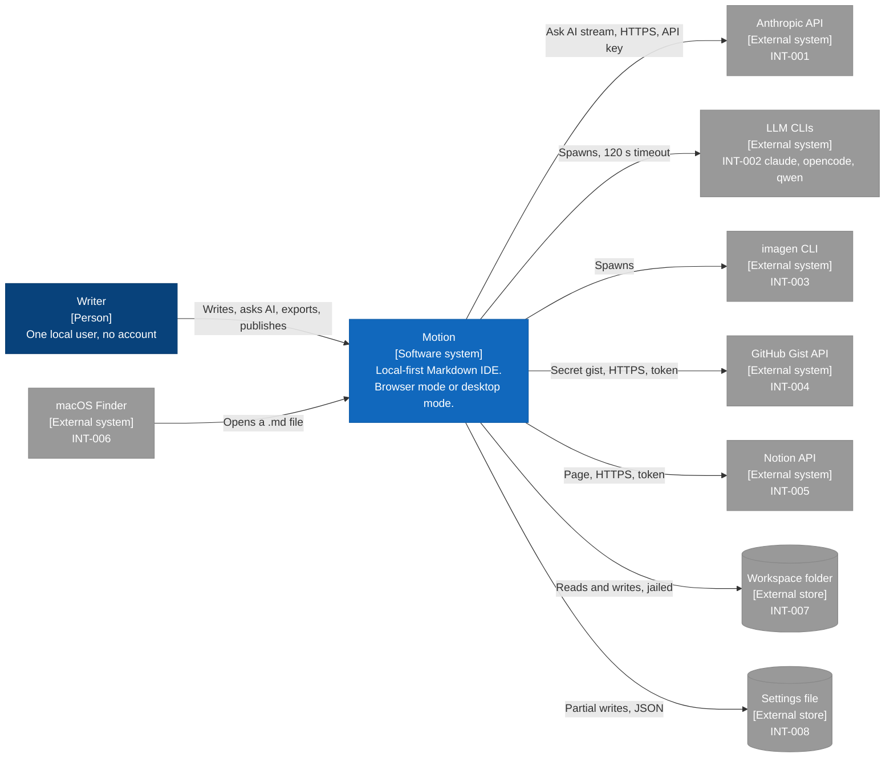

# Architecture diagram: Motion system context

> **Template Origin**: Official | **ArcKit Version**: 6.18.2 | **Command**: `/arckit:diagram`

## Document control

| Field | Value |
|-------|-------|
| **Document ID** | ARC-001-DIAG-001-v1.0 |
| **Document Type** | Architecture Diagram (C4 Context, level 1) |
| **Project** | Motion (Project 001) |
| **Classification** | PUBLIC |
| **Status** | DRAFT |
| **Version** | 1.0 |
| **Created Date** | 2026-10-21 |
| **Last Modified** | 2026-10-21 |
| **Review Cycle** | Monthly |
| **Next Review Date** | 2026-11-20 |
| **Owner** | Rick Hightower, Spillwave Solutions (maintainer and product owner) |
| **Reviewed By** | [PENDING] |
| **Approved By** | [PENDING] |
| **Distribution** | Motion maintainers, Spillwave Solutions, AI agent contributors (through the repo) |

## Revision history

| Version | Date | Author | Changes | Approved By | Approval Date |
|---------|------|--------|---------|-------------|---------------|
| 1.0 | 2026-10-21 | ArcKit AI | Initial creation from `/arckit:diagram` command. Reverse-engineered from the code at `56485be`. | PENDING | PENDING |

---

## Diagram

This diagram shows Motion as one system, the one person who uses it, and the eight external systems that it talks to. It answers the question "what does Motion touch outside itself?" Use it to explain Motion to someone who has not seen the code.

Motion runs on your machine. All eight external systems are integrations INT-001 to INT-008 in ARC-001-REQ. Three of them are local (the workspace folder, the settings file, and Finder). Two are local processes (the LLM CLIs and `imagen`). Three are remote services (Anthropic, GitHub Gist, and Notion). Motion calls a remote service only when you start an action that needs it (P-1, P-11).

### Mermaid format

**View this diagram**:

- **GitHub**: Renders in the Markdown preview.
- **VS Code**: Install a Mermaid preview extension.
- **Online**: Paste the code into <https://mermaid.live>.

### Legend

| Notation | Meaning |
|----------|---------|
| Dark blue box | Person |
| Mid blue box | Software system or container in Motion |
| Light blue box | Component, or a test fixture |
| Gray box or cylinder | External system or external store |
| Dashed border | System, container, or mode boundary |
| Solid arrow | Runtime call or data flow, labeled with the protocol |
| Dotted arrow | Test-time obligation, not a runtime call |

The diagram uses a `flowchart` with the C4 colors, not the native `C4Context` syntax. The native C4 layout placed every element in one column and put edge labels on top of boxes.

## Component inventory

| Component | Type | Technology | Responsibility | Evolution stage | Build/Buy |
|-----------|------|------------|----------------|-----------------|-----------|
| Writer | Person | None | Writes notes, asks AI, exports, and publishes. No account. | Not applicable | Not applicable |
| Motion | Software system | TypeScript, React, Tauri, Rust, Bun | Local-first Markdown IDE in browser mode or desktop mode | Custom | BUILD |
| Workspace folder | External store | Local filesystem | The only content store (INT-007, P-1) | Commodity | USE |
| Settings file | External store | JSON file | Zoom, pane sizes, themes, export default (INT-008) | Commodity | USE |
| macOS Finder | External system | Apple events | Opens a `.md` file with Motion (INT-006) | Commodity | USE |
| Anthropic API | External system | HTTPS, SDK | Ask AI streaming and tool calls (INT-001) | Product | BUY |
| LLM CLIs | External system | `claude`, `opencode`, `qwen` processes | Diagram generation, synthesis, Ask AI fallback (INT-002) | Product | USE |
| `imagen` CLI | External system | Local process | Image generation (INT-003) | Product | USE |
| GitHub Gist API | External system | HTTPS REST | Publishes a note as a secret gist (INT-004) | Commodity | USE |
| Notion API | External system | HTTPS REST | Publishes a note as a Notion page (INT-005) | Product | USE |

Evolution stages are estimates. No Wardley map exists for Motion.

## Architecture decisions

### Key design decisions

**Decision 1: Local-first with no hosted backend**

- **Context**: Writers keep notes for years and use other tools on the same files.
- **Decision**: Notes are plain files in a folder that you choose. Motion has no server that stores content.
- **Rationale**: P-1. Your files stay usable without Motion.
- **Consequences**: No sync, no sharing by link inside Motion, and no account. Publish to Gist or Notion fills the sharing gap.

**Decision 2: External services are optional**

- **Context**: AI and publish services can be missing, down, or changed by the supplier (R-5).
- **Decision**: Each external call starts from a user action, has a timeout, and shows a readable error in its own panel.
- **Rationale**: P-11. Writing must not stop because a service is down.
- **Consequences**: Each integration needs a failure-path test.

### Technology choices

| Technology | Purpose | Rationale | Evolution stage |
|------------|---------|-----------|-----------------|
| Plain Markdown files | Content store | Portable, diffable, readable by any tool (NFR-I-003) | Commodity |
| Local CLIs for AI | Model access without a key in Motion | The CLI owns its own credentials | Product |
| HTTPS APIs for publish | Sharing | Standard REST with a personal token | Commodity |

## Requirements traceability

| Requirement ID | Description | Component(s) | Coverage status |
|----------------|-------------|--------------|-----------------|
| BR-001 | Local-first editing | Motion, Workspace folder | Covered |
| BR-002 | One tool from draft to delivery | Motion, Gist, Notion | Covered |
| BR-003 | AI assistance under your control | Motion, Anthropic API, LLM CLIs | Covered |
| BR-004 | A native macOS desktop product | Motion, macOS Finder | Covered |
| FR-002 | Open a file from Finder | macOS Finder | Covered |
| FR-034 | Share to a GitHub Gist or a Notion page | GitHub Gist API, Notion API | Covered |
| FR-038 | Persist settings in one shared file | Settings file | Covered |
| INT-001 to INT-008 | All integrations | One external box each | Covered |
| NFR-SEC-001 | No accounts, localhost only | Motion boundary | Covered |
| NFR-SEC-004 | Secrets management | Gist and Notion edges (token) | Partial. Tokens are plaintext in webview storage. |

**Coverage summary**: All 8 integrations and the 4 business requirements with an external party appear. The context view does not show functional requirements inside Motion. DIAG-002 and DIAG-003 show those.

## Integration points

### External systems

| External system | Interface | Protocol | Responsibility | SLA |
|-----------------|-----------|----------|----------------|-----|
| Workspace folder | File I/O through the jail | `node:fs` or `std::fs` | Store notes and datasets | Not applicable |
| Settings file | Partial JSON write | File I/O | Store preferences | Not applicable |
| macOS Finder | Open-with event | Apple events | Hand a file to Motion | Not applicable |
| Anthropic API | Messages API, streaming | HTTPS, API key from `ANTHROPIC_API_KEY` | Ask AI replies | Supplier terms |
| LLM CLIs | Process spawn | stdin and stdout, 120 s timeout | Completions | None |
| `imagen` CLI | Process spawn | stdout, temp file | PNG images | None |
| GitHub Gist API | `POST /gists` | HTTPS, personal token | Secret gist | Supplier terms |
| Notion API | `POST /v1/pages`, `PATCH /v1/blocks/{id}/children` | HTTPS, integration token | Page under a parent | Supplier terms |

### APIs and endpoints

Motion exposes no public API. The dev server's `/api/*` routes bind to `127.0.0.1` by default and serve only the client bundle. The `MOTION_HOST` environment variable can change the address, which removes this protection. DIAG-002 lists them.

## Data flow

### Data sources

| Data source | Type | Data format | Update frequency | Owner |
|-------------|------|-------------|------------------|-------|
| Workspace folder | Local files | Markdown, CSV, JSON, JSONL | On save and autosave | Writer |
| Settings file | Local file | JSON | On each preference change | Writer |
| AI services | Remote or local process | Text stream | Per request | Supplier |

### Data sinks

| Data sink | Type | Data format | Retention | Backup |
|-----------|------|-------------|-----------|--------|
| Workspace folder | Local files | Markdown | Until you delete it | Your own, such as version control |
| Exported files | Local files | PDF, Office Open XML | Until you delete it | Your own |
| GitHub Gist, Notion | Remote | Markdown, Notion blocks | Supplier policy | Supplier |

### Personal data handling

| Component | Personal data type | Processing | Legal basis | Retention | Deletion |
|-----------|--------------------|------------|-------------|-----------|----------|
| Workspace folder | Any that you write | Local only | Not applicable, your own data | Your choice | You delete the file |
| Anthropic API, LLM CLIs | Note text that you send | Sent for one request | Your action | Supplier policy | Supplier policy |
| Gist, Notion | The published note | Stored by the supplier | Your action | Supplier policy | Delete it at the supplier |

**DPIA required**: No. Motion is a local tool with no operator that processes other people's data.
**DPO consulted**: Not applicable.

## Security architecture

### Security zones

| Zone | Components | Security level | Controls |
|------|------------|----------------|----------|
| Your machine | Motion, workspace, settings, CLIs | Trusted user, untrusted content | Workspace jail, sanitizing, SQL validation (P-3, P-4, P-9) |
| Internet | Anthropic, GitHub, Notion | Untrusted network | HTTPS, user-held tokens |

### Security controls

| Control | Type | Component(s) | Implementation |
|---------|------|--------------|----------------|
| Workspace jail | Preventive | Motion to workspace edge | Component-aware containment in both cores (P-4) |
| Localhost binding | Preventive | Dev server | Binds to `127.0.0.1` unless `MOTION_HOST` overrides it (NFR-SEC-001) |
| Provider allowlist | Preventive | Motion to LLM CLIs edge | `ALLOWED_LLM_PROVIDERS` in `src/server.ts` |
| Timeout | Detective | Motion to CLIs edge | 120 s per call |

### Authentication and authorization

| Component | Authentication | Authorization | Session management |
|-----------|----------------|---------------|--------------------|
| Motion | None. One local user. | Filesystem permissions of your account | None |
| Anthropic API | API key from the environment | Supplier account | Per request |
| GitHub Gist, Notion | Personal token from the **Publish** dialog | Token scope | Per request |

## Deployment architecture

Motion is not deployed to a cloud. It runs on your Mac as a desktop app, or as a local dev server that you open in a browser. DIAG-002 shows both modes.

| Item | Value |
|------|-------|
| **Provider** | None. Local machine. |
| **Region** | Not applicable |
| **Availability zones** | Not applicable |

## Non-functional requirements

| Requirement | Target | Component(s) | How achieved |
|-------------|--------|--------------|--------------|
| NFR-P-001 Response time | Visible feedback at once | Motion | In-page work, no network round-trip for editing |
| NFR-A-003 Fault tolerance | A failed service does not stop editing | All external edges | Readable errors per panel (P-11, P-13) |
| NFR-S-001 Horizontal scaling | Not applicable | None | Single user, no server |
| NFR-SEC-002 Authorization | No path leaves the workspace | Workspace edge | Jail in both cores |
| NFR-C-001 Data privacy | Content leaves only by your action | Remote edges | P-1, P-12 |

## UK Government compliance

Not applicable. Motion is an open-source product of Spillwave Solutions, not a UK Government service.

## Wardley map integration

**Related Wardley map**: None. The evolution stages in the inventory are estimates from this review.

## Diagram quality gate

| # | Criterion | Target | Result | Status |
|---|-----------|--------|--------|--------|
| 1 | Edge crossings | 0 for a simple diagram | 0 | PASS |
| 2 | Visual hierarchy | The system is the most prominent element | Motion is the only dark blue box in the center | PASS |
| 3 | Grouping | Related elements are close | Remote services top right, local stores bottom right | PASS |
| 4 | Flow direction | One direction | Left to right | PASS |
| 5 | Relationship traceability | Each line is clear | One edge per external system | PASS |
| 6 | Abstraction level | One C4 level | Context | PASS |
| 7 | Edge label readability | No overlap | No overlap in the `mmdc` render | PASS |
| 8 | Node placement | No long edges | Fan-out from one node | PASS |
| 9 | Element count | 10 or fewer | 10 of 10 | PASS |

## Linked artifacts

- **Requirements**: `projects/001-motion/ARC-001-REQ-v1.0.md`
- **Stakeholders**: `projects/001-motion/ARC-001-STKE-v1.0.md`
- **Architecture principles**: `projects/000-global/ARC-000-PRIN-v1.0.md`
- **Architecture decisions**: `projects/001-motion/decisions/`
- **Design doc**: `docs/designs/current_design_doc.md`, sections 4 to 6
- **Other diagrams**: `ARC-001-DIAG-002-v1.0.md`, `ARC-001-DIAG-003-v1.0.md`, `ARC-001-DIAG-004-v1.0.md`
- **Wardley map, HLD, DLD, TCoP, AI Playbook, ATRS**: None. Motion has no such artifacts.

## Change log

| Version | Date | Author | Changes | Rationale |
|---------|------|--------|---------|-----------|
| v1.0 | 2026-10-21 | ArcKit AI | Initial diagram | Reverse-engineered baseline |

**Next Review Date**: 2026-11-20

## External references

> This section provides traceability from generated content back to source documents.

### Document register

| Doc ID | Filename | Type | Source Location | Description |
|--------|----------|------|-----------------|-------------|
| DD | `current_design_doc.md` | Design doc | `docs/designs/` | Sections 4.3, 5.2, 5.3, and 5.5 |
| REQ | `ARC-001-REQ-v1.0.md` | ArcKit artifact | `projects/001-motion/` | INT-001 to INT-008 |
| PRIN | `ARC-000-PRIN-v1.0.md` | ArcKit artifact | `projects/000-global/` | P-1 to P-19 |

### Citations

| Citation ID | Doc ID | Page/Section | Category | Quoted Passage |
|-------------|--------|--------------|----------|----------------|
| DD-C1 | DD | 4.3 | Context | "The UI never touches the filesystem or a CLI itself" |

### Unreferenced documents

| Filename | Source Location | Reason |
|----------|-----------------|--------|
| None | None | None |

---

**Generated by**: ArcKit `/arckit:diagram` command
**Generated on**: 2026-10-21 21:40 GMT
**ArcKit Version**: 6.18.2
**Project**: Motion (Project 001)
**AI Model**: Claude Opus 5.5 (claude-opus-5-5)
**Generation Context**: The code at `56485be` (`src/server.ts`, `src-tauri/src/lib.rs`, `src/lib/**`), design doc sections 4 and 5, ARC-001-REQ-v1.0, and ARC-000-PRIN-v1.0. Each Mermaid block was rendered with `mmdc` before the file was written.
