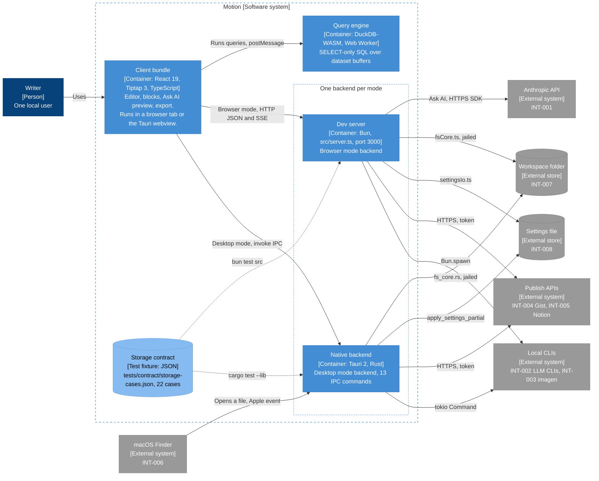

# Architecture diagram: Motion containers in browser and desktop mode

> **Template Origin**: Official | **ArcKit Version**: 6.18.2 | **Command**: `/arckit:diagram`

## Document control

| Field | Value |
|-------|-------|
| **Document ID** | ARC-001-DIAG-002-v1.0 |
| **Document Type** | Architecture Diagram (C4 Container, level 2) |
| **Project** | Motion (Project 001) |
| **Classification** | PUBLIC |
| **Status** | DRAFT |
| **Version** | 1.0 |
| **Created Date** | 2026-10-21 |
| **Last Modified** | 2026-10-21 |
| **Review Cycle** | Monthly |
| **Next Review Date** | 2026-11-20 |
| **Owner** | Rick Hightower, Spillwave Solutions (maintainer and product owner) |
| **Reviewed By** | [PENDING] |
| **Approved By** | [PENDING] |
| **Distribution** | Motion maintainers, Spillwave Solutions, AI agent contributors (through the repo) |

## Revision history

| Version | Date | Author | Changes | Approved By | Approval Date |
|---------|------|--------|---------|-------------|---------------|
| 1.0 | 2026-10-21 | ArcKit AI | Initial creation from `/arckit:diagram` command. Reverse-engineered from the code at `56485be`. | PENDING | PENDING |

---

## Diagram

This diagram opens the Motion box from DIAG-001. It shows the five containers and how they differ between the two runtime modes. Use it to answer "which process does this work run in?"

Motion has one client bundle and two backends. Only one backend serves storage at a time. At module load, `isTauri()` in `src/lib/storage/index.ts` picks the backend:

- **Browser mode** (`bun run dev`): the bundle runs in a browser tab and calls the dev server over HTTP.
- **Desktop mode** (`bun tauri dev`, or the packaged app): the bundle runs in the Tauri webview and calls the native backend over IPC.

The storage contract is a test fixture, not a runtime process. It appears in this view because it is the mechanism that keeps the two backends the same (P-2, AD-1).

### Mermaid format

**View this diagram**:

- **GitHub**: Renders in the Markdown preview.
- **VS Code**: Install a Mermaid preview extension.
- **Online**: Paste the code into <https://mermaid.live>.

### Legend

| Notation | Meaning |
|----------|---------|
| Dark blue box | Person |
| Mid blue box | Software system or container in Motion |
| Light blue box | Component, or a test fixture |
| Gray box or cylinder | External system or external store |
| Dashed border | System, container, or mode boundary |
| Solid arrow | Runtime call or data flow, labeled with the protocol |
| Dotted arrow | Test-time obligation, not a runtime call |

The diagram uses a `flowchart` with the C4 colors, not the native `C4Context` syntax. The native C4 layout placed every element in one column and put edge labels on top of boxes.

## Runtime modes

| Item | Browser mode | Desktop mode |
|------|--------------|--------------|
| Start command | `bun run dev` | `bun tauri dev`, `bun run tauri:mcp`, or the packaged app |
| Client host | Browser tab | Tauri webview |
| Storage backend | Dev server, `HttpStorage` | Native backend, `TauriStorage` |
| Workspace root | `MOTION_WORKSPACE`, default `public/demo` (P-5) | The folder that you pick in the native dialog (P-5) |
| Ask AI | `POST /api/ai/stream` to the Anthropic API | HTTP when a dev server is reachable, otherwise `run_llm_cli` |
| Open from Finder | Not available | `RunEvent::Opened` and `take_pending_open` |
| `Bun` available in the client | No | No (P-10, P-16) |

In desktop development, the dev server still runs. It serves the bundle through `devUrl` (`http://localhost:3000`), but storage calls go over IPC.

## Component inventory

| Component | Type | Technology | Responsibility | Evolution stage | Build/Buy |
|-----------|------|------------|----------------|-----------------|-----------|
| Client bundle | Container | React 19, Tiptap 3, TypeScript, built by `scripts/build.ts` | All UI: editor, blocks, Ask AI preview, export, themes, publish dialog | Custom | BUILD |
| Query engine | Container | DuckDB-WASM in a Web Worker, served from `public/duckdb/` | SELECT-only SQL over registered dataset buffers | Product | USE |
| Dev server | Container | Bun, `src/server.ts`, port 3000 | Builds and serves the bundle, browser mode backend, `/api/*` routes | Custom | BUILD |
| Native backend | Container | Tauri 2, Rust, `src-tauri/src` | Desktop backend with 13 IPC commands, folder dialog, Finder hand-off | Custom | BUILD |
| Storage contract | Test fixture | JSON, `tests/contract/storage-cases.json` | 22 cases that both filesystem cores must pass | Custom | BUILD |
| Workspace folder | External store | Local filesystem | Notes and datasets (INT-007) | Commodity | USE |
| Settings file | External store | JSON | Preferences (INT-008) | Commodity | USE |
| Anthropic API | External system | HTTPS SDK `@anthropic-ai/sdk` | Ask AI (INT-001) | Product | BUY |
| Local CLIs | External system | Processes | LLM CLIs (INT-002) and `imagen` (INT-003) | Product | USE |
| Publish APIs | External system | HTTPS REST | GitHub Gist (INT-004) and Notion (INT-005) | Product | USE |
| macOS Finder | External system | Apple events | Opens files (INT-006) | Commodity | USE |

## Architecture decisions

### Key design decisions

**Decision 1: Two backends, one contract (AD-1, P-2)**

- **Context**: Browser mode needs a Bun process. Desktop mode needs a native process. They cannot share code.
- **Decision**: Each backend has its own filesystem core. Both test suites run the same hand-written fixture.
- **Rationale**: The two storage implementations once drifted in seven ways. The fixture turns drift into a red build.
- **Consequences**: A storage change needs three edits. ADR-001 records this decision.

**Decision 2: The client never calls a runtime-only API (AD-4, P-10)**

- **Context**: `Bun` is undefined in the browser tab and in the webview.
- **Decision**: Client code calls transport routers. A static guard checks the import graph.
- **Rationale**: The same bug was fixed four times before the guard existed.
- **Consequences**: Every new capability that needs a process gets a route and an IPC command.

**Decision 3: Export runs in the page**

- **Context**: PDF and Word export (FR-028, FR-029) work on the live editor buffer.
- **Decision**: The client bundle builds the file with jsPDF and docx, then saves it through a browser download link.
- **Rationale**: No backend round-trip, and the preview is the exact page that the file comes from.
- **Consequences**: No backend involvement. This review did not check how the Tauri webview handles the download link. The desktop dogfood for PR 63 covers it.

### Technology choices

| Technology | Purpose | Rationale | Evolution stage |
|------------|---------|-----------|-----------------|
| Bun | Dev server, build, unit tests | One runtime for the toolchain | Product |
| Tauri 2 | Desktop shell | Small native app, Rust backend, system webview | Product |
| React 19 and Tiptap 3 | Editor UI | Rich-text editor with custom node views for blocks | Product |
| DuckDB-WASM | In-page SQL | SQL over local files with no server | Product |
| jsPDF and docx | Export | Client-side file generation | Product |

## Requirements traceability

| Requirement ID | Description | Component(s) | Coverage status |
|----------------|-------------|--------------|-----------------|
| FR-001 | Open a folder as the workspace | Native backend (`set_workspace`), Dev server (`/api/fs/workspace`) | Covered |
| FR-002 | Open a file from Finder | macOS Finder, Native backend | Covered |
| FR-009 | Save a note, by hand and by autosave | Client bundle, both backends | Covered |
| FR-018, FR-019 | Register a dataset, run read-only SQL | Client bundle, Query engine | Covered |
| FR-020, FR-021 | Generate an image or a diagram | Client bundle, both backends, Local CLIs | Covered |
| FR-022 to FR-025 | Ask AI | Client bundle, Dev server, Anthropic API, Local CLIs | Covered |
| FR-026 | Synthesize a workspace index | Client bundle, Local CLIs | Covered |
| FR-027 to FR-032 | Reload, export, and themes | Client bundle, Settings file | Covered |
| FR-034 | Share to a Gist or Notion page | Both backends, Publish APIs | Covered |
| FR-038 | Persist settings in one shared file | Both backends, Settings file | Partial. No shared contract for settings. |
| NFR-SEC-002 | Containment in both cores | Dev server, Native backend, Storage contract | Covered |
| NFR-M-004 | Verification gate | Storage contract | Covered |
| NFR-I-003 | Data portability | Workspace folder | Covered |
| INT-001 to INT-008 | Integrations | External boxes | Covered |

**Coverage summary**: Each container maps to at least one requirement. FR-038 is partial because settings have two implementations and no shared fixture (P-2 known gap).

## Integration points

### External systems

See DIAG-001 for protocols and authentication. This table adds the container that owns each edge.

| External system | Browser mode owner | Desktop mode owner |
|-----------------|--------------------|--------------------|
| Workspace folder | Dev server, `fsCore.ts` | Native backend, `fs_core.rs` |
| Settings file | Dev server, `settingsIo.ts` | Native backend, `apply_settings_partial` |
| Anthropic API | Dev server, `ai/service.ts` | Dev server when reachable, otherwise none |
| Local CLIs | Dev server, `Bun.spawn` | Native backend, `tokio::process::Command` |
| Publish APIs | Dev server, `publish/gist.ts` and `publish/notion.ts` | Native backend, `publish.rs` |
| macOS Finder | None | Native backend |

### APIs and endpoints

| API | Endpoint | Method | Purpose | Authentication |
|-----|----------|--------|---------|----------------|
| Dev server | `/api/fs/*` | GET, POST | Workspace root, list notes, list data files, read, write, rename | None, localhost only |
| Dev server | `/api/settings` | GET, POST | Read settings, partial write | None, localhost only |
| Dev server | `/api/llm` | POST | Spawn an allowed LLM CLI | None, localhost only |
| Dev server | `/api/ai/stream` | POST | Ask AI, server-sent events | `ANTHROPIC_API_KEY` on the server |
| Dev server | `/api/image` | POST | Spawn `imagen` | None, localhost only |
| Dev server | `/api/publish/gist`, `/api/publish/notion` | POST | Publish a note | Token in the request body |
| Native backend | `set_workspace`, `take_pending_open`, `read_file`, `write_file`, `rename_file`, `list_markdown_files`, `list_data_files` | IPC | Storage and Finder hand-off | Tauri IPC |
| Native backend | `get_settings`, `set_settings` | IPC | Settings | Tauri IPC |
| Native backend | `run_llm_cli`, `run_image_cli`, `publish_gist`, `publish_notion` | IPC | Processes and publish | Tauri IPC |

## Data flow

| Flow | Path | Notes |
|------|------|-------|
| Save a note | Client bundle, router, backend core, workspace | Containment check on the file and its parent (design doc 5.4) |
| Run a query | Client bundle, `sqlSafety.ts`, Query engine | Dataset bytes come from the backend first |
| Export | Client bundle only | The file is built in the page from the live buffer |
| Ask AI | Client bundle, Dev server, Anthropic API, back to a preview | Nothing changes until you accept (P-12) |

See DIAG-001 for personal data handling.

## Security architecture

### Security zones

| Zone | Components | Security level | Controls |
|------|------------|----------------|----------|
| Client | Client bundle, Query engine | Runs untrusted document content | Sanitizing, SQL validation, no runtime-only APIs (P-9, P-16) |
| Backend | Dev server, Native backend | Trusts no client input | Jail in the core, root from configuration only (P-3, P-5) |
| External | Workspace, settings, services | Outside Motion | HTTPS, user-held tokens |

### Security controls

| Control | Type | Component(s) | Implementation |
|---------|------|--------------|----------------|
| Workspace jail | Preventive | Both backends | `resolveInWorkspace` and `resolve_in_workspace` |
| Contract test | Detective | Storage contract | 22 cases in `bun test src` and `cargo test --lib` |
| Client guard | Detective | Client bundle | `bun run guard:client` |
| HTTP status gate | Detective | Dev server | `e2e/fixtures.ts` fails on any status 400 or higher |

### Authentication and authorization

| Component | Authentication | Authorization | Session management |
|-----------|----------------|---------------|--------------------|
| Dev server | None. Localhost binding. | Workspace jail | None |
| Native backend | Tauri IPC from its own webview | Workspace jail | `WorkspaceState` holds the root |

## Deployment architecture

| Container | Where it runs | How it ships |
|-----------|---------------|--------------|
| Client bundle | Browser tab or Tauri webview | `bun run build` writes `dist/`, including `index.html` from `scripts/build.ts` |
| Dev server | Your machine, port 3000 | Source checkout, `bun run dev` |
| Native backend | Your machine | `bun tauri build` packages it with `dist/` |
| Query engine | Web Worker in the page | Static files in `public/duckdb/` |

Design doc section 5.6 still says that `dist/` has no `index.html`. The code no longer agrees: `scripts/build.ts` writes it. ARC-001-REQ Appendix F tracks this kind of difference.

## Non-functional requirements

| Requirement | Target | Component(s) | How achieved |
|-------------|--------|--------------|--------------|
| NFR-P-001 Response time | Feedback at once | Client bundle | Editing never waits on a backend |
| NFR-A-003 Fault tolerance | One failure does not stop editing | All containers | Errors stay in the panel that started them |
| NFR-SEC-002 Authorization | No path leaves the workspace | Both backends | Jail in the cores, contract-tested |
| NFR-M-004 Verification gate | `bun run verify` and `cargo test` pass | All containers | CI jobs `typecheck, guards, unit, e2e` and `cargo test + clippy` |

## UK Government compliance

Not applicable. See DIAG-001.

## Wardley map integration

**Related Wardley map**: None. The evolution stages in the inventory are estimates.

## Diagram quality gate

| # | Criterion | Target | Result | Status |
|---|-----------|--------|--------|--------|
| 1 | Edge crossings | Fewer than 5 | About 5, where the two backends reach the same stores | PASS, accepted trade-off |
| 2 | Visual hierarchy | The system boundary is prominent | Dashed Motion boundary holds all containers | PASS |
| 3 | Grouping | Related elements are close | The two backends share an inner "one backend per mode" boundary | PASS |
| 4 | Flow direction | One direction | Left to right | PASS |
| 5 | Relationship traceability | Each line is clear | Each backend has its own edge to each store | PASS |
| 6 | Abstraction level | One C4 level | Container | PASS |
| 7 | Edge label readability | No overlap | No overlap in the `mmdc` render | PASS |
| 8 | Node placement | No long edges | The Finder edge is long, because Finder is an input on the left | PASS |
| 9 | Element count | 15 or fewer | 12 of 15 | PASS |

**Accepted trade-off**: Each backend draws its own edges to the workspace, the settings file, the CLIs, and the publish APIs. Merged edges would hide the main fact of this view: both modes reach the same stores through different code. The crossings that this causes are accepted.

## Linked artifacts

- **Requirements**: `projects/001-motion/ARC-001-REQ-v1.0.md`
- **Stakeholders**: `projects/001-motion/ARC-001-STKE-v1.0.md`
- **Architecture principles**: `projects/000-global/ARC-000-PRIN-v1.0.md`
- **Architecture decisions**: `projects/001-motion/decisions/`
- **Design doc**: `docs/designs/current_design_doc.md`, sections 4 to 6
- **Other diagrams**: `ARC-001-DIAG-001-v1.0.md`, `ARC-001-DIAG-003-v1.0.md`, `ARC-001-DIAG-004-v1.0.md`
- **Wardley map, HLD, DLD, TCoP, AI Playbook, ATRS**: None. Motion has no such artifacts.

## Change log

| Version | Date | Author | Changes | Rationale |
|---------|------|--------|---------|-----------|
| v1.0 | 2026-10-21 | ArcKit AI | Initial diagram | Reverse-engineered baseline |

**Next Review Date**: 2026-11-20

## External references

> This section provides traceability from generated content back to source documents.

### Document register

| Doc ID | Filename | Type | Source Location | Description |
|--------|----------|------|-----------------|-------------|
| DD | `current_design_doc.md` | Design doc | `docs/designs/` | Sections 4.3, 5.2, 5.3, and 5.5 |
| REQ | `ARC-001-REQ-v1.0.md` | ArcKit artifact | `projects/001-motion/` | INT-001 to INT-008 |
| PRIN | `ARC-000-PRIN-v1.0.md` | ArcKit artifact | `projects/000-global/` | P-1 to P-19 |

### Citations

| Citation ID | Doc ID | Page/Section | Category | Quoted Passage |
|-------------|--------|--------------|----------|----------------|
| DD-C1 | DD | 4.3 | Context | "The UI never touches the filesystem or a CLI itself" |

### Unreferenced documents

| Filename | Source Location | Reason |
|----------|-----------------|--------|
| None | None | None |

---

**Generated by**: ArcKit `/arckit:diagram` command
**Generated on**: 2026-10-21 21:40 GMT
**ArcKit Version**: 6.18.2
**Project**: Motion (Project 001)
**AI Model**: Claude Opus 5.5 (claude-opus-5-5)
**Generation Context**: The code at `56485be` (`src/server.ts`, `src-tauri/src/lib.rs`, `src/lib/**`), design doc sections 4 and 5, ARC-001-REQ-v1.0, and ARC-000-PRIN-v1.0. Each Mermaid block was rendered with `mmdc` before the file was written.
