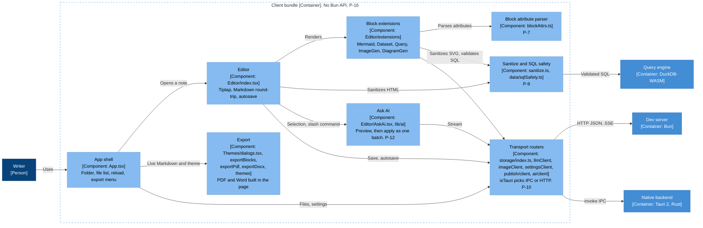

# Architecture diagram: Client bundle components

> **Template Origin**: Official | **ArcKit Version**: 6.18.2 | **Command**: `/arckit:diagram`

## Document control

| Field | Value |
|-------|-------|
| **Document ID** | ARC-001-DIAG-003-v1.0 |
| **Document Type** | Architecture Diagram (C4 Component, level 3) |
| **Project** | Motion (Project 001) |
| **Classification** | PUBLIC |
| **Status** | DRAFT |
| **Version** | 1.0 |
| **Created Date** | 2026-10-21 |
| **Last Modified** | 2026-10-21 |
| **Review Cycle** | Monthly |
| **Next Review Date** | 2026-11-20 |
| **Owner** | Rick Hightower, Spillwave Solutions (maintainer and product owner) |
| **Reviewed By** | [PENDING] |
| **Approved By** | [PENDING] |
| **Distribution** | Motion maintainers, Spillwave Solutions, AI agent contributors (through the repo) |

## Revision history

| Version | Date | Author | Changes | Approved By | Approval Date |
|---------|------|--------|---------|-------------|---------------|
| 1.0 | 2026-10-21 | ArcKit AI | Initial creation from `/arckit:diagram` command. Reverse-engineered from the code at `56485be`. | PENDING | PENDING |

---

## Diagram

This diagram opens the client bundle container from DIAG-002. It shows the eight component groups in the bundle and the three containers that the bundle calls. Use it to find where a UI feature lives and which path it takes to a backend.

Two rules shape this view. First, all backend traffic leaves through the transport routers, which pick IPC or HTTP (P-10). Second, all untrusted content passes through the sanitize and SQL safety component before it renders or runs (P-9). The guard `bun run guard:client` proves statically that no component here reaches a `Bun` API (P-16).

### Mermaid format

**View this diagram**:

- **GitHub**: Renders in the Markdown preview.
- **VS Code**: Install a Mermaid preview extension.
- **Online**: Paste the code into <https://mermaid.live>.

### Legend

| Notation | Meaning |
|----------|---------|
| Dark blue box | Person |
| Mid blue box | Software system or container in Motion |
| Light blue box | Component, or a test fixture |
| Gray box or cylinder | External system or external store |
| Dashed border | System, container, or mode boundary |
| Solid arrow | Runtime call or data flow, labeled with the protocol |
| Dotted arrow | Test-time obligation, not a runtime call |

The diagram uses a `flowchart` with the C4 colors, not the native `C4Context` syntax. The native C4 layout placed every element in one column and put edge labels on top of boxes.

## Component inventory

| Component | Type | Technology | Responsibility | Evolution stage | Build/Buy |
|-----------|------|------------|----------------|-----------------|-----------|
| App shell | Component | `src/App.tsx` | Folder open, file list, search, reload, export menu, view modes | Custom | BUILD |
| Editor | Component | `src/components/Editor/index.tsx`, `markdown.ts`, `dirtyBaseline.ts` | Tiptap editor, Markdown round-trip, 1.5 s autosave, dirty tracking | Custom | BUILD |
| Block extensions | Component | `Editor/extensions/*Extension.tsx` | Mermaid, Dataset, Query, ImageGen, and DiagramGen node views | Custom | BUILD |
| Block attribute parser | Component | `Editor/extensions/blockAttrs.ts` | One `key: value` parser for all blocks (P-7, AD-9) | Custom | BUILD |
| Sanitize and SQL safety | Component | `lib/sanitize.ts`, `lib/data/sqlSafety.ts` | DOMPurify wrappers, SELECT-only SQL, identifier check, limit clamp (P-9, AD-8) | Custom | BUILD |
| Ask AI | Component | `Editor/AskAi.tsx`, `lib/ai/*` | Streamed preview, DocCommands, apply as one batch (P-12) | Custom | BUILD |
| Export | Component | `components/Themes/dialogs.tsx`, `lib/exportBlocks.ts`, `exportPdf.ts`, `exportDocx.ts`, `themes.ts` | Themed preview, PDF and Word built from the live buffer | Custom | BUILD |
| Transport routers | Component | `lib/storage/index.ts`, `llmClient.ts`, `imageClient.ts`, `settingsClient.ts`, `publish/client.ts`, `ai/client.ts` | Pick IPC or HTTP with `isTauri()` (P-10, AD-4) | Custom | BUILD |

The unlabeled edge from the block extensions to the routers carries three kinds of call: LLM calls from DiagramGen, image calls from ImageGen, and dataset reads from Dataset.

## Architecture decisions

### Key design decisions

**Decision 1: One router per backend capability (AD-4, P-10)**

- **Context**: The same client code runs in a browser tab and in a webview.
- **Decision**: Each capability has a client module that calls `invoke()` in desktop mode and `fetch("/api/...")` in browser mode.
- **Rationale**: Components stay free of runtime checks, and the guard has one place to look.
- **Consequences**: Six router modules exist. A new capability adds one more.

**Decision 2: One block-attribute parser (AD-9, P-7)**

- **Context**: Three inline parsers once turned `content: null` into the string `"null"`.
- **Decision**: All blocks call `parseBlockAttrs()`.
- **Rationale**: Each edge case gets one fix.
- **Consequences**: A value with a newline still cannot round-trip (B7).

**Decision 3: AI changes go through a preview (P-12)**

- **Context**: AI output can be wrong.
- **Decision**: `AskAi.tsx` streams into a preview. `lib/ai/apply.ts` applies an accepted change as one batch.
- **Rationale**: You stay in control, and one undo restores the note.
- **Consequences**: No AI feature writes to the note directly.

### Technology choices

| Technology | Purpose | Rationale | Evolution stage |
|------------|---------|-----------|-----------------|
| Tiptap 3 | Rich-text editor | Custom node views for blocks | Product |
| DOMPurify | HTML and SVG sanitizing | Standard, well-tested sanitizer | Commodity |
| jsPDF, docx | Export | Client-side file generation | Product |
| Mermaid | Diagram rendering | Diagrams as text in the note (P-6) | Product |

## Requirements traceability

| Requirement ID | Description | Component(s) | Coverage status |
|----------------|-------------|--------------|-----------------|
| FR-005, FR-006 | Search notes, find in note | App shell, Editor | Covered |
| FR-007 to FR-009 | View modes, highlighting, save | Editor | Covered |
| FR-011 to FR-013 | Create a note or folder, rename | App shell, routers | Covered |
| FR-014 to FR-017 | Blocks, round-trip, Mermaid, tables | Block extensions, parser | Covered |
| FR-018, FR-019 | Datasets and SQL | Block extensions, SQL safety | Covered |
| FR-020, FR-021 | Image and diagram generation | Block extensions, routers | Covered |
| FR-022 to FR-025 | Ask AI | Ask AI, routers | Covered |
| FR-027 | Reload the open note | App shell, routers | Covered |
| FR-028 to FR-032 | Export and themes | Export, routers (settings) | Covered |
| FR-033, FR-034 | Copy and share | App shell, routers | Covered |
| FR-035, FR-036 | Zoom and resize | App shell, routers (settings) | Covered |
| NFR-SEC-005 | Untrusted content | Sanitize and SQL safety | Covered |
| NFR-U-002 | Accessibility | All components | Partial. E2E specs use roles and names. No audit exists. |

**Coverage summary**: Every client-side FR in ARC-001-REQ maps to a component. FR-001 to FR-004 and FR-038 are mostly backend work. DIAG-004 covers them.

## Integration points

| Target | Interface | Protocol | Responsibility |
|--------|-----------|----------|----------------|
| Dev server | Routers | HTTP JSON, server-sent events | Browser mode backend |
| Native backend | Routers | Tauri `invoke()` | Desktop mode backend |
| Query engine | `lib/data/duckdb.ts` | Web Worker messages | SQL after validation |

## Data flow

| Flow | Components in order |
|------|---------------------|
| Save | Editor, routers, backend |
| Render a diagram block | Block extensions, parser, sanitize (`sanitizeSvg`), DOM |
| Run a Query block | Block extensions, SQL safety, Query engine |
| Ask AI | Editor, Ask AI, routers, then back to the Ask AI preview, then Editor on accept |
| Export | App shell, Export, browser download |

## Security architecture

| Control | Type | Component(s) | Implementation |
|---------|------|--------------|----------------|
| HTML sanitizing | Preventive | Editor | `sanitizeHtml()` |
| SVG sanitizing | Preventive | Block extensions | `sanitizeSvg()` |
| SQL validation | Preventive | Block extensions | `validateSelectSql()`, `validateIdentifier()`, `clampLimit()` |
| No runtime-only APIs | Detective | Whole bundle | `bun run guard:client` |
| AI preview | Preventive | Ask AI | Nothing changes until you accept |

The client does not authenticate. Publish tokens live in webview `localStorage` under `motion.publish.*`. A work item tracks where they should live.

## Deployment architecture

The bundle is one file, `bundle.js` in development or `dist/` in a build. See DIAG-002.

## Non-functional requirements

| Requirement | Target | Component(s) | How achieved |
|-------------|--------|--------------|--------------|
| NFR-P-001 Response time | Feedback at once | Editor | Local state, debounced autosave |
| NFR-SEC-005 Untrusted content | No script from a note runs | Sanitize and SQL safety | P-9 |
| NFR-M-004 Verification gate | Guard passes | Whole bundle | `bun run verify` |

## UK Government compliance

Not applicable. See DIAG-001.

## Wardley map integration

**Related Wardley map**: None.

## Diagram quality gate

| # | Criterion | Target | Result | Status |
|---|-----------|--------|--------|--------|
| 1 | Edge crossings | Fewer than 5 | 2 | PASS |
| 2 | Visual hierarchy | The container boundary is prominent | Dashed client bundle boundary | PASS |
| 3 | Grouping | Related elements are close | Safety beside the query engine, routers beside the backends | PASS |
| 4 | Flow direction | One direction | Left to right | PASS |
| 5 | Relationship traceability | Each line is clear | One unlabeled edge, explained under the inventory | PASS |
| 6 | Abstraction level | One C4 level | Component | PASS |
| 7 | Edge label readability | No overlap | No overlap after the label fix | PASS |
| 8 | Node placement | No long edges | Two long edges into the routers | PASS, accepted |
| 9 | Element count | 12 or fewer per container | 8 components | PASS |

## Linked artifacts

- **Requirements**: `projects/001-motion/ARC-001-REQ-v1.0.md`
- **Stakeholders**: `projects/001-motion/ARC-001-STKE-v1.0.md`
- **Architecture principles**: `projects/000-global/ARC-000-PRIN-v1.0.md`
- **Architecture decisions**: `projects/001-motion/decisions/`
- **Design doc**: `docs/designs/current_design_doc.md`, sections 4 to 6
- **Other diagrams**: `ARC-001-DIAG-001-v1.0.md`, `ARC-001-DIAG-002-v1.0.md`, `ARC-001-DIAG-004-v1.0.md`
- **Wardley map, HLD, DLD, TCoP, AI Playbook, ATRS**: None. Motion has no such artifacts.

## Change log

| Version | Date | Author | Changes | Rationale |
|---------|------|--------|---------|-----------|
| v1.0 | 2026-10-21 | ArcKit AI | Initial diagram | Reverse-engineered baseline |

**Next Review Date**: 2026-11-20

## External references

> This section provides traceability from generated content back to source documents.

### Document register

| Doc ID | Filename | Type | Source Location | Description |
|--------|----------|------|-----------------|-------------|
| DD | `current_design_doc.md` | Design doc | `docs/designs/` | Sections 4.3, 5.2, 5.3, and 5.5 |
| REQ | `ARC-001-REQ-v1.0.md` | ArcKit artifact | `projects/001-motion/` | INT-001 to INT-008 |
| PRIN | `ARC-000-PRIN-v1.0.md` | ArcKit artifact | `projects/000-global/` | P-1 to P-19 |

### Citations

| Citation ID | Doc ID | Page/Section | Category | Quoted Passage |
|-------------|--------|--------------|----------|----------------|
| DD-C1 | DD | 4.3 | Context | "The UI never touches the filesystem or a CLI itself" |

### Unreferenced documents

| Filename | Source Location | Reason |
|----------|-----------------|--------|
| None | None | None |

---

**Generated by**: ArcKit `/arckit:diagram` command
**Generated on**: 2026-10-21 21:40 GMT
**ArcKit Version**: 6.18.2
**Project**: Motion (Project 001)
**AI Model**: Claude Opus 5.5 (claude-opus-5-5)
**Generation Context**: The code at `56485be` (`src/server.ts`, `src-tauri/src/lib.rs`, `src/lib/**`), design doc sections 4 and 5, ARC-001-REQ-v1.0, and ARC-000-PRIN-v1.0. Each Mermaid block was rendered with `mmdc` before the file was written.
