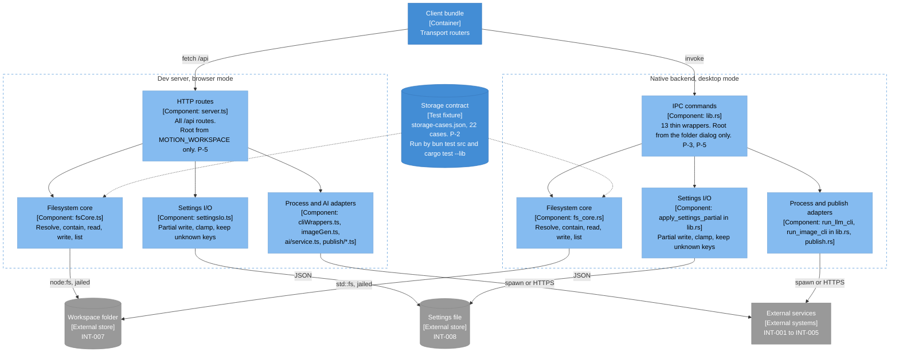

# Architecture diagram: Backend components and the storage contract

> **Template Origin**: Official | **ArcKit Version**: 6.18.2 | **Command**: `/arckit:diagram`

## Document control

| Field | Value |
|-------|-------|
| **Document ID** | ARC-001-DIAG-004-v1.0 |
| **Document Type** | Architecture Diagram (C4 Component, level 3) |
| **Project** | Motion (Project 001) |
| **Classification** | PUBLIC |
| **Status** | DRAFT |
| **Version** | 1.0 |
| **Created Date** | 2026-10-21 |
| **Last Modified** | 2026-10-21 |
| **Review Cycle** | Monthly |
| **Next Review Date** | 2026-11-20 |
| **Owner** | Rick Hightower, Spillwave Solutions (maintainer and product owner) |
| **Reviewed By** | [PENDING] |
| **Approved By** | [PENDING] |
| **Distribution** | Motion maintainers, Spillwave Solutions, AI agent contributors (through the repo) |

## Revision history

| Version | Date | Author | Changes | Approved By | Approval Date |
|---------|------|--------|---------|-------------|---------------|
| 1.0 | 2026-10-21 | ArcKit AI | Initial creation from `/arckit:diagram` command. Reverse-engineered from the code at `56485be`. | PENDING | PENDING |

---

## Diagram

This diagram opens the two backend containers from DIAG-002 and puts them side by side. Each backend has the same four component roles: an entry point, a filesystem core, settings I/O, and adapters for processes and publishing. Use it to see where the two runtimes match, and where only a test keeps them matched.

The storage contract sits between the two filesystem cores. Both test suites load it, so a difference between the cores fails a build (P-2, AD-1). The two settings components have no shared contract. This gap is the main finding of this view.

### Mermaid format

**View this diagram**:

- **GitHub**: Renders in the Markdown preview.
- **VS Code**: Install a Mermaid preview extension.
- **Online**: Paste the code into <https://mermaid.live>.

### Legend

| Notation | Meaning |
|----------|---------|
| Dark blue box | Person |
| Mid blue box | Software system or container in Motion |
| Light blue box | Component, or a test fixture |
| Gray box or cylinder | External system or external store |
| Dashed border | System, container, or mode boundary |
| Solid arrow | Runtime call or data flow, labeled with the protocol |
| Dotted arrow | Test-time obligation, not a runtime call |

The diagram uses a `flowchart` with the C4 colors, not the native `C4Context` syntax. The native C4 layout placed every element in one column and put edge labels on top of boxes.

## Component inventory

| Component | Container | Technology | Responsibility | Evolution stage | Build/Buy |
|-----------|-----------|------------|----------------|-----------------|-----------|
| HTTP routes | Dev server | `src/server.ts` | All `/api/*` routes, bundle serving, status mapping. Root from `MOTION_WORKSPACE` only (P-5, AD-3). | Custom | BUILD |
| Filesystem core | Dev server | `src/lib/fsCore.ts` | Resolve, contain, read, write, rename, list (P-4) | Custom | BUILD |
| Settings I/O | Dev server | `src/lib/settingsIo.ts` | Partial write, clamp, keep unknown keys (P-8) | Custom | BUILD |
| Process and AI adapters | Dev server | `cliWrappers.ts`, `imageGen.ts`, `ai/service.ts`, `publish/gist.ts`, `publish/notion.ts` | Spawn CLIs, call the Anthropic SDK, publish | Custom | BUILD |
| IPC commands | Native backend | `src-tauri/src/lib.rs` | 13 thin `#[tauri::command]` wrappers. Root from the folder dialog only (P-3, P-5). | Custom | BUILD |
| Filesystem core | Native backend | `src-tauri/src/fs_core.rs` | Resolve, contain, read, write, rename, list (P-4) | Custom | BUILD |
| Settings I/O | Native backend | `apply_settings_partial` in `lib.rs` | Partial write, clamp, keep unknown keys (P-8) | Custom | BUILD |
| Process and publish adapters | Native backend | `run_llm_cli`, `run_image_cli` in `lib.rs`, `publish.rs` | Spawn CLIs, publish | Custom | BUILD |
| Storage contract | Test fixture | `tests/contract/storage-cases.json` | 22 cases, run by `bun test src` and `cargo test --lib` | Custom | BUILD |

## Architecture decisions

### Key design decisions

**Decision 1: The jail lives in the cores, not in the wrappers (AD-7, P-3)**

- **Context**: A second copy of the jail rules in a wrapper is how the runtimes drifted before.
- **Decision**: Routes and IPC commands call the core and convert its result. They hold no path rules.
- **Rationale**: The contract tests the cores. Rules outside the cores would be untested.
- **Consequences**: A new storage operation goes into both cores and the contract first.

**Decision 2: Containment by path component (AD-2, P-4)**

- **Context**: `/x/ws-evil` starts with the string `/x/ws`.
- **Decision**: TypeScript uses `path.relative`. Rust uses `Path::starts_with`, which compares components. Both resolve the parent of a new file before the check.
- **Rationale**: A string-prefix check admits a sibling folder. A late resolution admits a symlinked parent.
- **Consequences**: The contract plants a `-evil` sibling and escaping symlinks as bait.

**Decision 3: Settings have two implementations and no shared contract**

- **Context**: The settings file arrived on 2026-09-03 (PR #54). The storage contract came first, on 2026-07-28.
- **Decision**: Not recorded. Each side has its own tests: `settingsIo.test.ts` and `settings_partial_clamps_and_preserves_unknown_keys`.
- **Rationale**: Not recorded in the repo.
- **Consequences**: The Rust side stores `themes` without validation. No test round-trips custom themes or `exportThemeId` through Rust. Work item 01M5GQ207P956J179YGENY9ERT tracks the test. A shared settings fixture would apply P-2 here too.

### Technology choices

| Technology | Purpose | Rationale | Evolution stage |
|------------|---------|-----------|-----------------|
| `node:fs` under Bun | Browser mode file I/O | The dev server runs in Bun | Commodity |
| `std::fs` | Desktop mode file I/O | Native backend | Commodity |
| `tokio::process::Command` | Desktop CLI spawn | Async process with a timeout | Commodity |
| `@anthropic-ai/sdk` | Ask AI | Streaming and tool calls | Product |

## Requirements traceability

| Requirement ID | Description | Component(s) | Coverage status |
|----------------|-------------|--------------|-----------------|
| FR-001 | Open a folder as the workspace | IPC commands (`set_workspace`), HTTP routes (`/api/fs/workspace`) | Covered |
| FR-002 | Open a file from Finder | IPC commands (`take_pending_open`) | Covered |
| FR-003 | Restore the last workspace on desktop | IPC commands (`set_workspace`). The client keeps the last root in webview storage (`lib/workspaceMemory.ts`). | Covered |
| FR-009, FR-011 to FR-013 | Save, create, rename | Both filesystem cores | Covered |
| FR-020, FR-021, FR-026 | Image, diagram, synthesis | Both adapter components | Covered |
| FR-034 | Share to Gist or Notion | Both adapter components | Covered |
| FR-038 | Persist settings in one shared file | Both settings components | Partial. No shared contract, no Rust round-trip test for themes. |
| NFR-SEC-002 | Containment | Both cores, storage contract | Covered |
| NFR-M-004 | Verification gate | Storage contract | Covered |

## Integration points

| Component | External system | Protocol |
|-----------|-----------------|----------|
| Both filesystem cores | Workspace folder (INT-007) | `node:fs` or `std::fs` |
| Both settings components | Settings file (INT-008) | JSON file |
| Dev server adapters | Anthropic API, LLM CLIs, `imagen`, Gist, Notion (INT-001 to INT-005) | HTTPS, `Bun.spawn` |
| Native adapters | LLM CLIs, `imagen`, Gist, Notion (INT-002 to INT-005) | `tokio` process, HTTPS |

## Data flow

The save flow in design doc section 5.4 goes through this view: router, then HTTP route or IPC command, then the core's resolve and containment check on the file and its parent, then the disk. A refusal returns HTTP 403 or `Err(String)`.

## Security architecture

| Control | Type | Component(s) | Implementation |
|---------|------|--------------|----------------|
| Component-aware containment | Preventive | Both cores | `isInsideWorkspace`, `is_inside_workspace` |
| Resolve before contain | Preventive | Both cores | `resolveInWorkspace`, `resolve_in_workspace` |
| Root from configuration | Preventive | HTTP routes, IPC commands | `MOTION_WORKSPACE`, `set_workspace` |
| No re-root through listing | Preventive | IPC commands | `listing_cannot_re_root_the_workspace_and_refuses_outside_paths` |
| Provider allowlist | Preventive | HTTP routes | `ALLOWED_LLM_PROVIDERS` |
| Contract test | Detective | Both cores | 22 cases in both suites |

## Deployment architecture

See DIAG-002. The dev server runs from a source checkout. The native backend ships inside the packaged app.

## Non-functional requirements

| Requirement | Target | Component(s) | How achieved |
|-------------|--------|--------------|--------------|
| NFR-SEC-002 | No path leaves the workspace | Both cores | P-4, contract |
| NFR-A-003 | A failure stays local | Adapters | 120 s timeout, classified errors |
| NFR-M-004 | Both suites pass | All | `bun test src`, `cargo test --lib`, clippy |

## UK Government compliance

Not applicable. See DIAG-001.

## Wardley map integration

**Related Wardley map**: None.

## Diagram quality gate

| # | Criterion | Target | Result | Status |
|---|-----------|--------|--------|--------|
| 1 | Edge crossings | Fewer than 5 | 3, in the bottom row where both backends reach the same stores | PASS |
| 2 | Visual hierarchy | Container boundaries are prominent | Two dashed boundaries, side by side | PASS |
| 3 | Grouping | Related elements are close | Matching roles in matching positions | PASS |
| 4 | Flow direction | One direction | Top to bottom | PASS |
| 5 | Relationship traceability | Each line is clear | Contract edges are dotted, runtime edges are solid | PASS |
| 6 | Abstraction level | One C4 level | Component | PASS |
| 7 | Edge label readability | No overlap | Contract test commands moved into the node | PASS |
| 8 | Node placement | No long edges | Cross-over edges to the shared stores are long | PASS, accepted |
| 9 | Element count | 12 or fewer per container | 4 per container, 13 in total | PASS |

## Linked artifacts

- **Requirements**: `projects/001-motion/ARC-001-REQ-v1.0.md`
- **Stakeholders**: `projects/001-motion/ARC-001-STKE-v1.0.md`
- **Architecture principles**: `projects/000-global/ARC-000-PRIN-v1.0.md`
- **Architecture decisions**: `projects/001-motion/decisions/`
- **Design doc**: `docs/designs/current_design_doc.md`, sections 4 to 6
- **Other diagrams**: `ARC-001-DIAG-001-v1.0.md`, `ARC-001-DIAG-002-v1.0.md`, `ARC-001-DIAG-003-v1.0.md`
- **Wardley map, HLD, DLD, TCoP, AI Playbook, ATRS**: None. Motion has no such artifacts.

## Change log

| Version | Date | Author | Changes | Rationale |
|---------|------|--------|---------|-----------|
| v1.0 | 2026-10-21 | ArcKit AI | Initial diagram | Reverse-engineered baseline |

**Next Review Date**: 2026-11-20

## External references

> This section provides traceability from generated content back to source documents.

### Document register

| Doc ID | Filename | Type | Source Location | Description |
|--------|----------|------|-----------------|-------------|
| DD | `current_design_doc.md` | Design doc | `docs/designs/` | Sections 4.3, 5.2, 5.3, and 5.5 |
| REQ | `ARC-001-REQ-v1.0.md` | ArcKit artifact | `projects/001-motion/` | INT-001 to INT-008 |
| PRIN | `ARC-000-PRIN-v1.0.md` | ArcKit artifact | `projects/000-global/` | P-1 to P-19 |

### Citations

| Citation ID | Doc ID | Page/Section | Category | Quoted Passage |
|-------------|--------|--------------|----------|----------------|
| DD-C1 | DD | 4.3 | Context | "The UI never touches the filesystem or a CLI itself" |

### Unreferenced documents

| Filename | Source Location | Reason |
|----------|-----------------|--------|
| None | None | None |

---

**Generated by**: ArcKit `/arckit:diagram` command
**Generated on**: 2026-10-21 21:40 GMT
**ArcKit Version**: 6.18.2
**Project**: Motion (Project 001)
**AI Model**: Claude Opus 5.5 (claude-opus-5-5)
**Generation Context**: The code at `56485be` (`src/server.ts`, `src-tauri/src/lib.rs`, `src/lib/**`), design doc sections 4 and 5, ARC-001-REQ-v1.0, and ARC-000-PRIN-v1.0. Each Mermaid block was rendered with `mmdc` before the file was written.
